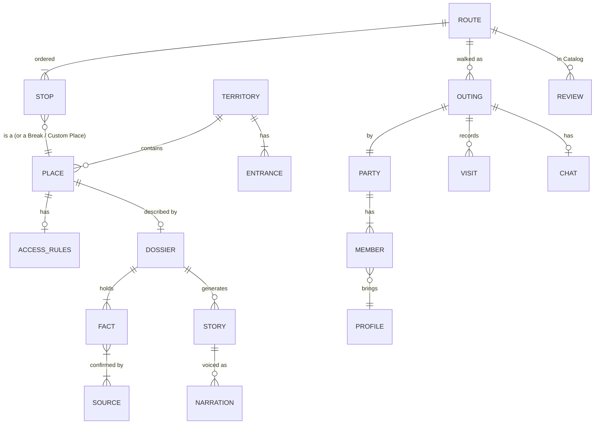
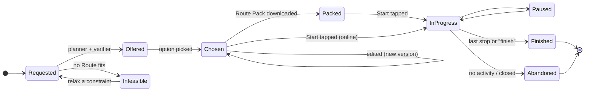
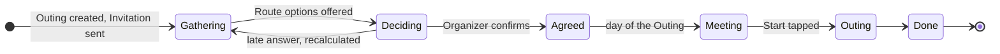

# Promenade — Product Specification

| | |
|---|---|
| **Status** | Draft v1, agreed with the product owner in a requirements interview (15–22 November 2026), including the rules listed in section 12. Not yet reviewed by a second person. |
| **Supersedes** | [`CONCEPT.md`](../CONCEPT.md) — kept as an archive; where the two disagree, this document wins. |
| **Language** | Terms are defined in [`GLOSSARY.md`](../GLOSSARY.md). Capitalised words (Place, Route, Outing, Party, Dossier, Story…) are glossary terms and are used in exactly that sense. |
| **Next step** | Architecture Decision Records. Section 10 lists the constraints and decision forks the ADR session must resolve. |

## 0. How to read this document

- **Requirement IDs** are stable and have the form `AREA-n` (for example `RTE-4`). ADRs, tasks and tests should refer to them.
- **Stage** says when a requirement is built (section 7): `S1` solo Outing on foot in Minsk, `S2` Party, `S3` Catalog, `S4` bicycle and car, `S5` other cities. `Later` means agreed as a future direction, not designed here. Stages S1–S3 are the current focus; S4–S5 follow, but their foundations are laid from S1 (section 7.3).
- **Must / should.** Requirements are mandatory for their stage unless marked *(should)*.
- **Research references** look like `[R4 §10]` and point to the reports in [`docs/research/`](research/) (written in Russian). Numbers taken from those reports are quoted as the reports give them; except where stated, they were **not independently re-verified** and must be re-checked before they drive a decision. Section 10.4 lists what is known to be unverified.
- **Rules added while writing.** A few rules were not discussed in the interview and were filled in by the author to make the specification complete. The owner confirmed all of them on 22 November 2026; they are listed in section 12 so that their origin stays visible.

---

## 1. Product vision

### 1.1 One sentence

> **Say who is going, when, and how much time you have — get an outing that fits everyone, and a guide that walks it with you.**

Promenade plans an Outing around a city for a Party of one or more people. It picks the Places, puts them in an order that is guaranteed to fit the time and the opening hours, respects everybody's Dealbreakers, and then accompanies the Party along the Route: navigation, Stories that start by themselves when you arrive, and everything working without a network.

### 1.2 The problem

1. **Deciding where to go is work.** A visitor spends hours stitching a route together from blogs, maps and reviews without knowing whether it fits the time they have. A group of friends cannot decide at all; the whole burden lands on whoever organises `[R5 §5]`.
2. **Generated plans cannot be trusted.** General-purpose assistants produce itineraries that send people to closed places and ignore opening hours and realistic timing `[R1 §10, R4 §4]`.
3. **On the spot, people do not know what they are looking at**, and reading an article on a phone in the street is not an experience anyone wants.
4. **Tourism alone is an occasional need.** A product used once or twice a year has no retention; "where shall we go this Saturday" is a weekly question `[R2 §4]`.

### 1.3 Positioning

The original idea — a personal route for your time and interests, narrated on the spot — is no longer unique: several AI guide apps and both Google and Yandex ship some version of it `[R1 §4–6]`. Promenade therefore competes on four things together:

| Differentiator | What it means | Where it comes from |
|---|---|---|
| **A Route you can trust** | Every Route passes an independent check of all hard constraints before it is shown. No closed doors, no impossible timing. | `RTE-3…6`, `NFR-1` |
| **A Route for the whole Party** | The plan reconciles the interests and Dealbreakers of several people and says, in one line, why it suits them. | `PTY-*` |
| **Facts with sources** | Every factual statement in a Story traces back to a fact in the Dossier with a source one tap away. Where there is no source, the guide stays silent. | `KNW-4…9, 16` |
| **Works in your pocket, without a network** | The Outing runs with the screen off and in airplane mode. | `OUT-14…16`, `NFR-8` |

Coverage of cities and languages that the big platforms skipped (Belarus) is the entry wedge, not the long-term moat.

### 1.4 What changed since `CONCEPT.md`

| Then | Now |
|---|---|
| A diploma project with a research goal and "levels" for a defence | A real product that also serves as a portfolio piece; the research goal is dropped |
| A tourist audio guide for one person | An outing planner for a **Party** of one or more — locals and visitors; the guide is one of two modes |
| "Nobody does this" | The idea is commodity; the bet is trust, group fit, sources and offline (1.3) |
| City prepared as a whole by an operator | Knowledge prepared **per Place**, shared and reused; draft → verified (`KNW-*`) |
| Flat list of places | **Territories** that contain Places, with Entrances and inherited Access Rules |
| On foot only; car and bicycle "some day" | Three **Travel Modes**; foot first, bicycle and car in S4 |
| Operator | **Curator**, **Moderator**, **Administrator** |
| "≥ 95 % of statements have a source" | Two measures: source present (automatic) and source actually supports the statement (sampled by hand) |
| Leaderboards, awards, seasons | Removed |
| Subscription "without real payments" as an afterthought | A monetisation concept plus entitlement and billing foundations; no real money yet |

### 1.5 Project frame

These are the owner's decisions and bound every later choice.

- **Not in production yet.** The goal now is a working product with a modern, scalable architecture that runs locally and on a free cloud tier. No revenue is expected at this stage.
- **Portfolio value.** The architecture and stack should follow current best practice and demonstrate breadth. To keep that honest, every technology in an ADR must be justified by a requirement in this document.
- **Minimal spend** until there are customers: free tiers of cloud providers, and a local environment built on service emulators that matches the cloud deployment as closely as possible.
- **Market:** Belarus only — the owner's decision of 24 November 2026; until then it read "Belarus first, then the CIS". Adding a region or a city must not require changing the system.
- **Languages:** Russian and English from the start.
- **Reference City:** Minsk — the showcase for investors.
- **No calendar constraints.** Scope is ordered by dependency (section 7), not by dates.
- **Law and compliance are deferred** until a production launch is planned (section 9.3). Three things usually filed under "legal" are kept as engineering requirements because retrofitting them is expensive: the location track never leaves the device, every fact is stored with its source and licence, and automatically generated Stories are labelled as such.

### 1.6 Non-goals

Promenade is not a general leisure planner (no cinema sessions, table bookings, tickets or scheduled events), not a messenger or social network, not a dating or stranger-matching service, not a museum hall guide, and does not build its own cartography. Section 9 gives the full lists.

---

## 2. People and scenarios

### 2.1 System roles

| Role | Who | Can do |
|---|---|---|
| **Guest** | A person without an account | Request, edit and save Routes on the device; go on an Outing; answer an Invitation and take part in a Party from the browser |
| **User** | A person with an account | Everything a Guest can, plus: data on all their devices, publishing Routes (becoming their **Author**), Reviews, Corrections with a visible outcome, organising a Party |
| **Curator** | Internal | Verifies Dossiers and Stories, maintains Reference Cities, starts Preparation, selects Venues, assembles Catalog Routes, handles Corrections |
| **Moderator** | Internal | Handles Complaints about published Routes, Reviews, Chat messages and people |
| **Administrator** | Internal | Roles, limits, Plans, settings, audit log |

One person may hold several internal roles; at the start the owner holds all three. They are separate because they carry different trust and their actions are audited separately.

A Guest can *join* a Party; *organising* one requires an account: the Organizer must be reachable and accountable for the Invitation link and the Chat.

### 2.2 Party roles

Within one Outing a member of the Party is either the **Organizer** (created the Outing, edits the Route, decides) or a **Participant** (answers the Invitation, votes). A Party of one has only an Organizer and none of the group mechanics are shown.

### 2.3 Primary scenarios

These narratives are the reference for what "working" means. Each stage in section 7 names the scenarios it must make pass.

**SC-1 · Three hours before the train (solo, on foot, Guided Mode).**
Anna arrives in Minsk and has three hours before her train. She opens Promenade without registering, taps a few themes, says she starts and finishes at the railway station and has three hours, and adds: "early 20th-century architecture, no museums". Promenade shows how it understood her and offers three Routes. She picks one, removes a stop, downloads the Route Pack over the station Wi-Fi and puts the phone in her pocket. At each Place a Story of about a minute and a half starts by itself; between Places the guide bridges to the next. Forty minutes before the end she is tired and asks to shorten; the Route is recalculated on the phone. She is back at the station on time.

**SC-2 · Saturday with friends (Party of five, on foot, Quiet Mode).**
Dima wants to see his friends on Saturday at 14:00 for about three hours. He creates an Outing and drops the Invitation link into their messenger group. Each friend opens it in the browser and, within a minute, enters a name, picks what they like, marks Dealbreakers and pace. Olya's Dealbreaker is "no bars". Promenade offers three Routes with a line each — "architecture for Anya, the park for Olya, coffee for Dima" — and nobody's Dealbreaker is violated. The friends vote in the Chat; Dima confirms. On Saturday everyone sees the Meeting Point; those who opted in appear on the map until the group has gathered. During the Outing, visited Places tick off on everyone's phone.

**SC-3 · Two languages, one Outing.**
Pavel and his colleague Emma go on the same Outing in Guided Mode. Pavel hears the Stories in Russian on his phone, Emma in English on hers. Progress is shared.

**SC-4 · No network.**
Halfway through an Outing the network disappears. Navigation, Stories, skipping a Place and recalculating the rest keep working. Chat, live positions and "ask the guide" are shown as unavailable. When the network returns, Visits and ratings are synchronised once — nothing lost, nothing duplicated.

**SC-5 · The Curator prepares Minsk.**
The Curator starts Preparation for central Minsk. Dossiers arrive in a queue ordered by expected popularity and sensitivity. For each, the Curator sees facts with their sources, fixes a wrong stress in a street name, removes a doubtful fact, listens to the Narration and marks the Dossier verified. A Place about a wartime event is flagged sensitive and stays without a Story until verified.

**SC-6 · A Correction.**
A listener hears a wrong date, taps the sentence and sends a Correction. The Curator sees the statement, its source and the claim, fixes the fact; the Story and Narration are regenerated; the listener is told the outcome.

**SC-7 · Publishing a Route.**
Olya liked the Route from SC-2, gives it a title and a description and publishes it. Other people find it in the Catalog, take it or start an Outing on it, rate it and — once they have completed it — write Reviews. Someone files a Complaint about a Review; the Moderator hides it.

**SC-8 · A day out by car (S4).**
A family plans a day from Minsk to Mir and Nesvizh by car. The Route drives them between the two castles; inside each Territory they walk and the Stories of the nested Places start as on foot. While the car is moving the app only speaks: "in one kilometre, on the right…".

**SC-9 · A city nobody prepared (S5).**
Someone asks for a Route in Grodno, where few Dossiers exist. A Route is built at once from light data; Stories are prepared in the background and the person sees "6 of 9 Stories ready". A second person asking about Grodno a minute later triggers no new Preparation for the same Places.

---

## 3. Domain model

### 3.1 Concepts and relationships

A Territory *is* a Place (it can be a stop and has its own Dossier); the diagram separates them only to show containment.

### 3.2 Places

- A **Place** has: names per language, a location (a point; a boundary if it is a Territory), a kind, themes, how it is experienced (**outside** or **inside**), a typical visit duration, Access Rules, a status (open, temporarily closed, permanently closed, unknown), a parent Territory if any, provenance and the date it was last checked.
- A **Territory** additionally has a boundary, one or more **Entrances**, and nested Places. Nesting forms a tree of any depth: a Place has at most one parent, the smallest Territory containing it.
- **Access Rules** — opening hours, price, ticket required — may exist at any level. A nested Place is reachable only while every Territory above it is open, and the costs add up. *Example: the Botanical Garden (paid entry, 10:00–20:00) contains a greenhouse with its own ticket, closed on Mondays. On a Monday the greenhouse cannot be a stop; on other days a stop there costs both tickets and must fall inside both sets of hours.*
- Opening hours carry a **confidence**: *known* hours are a hard constraint; *unknown* hours produce a warning, not an exclusion.
- Nested Places must be **outdoors** — reachable by satellite positioning. Halls and exhibits inside buildings are not modelled.
- **Kinds** include sights (buildings, monuments, memorials), nature (parks, embankments, viewpoints), Venues, markets, lodging and places of entertainment. *Memorial plaques* are a kind of their own and are excluded from Routes by default — they make up a large share of "historic" objects in open data for Minsk `[R3 §2]`.
- **Lodging** — hotels, hostels, guest houses — and **places of entertainment** are kinds of their own, not Venues. Lodging is shown on the map and can be the start or the finish of a Route; it is never a stop. A place of entertainment that is visited without a session — a zoo, an amusement park, a water park, a planetarium — is a stop like any Place visited inside. One that runs by sessions or at night — a cinema, a theatre, a club — is shown near a Route and is not a stop (see 9.1).
- A **Venue** enters a Route as a Place only when a Curator has selected it. Where no Venues are selected, the Route contains a **Break** instead: reserved time plus a list of nearby options, with no endorsement.
- A **Custom Place** belongs to one Route and is not part of the shared base.

### 3.3 Knowledge

- A **Dossier** is the single source of truth about a Place: a set of **atomic facts**, each with one or more sources (with revision or retrieval date and licence), theme tags and a sensitivity flag. Nothing unconfirmed gets into a Dossier.
- A Dossier is **draft** when compiled automatically and **verified** once a Curator has checked it. A verified Dossier changes only through a Curator.
- **Stories** are generated *from the Dossier and only from it*. There are five forms:

  | Form | When it plays | Length (target) |
  |---|---|---|
  | Route introduction | At the start of the Outing | 30–60 s |
  | Place Story | On arrival at a Place | about 90 s |
  | "More" block | On request, or automatically when its theme is liked in the Profile | 30–90 s each |
  | Bridge | On the way between two Places | 10–30 s |
  | Route finale | At the last stop | 20–40 s |

- Personalisation is done by **one base Story per Place plus thematic "More" blocks**, not by several parallel versions of the whole Story. A Curator therefore verifies each Place once.
- A **Narration** exists per Story and language. Stories are generated per language from the facts; audio is not machine-translated.
- A Venue has a short practical Dossier (what it is, price level if known, hours) and a one-line "why here"; it has no historical Story.

### 3.4 Route and Outing lifecycle

- A **Route** is versioned: every edit produces a new version. An Outing is bound to one version; replanning during an Outing produces a new version bound to that Outing.
- A Route keeps its **request parameters**, so it can always be explained and rebuilt.
- An **Outing** belongs to one Party, has one Travel Mode and one mode of accompaniment (Guided or Quiet, switchable at any time), and owns its Visits, ratings and Chat.

### 3.5 Party lifecycle

A Party exists only together with its Outing. There are no friend lists; "invite the same people" copies the list of a past Party into a new Outing.

### 3.6 Invariants

These hold at all times and are worth testing directly.

1. A Route offered by the planner violates no hard constraint (`NFR-1`).
2. The composition and order of a Route are decided by the deterministic planner and by explicit human edits — never by a language model (`RTE-3`).
3. A Story contains no factual statement that is absent from its Dossier (`KNW-8`).
4. A Place flagged sensitive has no published Story until its Dossier is verified (`KNW-14`).
5. A verified Dossier, Story or Narration never changes without a Curator action (`KNW-21`).
6. A Dossier is prepared at most once at a time, whatever the number of concurrent requests (`KNW-2`).
7. A member's Dealbreaker is never violated by a Route offered to their Party (`PTY-7`).
8. Exact location coordinates of a person never reach the server. Two things do: positions a person explicitly shares before the Party gathers — and those are never stored — and the start or finish of a Route request taken from the person's position, which the device coarsens to a cell of 100–150 m before sending (`NFR-14`, `PTY-15`, `RTE-1`).
9. Visits, ratings and Chat messages are delivered to the server exactly once (`NFR-9`).

---

## 4. Functional requirements

Each area gives its purpose, the requirements with their stage, the rules that are easy to get wrong, edge cases, and acceptance criteria. The last column of the mapping in section 11 shows where every requirement of `CONCEPT.md` went.

### 4.1 Accounts and identity — `ACC`

**Purpose.** Let people use the product at once, keep their data when they register, and keep internal powers separate and audited.

| ID | Requirement | Stage |
|---|---|---|
| ACC-1 | A person can use the product as a Guest, without an account. | S1 |
| ACC-2 | A Guest's Profile, saved Routes and Outing history are kept on the device. | S1 |
| ACC-3 | A person can register and sign in with an e-mail one-time code, Google, or Apple. | S1 |
| ACC-4 | On registration the Guest's Profile, Routes and history move into the account without loss or duplicates. | S1 |
| ACC-5 | A User's data is the same on all their devices and on the web. | S1 |
| ACC-6 | A User can delete their account and all personal data from inside the app and the web. | S1 |
| ACC-7 | Internal roles (Curator, Moderator, Administrator) are granted per person; one person may hold several. | S1 (Moderator from S2) |
| ACC-8 | Every action taken with an internal role is written to an audit log: who, what, when, on what. | S1 |
| ACC-9 | The internal console is unreachable for Guests and ordinary Users. | S1 |
| ACC-10 | A person has a list of their past Outings, and a personal map of what they visited: cities, Places, Outings. | list S1, map S3 |

**Rules.**
- Deleting an account removes the Profile, private Routes, Outing history and Corrections; unpublishes and deletes the User's published Routes and Reviews; and replaces the name on their Chat messages in other people's Outings with "deleted user". The history of changes to Places keeps no text and no author of a Correction.
- A Guest who signs in to an *existing* account on a new device is asked whether to merge the device data into the account; merging never overwrites newer data silently.

**Edge cases.** Registration started offline (completes when the network returns); the same person as Guest on two devices (two separate Guest identities until they register); a Guest Participant who later registers (their past Party answers are not migrated — they were deleted with the Outing).

**Acceptance.**
- A full solo Outing (SC-1) can be completed without ever creating an account.
- After registering, every Route and the Profile created as a Guest are present on a second device.
- Account deletion leaves no personal record retrievable by any API; a test proves it.
- A request to any console endpoint without an internal role is refused and logged.

Later: sign-in through Telegram.

### 4.2 Profile — `PRF`

**Purpose.** Know enough about a person to choose Places for them, in under a minute, and never guess silently.

| ID | Requirement | Stage |
|---|---|---|
| PRF-1 | First launch offers a set-up of at most one minute: Interests, Dealbreakers, pace. It can be skipped. | S1 |
| PRF-2 | **Interests** are a fixed list of 10–12 themes; each is marked *like*, *neutral* or *dislike*. | S1 |
| PRF-3 | **Dealbreakers** are chosen from a closed list, so that the planner can enforce each of them. | S1 |
| PRF-4 | **Pace** is one of relaxed, normal, brisk and changes travel times and visit durations. | S1 |
| PRF-5 | The Profile can be edited at any time. | S1 |
| PRF-6 | A **Wish** — free text — can be attached to a single Route request. It is not stored in the Profile. | S1 |
| PRF-7 | The person chooses the language of the interface and of the Stories (Russian or English). | S1 |
| PRF-8 | The system may *suggest* Profile changes from ratings and behaviour ("you seem to enjoy architecture — add it?"). Nothing changes without confirmation, and the Profile can be reset. *(should)* | S3 |

**Rules.**
- A skipped set-up yields a neutral Profile: all themes neutral, no Dealbreakers, normal pace.
- *Dislike* is soft (the planner avoids it); a *Dealbreaker* is hard (the planner may not violate it). The interface must make the difference obvious.
- Draft theme list, to be fixed in S1: history · architecture · art and street art · nature and parks · food and coffee · bars and nightlife · legends and curiosities · views and photo spots · Soviet heritage · religion and sacred places · science and technology · markets and shopping.
- Draft Dealbreaker list, to be fixed in S1: no alcohol venues · no going inside (museums, interiors) · no stairs or steep climbs · no paid entry · no religious sites · no cemeteries and memorial sites.

**Acceptance.** Set-up is completed in a usability run within 60 seconds; a Profile with a Dealbreaker never yields a Route violating it (property test over generated requests); switching the Story language changes the next Story played.

### 4.3 Places — `PLC`

**Purpose.** A base of Places rich enough to plan with and honest about what it does not know.

| ID | Requirement | Stage |
|---|---|---|
| PLC-1 | A Place carries the attributes listed in 3.2, each with provenance and a last-checked date. | S1 |
| PLC-2 | A Territory has a boundary, Entrances and nested Places; nesting is a tree of any depth. | S1 |
| PLC-3 | Access Rules are inherited down the tree (3.2). | S1 |
| PLC-4 | Opening hours carry a confidence: known or unknown. | S1 |
| PLC-5 | Each Place has a kind; memorial plaques are excluded from Routes unless a person asks for them. | S1 |
| PLC-6 | Venues become Places only by a Curator's selection. | S1 |
| PLC-7 | Status and hours of Places are re-checked on a schedule: hours often, history rarely. | S1 |
| PLC-8 | A city, a region and their Places are data. Adding a city requires no change to the system. | S1 |
| PLC-9 | Each Place can hold a parking point for cars and one for bicycles, when known. | field S1, used S4 |
| PLC-10 | Each city shows its **Coverage** to people requesting Routes there. | Curator view S1, public S5 |
| PLC-11 | Duplicate Places from different sources are merged; a Curator can merge and split by hand. | S1 |
| PLC-12 | Every change to the data of a Place is kept with its origin, its evidence and its date. The history of a Place can be read, and a recent change can be undone. | S1 |
| PLC-13 | A change is first a **Proposed Change**. A Curator accepts, rejects or edits it; some changes are applied without a person, by stated rules, and are marked as not reviewed. | S1 |
| PLC-14 | How recently the Places of an area were confirmed is shown by area and by kind. | S1 |

**Rules.**
- The base is built from open data; data from commercial map services may be used only for checking freshness and is not stored against their terms `[R3 §2]`.
- A Place that is permanently closed is never offered; a temporarily closed one is offered only with a warning and never as an "inside" stop.
- A Place whose location is inside a building or otherwise unreliable for positioning is marked **manual**: its Story is offered by a prompt, not started automatically (`OUT-3`).

**Edge cases.** A Place inside two overlapping Territories (parent is the smaller one); a Territory with no known Entrance (treated as open on all sides, flagged for the Curator); a Territory open around the clock with a nested Place that closes; a Place that moved (old one closed, new one created, Dossier re-linked by a Curator).

**Acceptance.** For the Botanical Garden example in 3.2 the planner refuses a Monday stop at the greenhouse and accepts a Tuesday one inside both sets of hours; a new city can be added and planned in by loading data only; every attribute shown to a person can be traced to its source in the console.

### 4.4 Knowledge: Preparation, Dossier, Story, Narration — `KNW`

**Purpose.** Produce Stories that are true, traceable and pleasant to listen to, once per Place, at a known cost.

| ID | Requirement | Stage |
|---|---|---|
| KNW-1 | The unit of Preparation is a Place. Its result is shared by everyone and is not produced again unless stale or corrected. | S1 |
| KNW-2 | Concurrent requests for the same Place result in one Preparation; the others wait for it. | S1 |
| KNW-3 | Preparation runs in the background, shows progress, can be resumed, and a failure on one Place neither stops the others nor damages existing data. | S1 |
| KNW-4 | A Dossier consists of atomic facts, each with its sources (revision or retrieval date, licence), theme tags and a sensitivity flag. | S1 |
| KNW-5 | A fact without a confirming source is not admitted to a Dossier. | S1 |
| KNW-6 | A Place with no confirmed facts may be in a Route, but gets no Story. The system never generates a Story from nothing. | S1 |
| KNW-7 | Stories exist in the five forms of 3.3. Introductions, bridges and finales are generated for a Route and are part of its Route Pack. | S1 |
| KNW-8 | Every *factual* statement of a Story maps to facts of the Dossier. Connective phrases, addresses to the listener and orientation cues ("look to your left") are classed as non-factual and need no source. | S1 |
| KNW-9 | Before a Story is available, each factual statement is checked automatically against the Dossier. A statement that fails is removed; if too little remains, the Story is withheld. | S1 |
| KNW-10 | "More" blocks whose theme the listener likes are added to the Place Story automatically; all others are available on request. | S1 |
| KNW-11 | Every Story has a Narration in Russian and in English, and its text is always available alongside the audio. | S1 |
| KNW-12 | A pronunciation dictionary holds the stress and reading of names per entity. A Curator can correct an entry; affected Narrations are regenerated. | S1 |
| KNW-13 | Each Narration is transcribed back and compared with its text; mismatches are flagged for the Curator. | S1 |
| KNW-14 | Facts and Places can be flagged **sensitive** (war, repression, contested twentieth-century history, religion, living persons). A Story for a sensitive Place is available only after a Curator verified the Dossier; until then the Place has no Story. | S1 |
| KNW-15 | Each Story shows that it was generated automatically and whether it is "verified by a Curator" or "not verified". | S1 |
| KNW-16 | The sources of a Story are one tap away, per statement. | S1 |
| KNW-17 | A Place can have photos, each with author and licence shown. | S1 |
| KNW-18 | A Venue has a short practical Dossier and a one-line "why here", and no historical Story. | S1 |
| KNW-19 | The cost of preparing a Place is measured per component: language model, search, speech, human review. | S1 |
| KNW-20 | Source facts may come from Belarusian, Russian or English sources; Stories are generated per output language from the facts. | S1 |
| KNW-21 | A *draft* Story may be regenerated automatically after poor ratings or Corrections. A *verified* one goes to the Curator's queue and does not change silently. | S3 |
| KNW-22 | **Ask the guide:** by a button, a person asks a question in text or by voice; the answer uses only the Dossiers of the current and nearby Places and says so when it does not know. Without a network, pre-generated answers to frequent questions are available per Place. | S3 |
| KNW-23 | A User can trigger Preparation for Places that have no Dossier, within a quota (see `RTE-17`). | S5 |
| KNW-24 | Story text in Belarusian, without Narration. *(should)* | S3 |

**Rules.**
- A Place Story targets about 90 seconds (roughly 250–300 words), one or two ideas, a hook first `[R3 §4]`. Length is a requirement on the generator, checked automatically.
- A Story that changed after a Curator verified the Dossier is itself "not verified" until looked at, except for changes caused by the Curator's own edit.
- Freshness: historical facts are re-collected rarely; a Dossier is marked **stale** when its sources changed materially or a Correction was accepted, and is then re-prepared.
- No generated "historical" images, no cloned voices of real people `[R3 §11]`.

**Edge cases.** Two sources contradict each other (the fact is admitted only with the contradiction noted, or dropped; a Curator decides for verified Dossiers); the only source is in Belarusian (facts extracted, Stories generated in Russian and English from the facts); a name with an unknown stress (flagged; Narration uses the best guess and the Story is marked for listening); Preparation interrupted halfway (resumes from the last completed step); a Correction arrives while the Dossier is being re-prepared (queued against the new version).

**Acceptance.**
- For a sample of Stories, an automatic check finds a Dossier fact for at least 98 % of factual statements, and a human reviewer confirms for at least 95 % of a random sample that the cited source supports the statement (`NFR-18`).
- Starting the same Preparation ten times concurrently produces exactly one Dossier and one set of Stories.
- Killing the Preparation process at any step and restarting it finishes the work without duplicating or corrupting data.
- A sensitive, unverified Place appears in a Route with no Story in both languages.
- A Curator's stress correction is audible in the regenerated Narration.
- The console shows the cost of the last Preparation per Place and per component.

### 4.5 Route request and planning — `RTE`

**Purpose.** Turn a request into a small number of Routes that are provably feasible and visibly personal.

| ID | Requirement | Stage |
|---|---|---|
| RTE-1 | A request states: who is going (the Party's Profiles), where (a city, a district, or "near me"), when (now or a date and time), how long, start and finish points, whether to go inside, a "familiar ↔ unusual" setting, the Travel Mode, and optionally a Wish. | S1 (foot only until S4) |
| RTE-2 | A Wish is translated into a closed set of constraints and weights. The interpretation — "how I understood your request" — is shown and can be corrected before the Route is calculated. | S1 |
| RTE-3 | Which Places are in a Route and in what order is decided by a deterministic planner. Language models propose candidates and score how well a Place fits an interest; they never decide composition or order. | S1 |
| RTE-4 | Hard constraints: the time budget; start and finish; known opening hours, including those inherited from Territories; visit durations; Dealbreakers; pinned Places; pace. | S1 |
| RTE-5 | The plan includes a buffer for uncertainty, and a Break when the Outing is long or a Break was asked for. | S1 |
| RTE-6 | An independent verifier checks every Route against all hard constraints before it is shown. A Route that fails is never shown. | S1 |
| RTE-7 | The person gets two or three Route options with a distinct character each (for example classic, unusual, relaxed), and can ask for "another option". | S1 |
| RTE-8 | The same request on the same data yields the same Routes. "Another option" is selected by a number that is part of the request. | S1 |
| RTE-9 | Every Place in a Route has a one-line "why it is here", derived from the features the planner used. | S1 |
| RTE-10 | When nothing fits, the system says which constraint to relax and by how much ("add 20 minutes", "allow going inside"). | S1 |
| RTE-11 | A Route may consist of a single Place. | S1 |
| RTE-12 | Status and hours of the chosen Places are re-checked when the Route is built and when its Route Pack is downloaded; the check date is stored. | S1 |
| RTE-13 | A Place with unknown hours is allowed with a warning; the person can exclude such Places. | S1 |
| RTE-14 | The "familiar ↔ unusual" setting counteracts the pull towards the most popular Places. | S1 |
| RTE-15 | A Route avoids monotony: no long run of the same kind of Place unless the request asks for it. | S1 |
| RTE-16 | For a Party of several people the planner optimises for the whole Party (`PTY-7`). | S2 |
| RTE-17 | In an area with few Dossiers a Route is built at once from light data (location, kind, hours); Stories are prepared in the background with visible progress, and the Outing can start without waiting — Places not ready go without a Story. | S5 |
| RTE-18 | Bicycle and car: travel times for the mode; between Territories and stand-alone Places the Party rides or drives, inside a Territory it walks; a time allowance for parking; for cars the area may be "the city and its surroundings" within one day. | S4 |

**Rules.**
- The guarantee of `RTE-6` covers Routes the planner produced. A Route edited by hand may violate constraints; it is then clearly marked and the violations are listed (`EDT-1`).
- The verifier is a separate implementation from the planner: it shares no optimisation code with it, only the definition of the constraints.
- Reproducibility is defined over: the request, the version of the data, the versions of the models that scored Places, and the option number.
- A request for "now" uses the current time for opening hours; a scheduled request uses the scheduled time and is re-checked on the day (`RTE-12`).
- Start and finish default to the person's current position; the finish may equal the start. A point taken from the person's position is coarsened on the device to a cell of 100–150 m before it is sent; a point the person picks on the map is Route data and is sent as picked.
- When the Wish contradicts the Profile, the Wish wins for that request — except Dealbreakers, which only their owner can lift.

**Edge cases.** The time budget is shorter than the travel from start to finish (infeasible, with the minimal budget stated); every candidate is closed at the requested time; the person is outside any city with data; the Wish is not understood (the interpretation says so and the Route is built from the Profile alone); "near me" without location permission (the person is asked to pick a point).

**Acceptance.**
- Over at least 1 000 generated requests the verifier accepts 100 % of Routes shown, and a deliberately broken planner is caught by the verifier.
- Ten repetitions of the same request return identical Routes.
- The interpretation of a Wish matches a hand-labelled test set field by field in at least 90 % of cases.
- Each of the edge cases above produces a specific, actionable message.
- In a prepared city the Routes are returned within the time of `NFR-4`.

### 4.6 Editing and keeping Routes — `EDT`

**Purpose.** The proposal is a starting point; the person stays in control, and is told when their change breaks something.

| ID | Requirement | Stage |
|---|---|---|
| EDT-1 | A person can remove a Place, add one, and change the order. The system recalculates times, re-checks every constraint and lists any violation. | S1 |
| EDT-2 | A Place can be added by choosing it on the map. | S1 |
| EDT-3 | A Place can be **pinned** ("I definitely want this one"); the Route is rebuilt around pinned Places. | S1 |
| EDT-4 | A Place can be replaced by a similar one in one tap; suggestions keep the Route feasible. | S1 |
| EDT-5 | A person can add a **Custom Place**: a point with a name. | S1 |
| EDT-6 | Routes are saved to a personal collection and can be renamed and deleted. | S1 |
| EDT-7 | Every Route has a **Route Page**: map, Places, photos, timing, Travel Mode. It opens by a link in a browser without installing anything. | S1 |
| EDT-8 | Every edit creates a new version of the Route; earlier versions are kept. | S1 |

**Rules.** A Custom Place has a default visit duration the person can change, no Access Rules and no Story; it takes part in timing like any stop. Deleting a Route does not delete past Outings that used it.

**Acceptance.** Removing a Place shortens the Route and re-validates it; adding a Place that breaks the time budget shows exactly that violation; "replace with similar" never offers a closed Place; the Route Page renders on a phone browser without an account.

### 4.7 The Outing — `OUT`

**Purpose.** Accompany the Party with the phone in a pocket: reliable arrival detection, audio first, everything working without a network.

| ID | Requirement | Stage |
|---|---|---|
| OUT-1 | An Outing starts only by an explicit tap. Location is used only while an Outing is in progress. | S1 |
| OUT-2 | The person sees their position, the next Place, the remaining distance and time, and whether they will reach the next Place before it closes. | S1 |
| OUT-3 | Arrival at a Place is detected **on the device** from the continuous stream of positions, by the trigger rules below. | S1 |
| OUT-4 | When the position is uncertain, the app asks "Are you at …?" instead of starting the Story. | S1 |
| OUT-5 | Playback can be controlled by hand — play, pause, replay, next — from the lock screen and from a headset. Automatic start can be switched off. | S1 |
| OUT-6 | The Outing runs in **Guided Mode** or **Quiet Mode**; the mode can be switched at any moment. | S1 |
| OUT-7 | A Story can be sped up, slowed down and rewound; its text follows the audio. | S1 |
| OUT-8 | A **Visit** is recorded by the rule below. The server receives the fact of the Visit, never coordinates. | S1 |
| OUT-9 | A Place can be skipped; the rest of the Route is recalculated on the device. | S1 |
| OUT-10 | The Outing can be shortened ("40 minutes left") or extended ("one more hour"); the Route is recalculated on the device. | S1 |
| OUT-11 | A Break can be inserted on demand ("coffee now"); the rest of the Route shifts. | S1 |
| OUT-12 | When the person strays from the Route, the app shows how to get back. The Outing is never reset by straying. | S1 |
| OUT-13 | An Outing can be paused, resumed and finished early. After the app is restarted or killed, the Outing resumes where it was. | S1 |
| OUT-14 | A **Route Pack** contains the map of the area, Narrations, texts, sources, photos, a pool of spare Places, travel times between them and the local network of streets. Its size is shown before download; download can be limited to Wi-Fi and resumes after interruption; the Pack is usable only once complete and checked. | S1 |
| OUT-15 | With a Route Pack the whole Outing works in airplane mode. Functions that need a network (Chat, shared positions, ask the guide) are shown as unavailable, not hidden. | S1 |
| OUT-16 | Everything done without a network — Visits, ratings, Corrections, skips, edits — is kept in a journal on the device and delivered when the network returns, exactly once. | S1 |
| OUT-17 | The app shows the battery level, warns when the remaining charge will not last the Outing, and offers a saver mode. | S1 |
| OUT-18 | Progress along the Route is always visible. | S1 |
| OUT-19 | The detailed track of movement stays on the device, is deleted automatically after 30 days, and can be deleted by the person at any time. | S1 |
| OUT-20 | On the web a member of a Party sees the Route and the shared progress and can play Stories by hand; there is no automatic start and no offline work. | manual play S1, shared progress S2 |
| OUT-21 | At the end the person gets a **Recap**. | S3 |
| OUT-22 | While a bicycle or car is moving, the app only speaks: the screen shows the next Place and one large pause control; text, Chat, editing and "ask the guide" are available at a stop. A Story begins on the approach ("in one kilometre, on the right…"). | S4 |

**Trigger rules** (`OUT-3`), adapted from `[R4 §10]`; the numbers are starting values to be calibrated on real Outings in Minsk.

| # | Rule |
|---|---|
| T1 | Triggers are computed on the device during an active Outing. Operating-system geofences are at most a backup: they are limited to 20 per app on iOS and can lag by minutes on Android `[R4 §11]`. |
| T2 | The trigger radius adapts to the reported accuracy, from 25 m up to 60 m; a Curator can override it for a Place. |
| T3 | Arrival needs confirmation: two consecutive positions inside the radius or a few seconds of presence. With accuracy worse than 50 m the app asks instead of starting (`OUT-4`). |
| T4 | Leaving is registered only beyond 1.5 × the radius. A Story starts automatically at most once per Outing; after that only by hand. |
| T5 | A trigger can be placed *on the approach* along the Route, so the Story begins before the Place — for Places with poor reception and for moving vehicles. |
| T6 | If a Story is playing when the next trigger fires, the next Story is queued, never dropped. If the person has walked on, it is offered as "tell me on the way". |
| T7 | Places standing closer than two radii are grouped into a scene with one arrival and Stories played in sequence. |
| T8 | A Place that was passed is marked "skipped — listen anyway?" without interrupting what is playing. |
| T9 | Out-of-order arrival is allowed (the person took a shortcut). Replanning is offered, not imposed. |
| T10 | Places marked **manual** (indoors, poor reception) never start automatically; the app prompts. |

**Visit rule** (`OUT-8`), evaluated on the device: a trigger fired and the person stayed at least the smaller of 60 seconds and 30 % of the planned visit time; *or* at least half of the Story was heard within two radii; *or* the person marked the Place by hand. The server receives the Outing, the Place, the time rounded to five minutes, how the Visit was detected and the share of the Story heard.

**Rules.**
- Location permission is asked "while using the app"; the "always" permission is not needed and not requested `[R4 §11]`.
- Replanning on the device uses the same planner rules as the server and the spare Places in the Route Pack; the result is verified on the device before it is shown.
- Guided Mode never talks over a phone call; it pauses and resumes. Other audio (music) is lowered while a Story plays.
- Before the Outing starts the app checks the Route Pack, the audio output and the location permission, and says in plain words what is missing.

**Edge cases.** The person starts far from the planned start (offer to replan from here); a Place closes earlier than planned today (warn, offer replacement); two members of a Party arrive at different Places (each device records its own Visits; shared progress shows both); the phone dies and the Outing is resumed on another device of the same User (state restored from the last synchronisation); headphones disconnect (pause, do not switch to the loudspeaker).

**Acceptance.**
- The reference Outing in Minsk is completed twice in the field with the screen locked the whole time after "Start": Stories start automatically at 95 % of Places or more, with at most one false start per Outing (`NFR-5`).
- The same Outing is completed in airplane mode.
- Killing the app in the middle of a Story and reopening it resumes the Outing and the Story.
- Tests that cut the network, resend and kill the process show no lost and no duplicated Visit, rating or Correction.
- Skip, shorten, extend and "coffee now" return a verified Route on a mid-range phone within the time of `NFR-4`.

Later: replanning for weather; watches and smart glasses; simultaneous playback for the whole Party.

### 4.8 The Party — `PTY`

**Purpose.** Take the work off the organiser: collect what everyone wants in a minute each, propose Routes nobody objects to, and get the Party to the same place at the same time.

| ID | Requirement | Stage |
|---|---|---|
| PTY-1 | A person planning for themselves is a Party of one. No Invitation, voting or Chat is shown unless they invite someone. | S1 |
| PTY-2 | The Organizer creates an Outing with a date and time, a duration, an area and a start, the mode (Guided or Quiet) and the Travel Mode, and receives an **Invitation** link. | S2 |
| PTY-3 | The Invitation opens in a browser. Answering needs neither installation nor an account. | S2 |
| PTY-4 | A Participant answers at most five questions: a name; Dealbreakers; liked themes; pace; an optional Wish. A person with a Profile sees it pre-filled. | S2 |
| PTY-5 | A Guest's answers are stored with the Outing and deleted with it. | S2 |
| PTY-6 | A Party has at most 10 members. | S2 |
| PTY-7 | The planner combines the Party's preferences in three steps: (1) every member's Dealbreakers are hard constraints for all; (2) among feasible Routes it maximises the satisfaction of the *least* satisfied member; (3) ties are broken by total satisfaction. | S2 |
| PTY-8 | Each Route option carries one line saying what is in it for whom, and a tag per member showing what was taken into account. No charts or matrices. | S2 |
| PTY-9 | If the Dealbreakers leave no feasible Route, the system shows *which* Dealbreaker blocks — without naming whose — and the relaxations available. | S2 |
| PTY-10 | Participants mark each option "for" or "against". The Organizer makes the final choice. Members who have not answered count as neutral. | S2 |
| PTY-11 | When an answer arrives after options were offered, the Organizer is offered a recalculation. | S2 |
| PTY-12 | The Organizer can hand the role to another member, remove a member, and replace the Invitation link. | S2 |
| PTY-13 | The Party has a **Chat**: text messages, reactions, and system events ("Dima answered", "option 2 chosen"). No files, no voice messages. Guest Participants use it on the web. | S2 |
| PTY-14 | The Party sees the **Meeting Point** and each member's status: "on my way" or "here". | S2 |
| PTY-15 | **Position sharing before gathering:** a member may switch on sharing of their position with the Party. It is off by default, limited in time, can be stopped at any moment, ends by itself when the Outing starts, and positions are never stored. | S2 |
| PTY-16 | The Outing is shared: Visits are visible to all members; each member listens on their own device in their own language; a device without a network works on its own and catches up later. | S2 |
| PTY-17 | A past Party can be invited again in one step ("invite the same people"). | S2 |
| PTY-18 | Each member rates the Outing for themselves. | S2 |
| PTY-19 | A Party has one Travel Mode. The product does not allocate people to cars. | S4 |

**Rules.**
- The Organizer sets the date and time; the product does not poll for availability. Opening hours depend on the time, so it must be fixed before Routes are calculated.
- A Dealbreaker can be lifted only by the member who set it. The Organizer chooses among the other relaxations: more time, a wider area, fewer stops.
- A recalculation discards the votes on the previous options.
- The line of `PTY-8` never promises "suits everyone"; it states that no Dealbreaker is violated and what each member gets `[R5 §8]`.
- Across the two or three options, each member should find at least one option that leans their way.
- Position sharing lasts at most until the planned start plus a grace period (default 30 minutes, at most 8 hours in total). The range of 15 minutes to 8 hours is the convention of WhatsApp and Glympse `[R5 §6]`.
- The Chat exists for the lifetime of the Outing and is removed with it. Any message can be the subject of a Complaint (`FBK-4`).
- Participants are never asked to pay (`ENT-5`).

**Edge cases.** Nobody answers (the Organizer can plan with their own Profile alone); one member's preferences contradict everyone else's (they are the "least satisfied" and the plan leans towards them; the line says so honestly); a member joins on the day (added as neutral unless they answer); the Organizer disappears (the role passes to the longest-standing member after the planned start); the Invitation link leaks (replace the link; removed members lose access); a Participant on the web during the Outing (`OUT-20`).

**Acceptance.**
- SC-2 passes end to end with four Participants answering in a browser without accounts.
- Over generated Parties, no offered Route violates any member's Dealbreaker.
- With one member whose only liked theme is excluded by another's Dealbreaker, the option line names that member as the one who gets least, and no option includes the excluded kind of Place.
- A position shared before the Outing is visible to the Party within the time of `NFR-13`, disappears when sharing is stopped, and no position can be found in any store afterwards.
- Chat messages sent from two devices arrive in the same order on all devices; a message sent offline is delivered once.

Later: a poll for "when suits everyone"; open Outings that strangers can join; simultaneous playback.

### 4.9 Sharing and the Catalog — `CAT`

**Purpose.** Let good Routes travel: to a friend by a link, to everyone through the Catalog — without turning the product into a place that needs constant policing.

| ID | Requirement | Stage |
|---|---|---|
| CAT-1 | A Route can be shared by a link to its Route Page (`EDT-7`). The recipient can "take a copy", which is independent of the original. | S1 |
| CAT-2 | The Catalog holds Routes published by Curators for the Reference City. | S3 |
| CAT-3 | The Catalog can be filtered by duration, themes, district and Travel Mode. | S3 |
| CAT-4 | A User can publish a Route: they choose and order the Places and give a title, a description and a cover. Stories remain the system's, from the Dossiers. | S3 |
| CAT-5 | Title, description and names of Custom Places are screened automatically before publication. | S3 |
| CAT-6 | A Catalog entry shows its rating, the number of Outings and its Reviews. | S3 |
| CAT-7 | A **Review** can be written only by a User who completed an Outing on that Route; one Review per User per Route; it can be edited and deleted by its author. | S3 |
| CAT-8 | An Author can unpublish their Route. Editing a published Route publishes a new version; rating and Reviews stay with the Route. | S3 |
| CAT-9 | A published Route or a Review is hidden automatically when several different people file Complaints about it, until a Moderator decides. | S3 |
| CAT-10 | Ratings influence the order of the Catalog. | S3 |

**Rules.**
- Sharing a Route (a plan to copy) and sending an Invitation (joining one Outing) are different actions with different links, and the interface must not confuse them.
- "The person curates, the system narrates": because Stories are never user-written, moderation covers only titles, descriptions, covers, Custom Place names, Reviews and Chat.
- In a published Route a Custom Place appears as a plain point with its name and no Story.
- One Complaint never hides anything by itself (it would be a tool for abuse); the threshold is configurable.

**Acceptance.** SC-7 passes; a User who has not completed the Route cannot submit a Review through any interface; a Route hidden by Complaints is invisible in the Catalog and to new visitors of its link, and visible to its Author with the reason.

Later: Authors' own texts and voice; payments to Authors; collections.

### 4.10 Feedback — `FBK`

| ID | Requirement | Stage |
|---|---|---|
| FBK-1 | At the end of an Outing each member can rate it. | S1 |
| FBK-2 | At the end of a Story the listener can mark "liked" or "did not like". It is optional and never blocks anything. | S1 |
| FBK-3 | A **Correction** is attached to a specific statement and its source, or to the data of a Place ("closed", "moved", "wrong hours", "missing from the base"). It goes to a Curator, has a status, and its author sees the outcome. | S1 |
| FBK-4 | A **Complaint** can be filed about a Chat message, a published Route, a Review or a Custom Place name. It goes to a Moderator, who can dismiss it, hide or remove the item, or restrict the person. | Chat S2, Catalog S3 |
| FBK-5 | Ratings are collected from the first day. Their influence on which Places are chosen for other people is switched on only when enough data exists. | collect S1, influence S3 |
| FBK-6 | Ratings, Corrections and events are available to Curators and Administrators in aggregate. | S1 |

**Rules.** A Correction and a Complaint are different things with different handlers (see the glossary); the interface offers the right one in the right place. A Correction from a Guest is accepted; the outcome is shown on that device.

**Acceptance.** SC-6 passes; a Correction sent offline arrives once; a restricted person cannot post in Chat or publish, and is told so.

### 4.11 Internal console — `CUR`

**Purpose.** One person must be able to bring a city to reference quality and keep it there.

| ID | Requirement | Stage |
|---|---|---|
| CUR-1 | A **verification queue** of Dossiers ordered by expected popularity, sensitivity and open Corrections. | S1 |
| CUR-2 | A **Dossier editor**: facts with their sources, themes and sensitivity; add, edit and remove facts; preview the Stories; regenerate Stories and Narration; mark verified. | S1 |
| CUR-3 | A **pronunciation editor** with playback. | S1 |
| CUR-4 | Start **Preparation** for a city, an area or a list of Places; see progress, failures and cost; resume. | S1 |
| CUR-5 | A **Place editor**: Territory boundaries, Entrances, Access Rules, kind, manual flag, trigger radius; merge and split duplicates; hide a Place. | S1 |
| CUR-6 | **Venue selection**. | S1 |
| CUR-7 | A **Corrections inbox**. | S1 |
| CUR-8 | **Dashboards**: Coverage per city, cost per Place, ratings, trigger reliability, failures. | S1 |
| CUR-9 | **Administration**: roles, limits on Preparation, Plans and what they grant, audit log. | S1 |
| CUR-10 | A **Complaints inbox** for the Moderator. | S2 |
| CUR-11 | **Catalog editing**: assemble and publish Curator Routes; review automatically hidden items. | S3 |
| CUR-12 | **Changes to Places**: the queue of Proposed Changes with their evidence; the history of a Place with undo; the table of Freshness Checks. | S1 |

**Acceptance.** SC-5 passes using the console only — no direct access to storage and no developer involved; every action in it appears in the audit log.

### 4.12 Notifications — `NTF`

| ID | Requirement | Stage |
|---|---|---|
| NTF-1 | The app notifies about: Stories ready for a Route, the outcome of a Correction. | S1 |
| NTF-2 | The app notifies Party members about: a new answer (Organizer only), options offered, an option chosen, a reminder before the Outing, Chat messages. | S2 |
| NTF-3 | A Guest Participant may leave an e-mail address to receive the chosen option and the reminder. | S2 |
| NTF-4 | The page behind an Invitation link always shows the current state of the Outing, so a person without notifications can find out everything by opening it again. | S2 |
| NTF-5 | Each kind of notification can be switched off. | S2 |

### 4.13 Plans, entitlements and billing foundation — `ENT`

**Purpose.** No money is taken yet, but the product must know what is open to whom, so that charging later is a matter of connecting a payment provider, not of rewriting features. The commercial idea is in section 8.

| ID | Requirement | Stage |
|---|---|---|
| ENT-1 | Every person has a **Plan**: Free or Plus. A Plan grants capabilities and limits (entitlements). | S1 |
| ENT-2 | Features check entitlements, never the Plan by name. The gated capabilities are: unlimited Narration, Route Packs, ask the guide, Preparation beyond the free quota. | S1 |
| ENT-3 | What each Plan grants is configuration that an Administrator can change without a release. | S1 |
| ENT-4 | An "open access" setting grants everyone the Plus entitlements; it is on until the product charges. | S1 |
| ENT-5 | For the duration of an Outing the Organizer's entitlements extend to the whole Party, so that Participants never pay. | S2 |
| ENT-6 | Entitlements keep working without a network for content already downloaded. | S1 |
| ENT-7 | Plus can be obtained in two ways: a **Pass** for a few days without renewal, and a yearly subscription. Both are modelled, with start, end and source. | S3 |
| ENT-8 | Payment goes through a provider-independent interface, with a sandbox provider that takes no real money. More than one provider can be attached side by side. | S3 |
| ENT-9 | The model allows access codes that grant a Pass (for hotels and tourist offices, later). | model S3, use Later |

**Acceptance.** Switching "open access" off makes the gated capabilities unavailable to a Free person and available to one with a sandbox Pass; an expired Pass stops granting at its end, including on a device that was offline; no feature code mentions a Plan by name.

### 4.14 Languages — `I18N`

| ID | Requirement | Stage |
|---|---|---|
| I18N-1 | The interface and all Stories and Narrations exist in Russian and English. | S1 |
| I18N-2 | Names of Places are stored per language, with the local name always kept. | S1 |
| I18N-3 | Adding a language of interface or of Stories requires no change to the structure of the data. | S1 |
| I18N-4 | Members of one Party may each use a different language. | S2 |

Later: Narration in Belarusian; further languages; a choice of the guide's voice.

### 4.15 Measurement — `ANL`

| ID | Requirement | Stage |
|---|---|---|
| ANL-1 | The system records the events needed to compute every measure in section 5 and the product measures below. Events carry no coordinates. | S1 |
| ANL-2 | Product measures: share of started Outings that are finished; share of Stories heard among Places visited; share of people who request a second Route; reliability of automatic starts; difference between planned and actual duration; cost of Preparation per Place. | S1 |
| ANL-3 | Party measures: share of invited people who answer; time from Invitation to an agreed Route; share of agreed Outings that are started. | S2 |
| ANL-4 | The first completed Outing is the activation event. | S1 |

---

## 5. Non-functional requirements

Thresholds marked † are starting values proposed in the research `[R4 §16]` and must be calibrated on real Outings in Minsk before they are treated as commitments.

### 5.1 Correctness and predictability

| ID | Requirement | Threshold |
|---|---|---|
| NFR-1 | Routes produced by the planner violate no hard constraint; this is checked by an independent verifier. | 100 % over a suite of at least 1 000 requests, run on every change |
| NFR-2 | The same request on the same data gives the same Routes. | 100 % identical over 10 repetitions |
| NFR-3 | Actual duration of an Outing on foot stays close to the plan. | Median deviation ≤ 15 %, 90th percentile ≤ 25 % † |
| NFR-36 | A Wish is interpreted correctly. | ≥ 90 % field-by-field match on a labelled set † |

### 5.2 Performance and scale

| ID | Requirement | Threshold |
|---|---|---|
| NFR-4 | Routes are returned quickly in a prepared city; replanning on the device is quick. | ≤ 3 s at the 95th percentile on a warm server instance; ≤ 6 s for the first request after an idle period †; ≤ 2 s on a mid-range phone † |
| NFR-5 | Stories start reliably on arrival. | ≥ 95 % of Places; ≤ 1 false start per Outing; ≤ 10 s after entering the radius † |
| NFR-6 | A Place is prepared once and reused; time and cost of Preparation are measured per Place. | Exactly one Dossier under 10 concurrent requests |
| NFR-7 | An Outing does not drain the battery. | ≤ 12 % per hour with the screen off, ≤ 20 % with it on † |
| NFR-13 | Chat, shared positions and shared progress feel live. | Chat and positions ≤ 2 s, progress ≤ 5 s, at the 95th percentile |
| NFR-32 | **Design load.** | 10 000 people active per month, 500 Outings in progress at once, 50 Route requests per minute at peak. Ten times that must be reachable by adding capacity, without redesign. |

### 5.3 Working without a network, and resilience

| ID | Requirement | Threshold |
|---|---|---|
| NFR-8 | A Route Pack is small enough to download on the go, and sufficient. | ≤ 150 MB; the Outing is completed in airplane mode |
| NFR-9 | Actions taken offline are synchronised without loss and without duplicates. | 0 lost, 0 duplicated in tests that cut the network, resend, and kill the process |
| NFR-10 | Progress of an Outing survives loss of network, restart and crash. | Resume at the same stop and Story position |
| NFR-11 | When an external source or provider is unavailable the system keeps working on what it has and says what is limited. | Verified by fault-injection tests for each external dependency |
| NFR-12 | A failed Preparation corrupts nothing and can be resumed. | Verified by killing each step |
| NFR-30 | Data is backed up and restoring it has been tried. | A restore is rehearsed, not assumed |

### 5.4 Privacy and security

| ID | Requirement |
|---|---|
| NFR-14 | The detailed track of movement never leaves the device. The server learns that a Place was visited, not where the person was. Positions shared before a Party gathers pass through the server and are not stored. A start or finish point taken from the person's position is sent only as a coarse cell of 100–150 m. |
| NFR-15 | The product is usable without an account, and a person can delete all their data at any moment. |
| NFR-16 | Requests to external language and speech services carry no identifier of the person and no location more precise than the city. |
| NFR-17 | Only the data needed for a function is collected; each collected item has a stated purpose. |
| NFR-31 | A person's data is accessible only to that person; all traffic is protected; secrets are not kept in source code; the console is protected; Invitation links and Preparation are protected against abuse by rate limits and quotas. |

### 5.5 Quality of knowledge

| ID | Requirement | Threshold |
|---|---|---|
| NFR-18 | Factual statements are traceable. | A Dossier fact is found automatically for ≥ 98 % of factual statements; for ≥ 95 % of a random human-checked sample the cited source supports the statement (lower bound of the confidence interval) † |
| NFR-19 | Every fact and every media file keeps its source, revision or retrieval date, and licence; attribution is shown in the interface. | No fact or file without provenance |
| NFR-20 | Automatic origin and verification status of every Story are disclosed. | — |
| NFR-22 | The cost of Preparation per Place is measured and compared with a budget set by the Administrator. | Alert when exceeded |

### 5.6 Extensibility

| ID | Requirement |
|---|---|
| NFR-21 | A city or region is data, not code. |
| NFR-23 | The language model, the verifier, the speech service, the map source and the payment provider can each be replaced without changing the rest — including using different providers for different regions. This is not optional: several major providers do not officially serve Belarus `[R3 §6]`. |
| NFR-26 | The data model supports any number of languages (see `I18N-3`). |
| NFR-37 | The three Travel Modes and out-of-city areas are present in the data model and the planner's interfaces from S1, even while only "on foot" is offered. |

### 5.7 Usability and accessibility

| ID | Requirement |
|---|---|
| NFR-24 | The app is usable on the move: one hand, bright sunlight, large targets. |
| NFR-25 | Audio is the main channel: an Outing can be completed with the screen locked and no touch after "Start". |
| NFR-27 | The app works with screen readers; the web meets WCAG 2.2 level AA; the text of every Story is available for people who cannot hear it. |
| NFR-35 | No interaction is required while a bicycle or car is moving (S4). |

### 5.8 Operations and engineering

| ID | Requirement |
|---|---|
| NFR-28 | State, errors and the measures of this section are visible without asking a developer; critical failures raise an alert. |
| NFR-29 | Deployment is reproducible and has no manual steps; there is a way back to the previous working version. |
| NFR-33 | **Local parity.** The whole system starts on a developer's machine with one command, using emulators of the cloud services, and runs the same build artefacts as the cloud. |
| NFR-34 | **Idle cost.** With no users the cloud deployment stays within the free tier of the chosen provider; cost is visible per component. |
| NFR-38 | Every change passes automated checks before it reaches the main branch, including the suites behind `NFR-1`, `NFR-2` and `NFR-9`. |

---

## 6. Where things run

There are three faces of the product. The split follows what a browser cannot do: it cannot follow location with the screen off or keep a Route Pack reliably `[R4 §11]`. And a friend who received an Invitation will not install an app to answer five questions.

| Capability | Web (no installation) | Mobile app |
|---|---|---|
| Open a Route Page by a link | yes | yes |
| Answer an Invitation, vote, Chat | yes | yes |
| Request and edit a Route | yes | yes |
| Browse the Catalog, read and write Reviews | yes | yes |
| Play a Story by hand | yes | yes |
| Outing with automatic Stories, screen off | no | **yes** |
| Outing without a network (Route Pack) | no | **yes** |
| Share position before gathering | yes, while the page is open | yes |

The third face is the **internal console** for Curators, Moderators and Administrators — a web application, not available to the public.

---

## 7. Build stages

Scope is ordered by dependency. Each stage ends with a product that works end to end; stages are delivered in increments decided at planning time.

### 7.1 Current focus

| Stage | Name | What it adds | Scenarios that must pass |
|---|---|---|---|
| **S1** | A solo Outing on foot in Minsk | Places and Territories; Preparation, Dossier, Stories and Narration in two languages; the console; Profile; Route request, planner and verifier; editing; the Outing with triggers and Route Pack; ratings and Corrections; web Route Page and Route creation; Plans and entitlements (open access on) | SC-1, SC-4, SC-5, SC-6 |
| **S2** | The Party | Invitations; combining preferences; voting; Chat; Meeting Point and position sharing; the shared Outing; notifications; Complaints about Chat and the Moderator | SC-2, SC-3 |
| **S3** | The Catalog | Curator Routes; publishing by Users; ratings and Reviews; Complaints about publications; Recap; personal map of visits; ask the guide; Pass, subscription and the sandbox payment provider | SC-7 |

### 7.2 Next

| Stage | Name | What it adds | Scenarios |
|---|---|---|---|
| **S4** | Bicycle and car | Travel Modes in the product; areas beyond the city; parking; behaviour while moving | SC-8 |
| **S5** | Other cities of Belarus | Preparation triggered by Users within quotas; immediate Routes on light data; public Coverage; a second city | SC-9 |

### 7.3 Foundations that S1 must not skip

The owner's decision: S4 and S5 come later, but nothing built in S1–S3 may have to be redone for them.

- **Travel Mode** is an attribute of every Route, Outing, travel-time calculation and trigger from the first version (`NFR-37`).
- **City and region are data** (`PLC-8`, `NFR-21`): no identifier, boundary or language of Minsk is fixed in code.
- **Preparation per Place with de-duplication** (`KNW-1…3`) is how Minsk itself is prepared, so that S5 only adds who may start it and how much.
- **Entitlement checks** exist in every gated feature from S1 (`ENT-2`), so that charging in S3 and beyond is configuration.
- **Provider independence** (`NFR-23`) is designed in from S1, not added when a provider becomes unavailable.
- **Parking points and "manual" flags** exist as fields of a Place from S1 (`PLC-9`).
- **Party of one** (`PTY-1`): the Outing is modelled as belonging to a Party from S1, so that S2 adds members rather than restructuring.

### 7.4 When a stage is done

A stage is complete when: its scenarios pass without a developer's help; the acceptance criteria of its requirements pass automatically where they can; the non-functional thresholds that apply are measured (not assumed); the system starts locally with one command and is deployed to the cloud by the pipeline; and the known limitations are written down.

---

## 8. How the product earns

No payments are connected now. This section records the commercial idea so that the entitlement model (`ENT`) fits it.

**Principle.** Everything that spreads the product is free. What is paid is convenience, and what costs us money per use.

| | Free | Plus |
|---|---|---|
| Request, edit, save and share Routes | ✓ | ✓ |
| Quiet Mode | ✓ | ✓ |
| The whole Party: Invitations, voting, Chat, Meeting Point | ✓ | ✓ |
| Catalog, ratings, Reviews | ✓ | ✓ |
| Stories as text, with sources | ✓ | ✓ |
| Narration | first few Places of a Route | unlimited |
| Route Pack (Outing without a network) | — | ✓ |
| Ask the guide | — | ✓ |
| Preparation in new cities | small quota | larger quota |

- **Two ways to get Plus:** a **Pass** for a few days without renewal — for visitors — and a **yearly subscription** — for locals who go out often.
- **Only the person who needs Plus pays.** Participants of a Party never pay; for one Outing the Organizer's Plus covers the Party (`ENT-5`).
- **Later:** access codes for hotels and tourist offices; partner links; payments to Authors.

**Why this shape.** Travel is the leanest category for subscriptions, while its trial-to-paid conversion is the highest `[R2 §2]` — people pay when they are about to travel, which argues for a short Pass. The pivot to weekly outings with friends is what makes a yearly subscription plausible at all. The research finds that Belarus alone is unlikely to sustain the product `[R2 §2]`. On 24 November 2026 the owner nevertheless narrowed the market to Belarus (1.5); the finding stands as a risk (section 13). Several payment providers side by side (`ENT-8`) remain needed: store billing beside a local provider.

---

## 9. Scope boundaries

### 9.1 Later — agreed directions, not designed here

- Open Outings that strangers can join (the safe form of "meeting new people")
- A poll for "when suits everyone"
- Simultaneous playback for the whole Party
- Mixed Travel Modes within one Route; public transport
- Multi-day trips
- A live voice conversation with the guide; "what is this?" through the camera
- Replanning for weather; a money budget; accessibility for people with limited mobility (the fields exist in the data from the start)
- Authors' own texts and voice; payments to Authors
- Collections ("all the castles of Belarus — 4 of 11 visited")
- Scheduled events, bookings, tickets — and with them cinemas, theatres and clubs as stops of a Route, once their sessions can be checked (the owner's direction of 24 November 2026)
- Narration in Belarusian; further languages; a choice of the guide's voice
- Sign-in through Telegram; watches and smart glasses
- Real payments; access codes for businesses; partner links

### 9.2 Not doing

- Leaderboards, streaks, competitions and seasonal mechanics — no evidence of benefit, easy to cheat with a faked position `[R2 §4]`
- Stories for museum halls and exhibits
- Matching pairs of strangers
- Own cartography
- Generated "historical" images
- A language model deciding what is in a Route or in what order
- Storing movement tracks on the server

### 9.3 Deferred until a production launch

These were consciously set aside by the owner. They are recorded so that the launch decision starts from a list, not from memory. None of them is a requirement of this document.

| Topic | What is known | Source |
|---|---|---|
| **Attestation of audio guides in Belarus** | Resolution of the Council of Ministers No. 582 of 2 September 2022 "On excursion services" (edition in force from 22 January 2026) approves a regulation on the attestation of "audio guides (mobile accompaniments of excursions)" by the National Tourism Agency: per audio guide, with a route scheme, full text and two reviews; one object's description may not exceed five minutes; certificate valid three years. Whether a self-used app falls under "excursion services" is unresolved and needs a lawyer or a written inquiry. Attestation fits fixed Catalog Routes and conflicts with generation on request. | Verified against the text of the resolution on 15 November 2026; `[R2 §6]` |
| **Personal data law of Belarus (No. 99-Z)** | Consent, a published policy, breach notification, limits on cross-border transfer. The architecture (track on the device, no identifiers to external services) is the strongest position available. | `[R2 §6]`, not re-verified |
| **Content on twentieth-century history** | Criminal liability exists for certain statements about the war period; hence `KNW-14`. | `[R2 §6, R3 §9]`, not re-verified |
| **App store rules** | Reporting and blocking for user content, justification of location use, in-app account deletion, disclosure of generated content. Most are already requirements here for product reasons. | `[R2 §6]`, not re-verified |
| **Store accounts and payouts for a Belarus-based developer** | Not confirmed for 2026 in three separate reports. Must be tested in practice before distribution is decided. | `[R2 §2, R4 §11]` |
| **Licences of sources** | Wikipedia text is CC BY-SA, OpenStreetMap data is ODbL; whether a model's paraphrase is a derivative work is unsettled. Provenance and attribution are kept as engineering requirements (`NFR-19`). | `[R2 §6]`, not re-verified |
| **EU rules on labelling synthetic text and audio** | Relevant when entering the EU; `KNW-15` already labels. | `[R2 §6]`, not re-verified |
| **Payment channels** | Local providers and store billing; see `ENT-8`. | `[R2 §2]` |

---

## 10. Input for the architecture decisions

This section is for the next session. It contains no decisions — only what the decisions must satisfy, the forks to resolve, and the facts gathered so far with their reliability.

### 10.1 Constraints every decision must respect

1. **Requirement-driven breadth.** The owner wants a modern architecture that demonstrates many technologies and concepts. Each one must be traceable to a requirement here. The product legitimately calls for: an asynchronous, resumable pipeline (`KNW-1…3`); a constraint solver and an independent verifier (`RTE-3…6`); language models with grounded generation and automatic checking (`KNW-8…9`); speech synthesis (`KNW-11…13`); geospatial storage and queries (`PLC-*`); a mobile client with background location and audio (`OUT-*`); offline-first synchronisation (`OUT-16`, `NFR-9`); real-time messaging and presence (`PTY-13…16`, `NFR-13`); role-based access with audit (`ACC-7…8`); entitlements and a payment abstraction (`ENT-*`); observability and analytics (`ANL-*`, `NFR-28`); reproducible deployment and local emulation (`NFR-29`, `NFR-33`).
2. **Free tier and idle cost** (`NFR-34`). Candidates named by the owner: GCP, AWS, possibly Azure — to be compared by research, including whether accounts and billing are available to a developer based in Belarus (unverified).
3. **Local parity** (`NFR-33`): one command, emulators, same artefacts.
4. **Provider independence by region** (`NFR-23`).
5. **One developer.** Operational complexity is a cost; an ADR that adds a moving part should say what requirement would fail without it.
6. **Design load** (`NFR-32`).
7. **Determinism** of planning (`NFR-2`) constrains the solver, its threading and the versioning of data.
8. **Privacy by construction** (`NFR-14`, `NFR-16`) constrains where trigger detection, Visit detection and replanning run: on the device.

### 10.2 Decision forks

| # | Fork | Options seen so far | Requirements that decide it |
|---|---|---|---|
| 1 | Mobile client for the Outing | Native (Swift, Kotlin) · cross-platform with native modules | `OUT-1…16`, `NFR-5`, `NFR-7`, `NFR-25`; on-device planner |
| 2 | Web client and console | One web codebase or two; rendering approach for Route Pages opened from messengers | `EDT-7`, `PTY-3`, section 6 |
| 3 | Planner and verifier | Constraint programming · mixed-integer programming · own iterated local search; one implementation for server and device or two | `RTE-3…8`, `NFR-1`, `NFR-2`, `NFR-4`, `OUT-9…11` |
| 4 | Travel times and routing | Routing engine for foot, bicycle and car; pre-computed matrices; a local street network in the Route Pack | `RTE-4`, `RTE-18`, `OUT-12`, `OUT-14` |
| 5 | Maps | OpenStreetMap with own tiles and an open renderer · Yandex MapKit · Mapbox | `OUT-14…15`, `NFR-8`; licence terms on offline use `[R4 §12]` |
| 6 | Synchronisation | Event journal with an idempotent interface · conflict-free replicated data · a local-first framework | `OUT-16`, `NFR-9`, `NFR-10`, `EDT-8` |
| 7 | Real time | Transport and fan-out for Chat, positions, shared progress; presence; delivery while offline | `PTY-13…16`, `NFR-13`, `NFR-32` |
| 8 | Preparation pipeline | Workflow engine · queues and workers · scheduled jobs; de-duplication; resumability; cost accounting | `KNW-1…3`, `KNW-19`, `NFR-6`, `NFR-12` |
| 9 | Language models | Which providers are reachable from the chosen jurisdiction; hosted versus self-hosted open models; one provider or several by region | `NFR-23`, `NFR-16`, `KNW-8…9`, `RTE-2` |
| 10 | Verification of statements | An entailment model · a second language model as judge · both in sequence | `KNW-9`, `NFR-18` |
| 11 | Speech | Provider; handling of stress and names; audio format (size versus compatibility) | `KNW-11…13`, `NFR-8` |
| 12 | Sources of Places and facts | OpenStreetMap · Overture · Wikidata · Wikipedia (dumps or interfaces); how freshness is checked | `PLC-*`, `KNW-4…5`, `RTE-12` |
| 13 | Storage | Geospatial queries; versioned snapshots of city data for reproducibility; object storage for audio and Route Packs; search for the Catalog | `NFR-2`, `PLC-8`, `CAT-3` |
| 14 | Representing interests | Fixed taxonomy only · taxonomy plus embeddings; where scores are computed and cached | `PRF-2`, `RTE-3`, `RTE-9`, `NFR-2` |
| 15 | Identity and access | Own implementation or an identity service; Guest identity; roles and audit | `ACC-*` |
| 16 | Cloud, infrastructure as code, pipeline | Provider; managed services versus portable ones; emulators | `NFR-29`, `NFR-33`, `NFR-34` |
| 17 | Shape of the back end | Modular monolith · a few services · many services | Constraint 5 above, `NFR-32` |
| 18 | Observability and analytics | Logs, metrics, traces; the event pipeline for `ANL-*` | `NFR-28`, `ANL-1` |
| 19 | Notifications | Push for two platforms, e-mail for Guests | `NTF-*` |
| 20 | Entitlements and payments | Own model or a subscription service; the provider interface | `ENT-*` |
| 21 | Distribution | Stores, test channels, direct installation | Section 9.3; unverified store status |
| 22 | Bridges, introductions, finales | Generated per Route on the server · assembled from templates | `KNW-7`, `NFR-4` |

### 10.3 Findings to carry forward

Figures are as reported by the research agents. "Measured" means the agent ran the measurement itself; "reported" means taken from a published source; "estimate" means the agent's own calculation.

| Finding | Kind | Ref. |
|---|---|---|
| On the TravelPlanner benchmark a language model alone produced 0.6 % feasible plans; a model paired with a solver 93.9 %. | reported | R4 §3 |
| In one test of ChatGPT itineraries for ten cities, 52 % sent people to places outside opening hours and 24 % included closed places. | reported, single test, second-hand | R1 §10, R4 §4 |
| A walking Outing of 5–20 Places chosen from 30–150 candidates is a small instance of the orienteering problem with time windows. Whether an exact method meets the response time of `NFR-4` must be confirmed by a prototype. | agent's conclusion | R4 §2 |
| System geofences: at most 20 per app on iOS; on Android up to 100, with a recommended radius of 100–150 m and possible delays of 2–6 minutes. | reported | R4 §11 |
| A browser page or a Telegram Mini App cannot follow location in the background or keep a Route Pack. | reported | R4 §11 |
| Location "while in use" plus a session started from the foreground is enough; "always" is not needed. | reported; behaviour on the newest iOS known only from developer forums | R4 §11 |
| Mapbox restricts redistributing downloaded maps; Yandex MapKit offers offline only under a paid licence; OpenStreetMap-based maps have no such limits. Belarus extract: 335 MB on 14 November 2026. | reported | R4 §12 |
| A Route Pack is estimated at up to 80 MB. | estimate | R4 §12 |
| GPS plus navigation used about 10 % of battery per hour. | reported, one measurement | R4 §14 |
| Within 1.5 km of the centre of Minsk, Wikidata has 873 objects; an article exists in Belarusian for 510, in Russian for 285, in English for 86. Belarusian is the main language of knowledge about Belarusian places. | measured | R3 §2 |
| Wikidata holds 8 160 objects of the Belarusian state heritage list, 6 475 with coordinates. | measured | R3 §2 |
| In OpenStreetMap, opening hours are filled in for 64 % of museums in Minsk and for 1 of 6 in Nesvizh. | measured | R3 §2 |
| OpenAI, Anthropic, the Gemini API and ElevenLabs do not officially serve Belarus or Russia. | reported from provider pages, 15 November 2026 | R3 §6 |
| Preparing one Place was estimated at USD 0.13–1.5 for three Story variants in two languages. The model has since changed to one base Story plus "More" blocks — recalculate. | estimate | R3 §8 |
| The best models on a public hallucination leaderboard erred in 1.8–5 % of summaries; flagship models in 9–14 %. | reported | R3 §3 |
| Audio-guide practice: about two minutes per stop, one or two ideas. | reported practice, not measured preference | R3 §4, R1 §11 |
| Automatic stress placement for Russian reaches 0.96–0.97 accuracy in general; no figures for names and toponyms. | reported | R3 §5 |
| Open data on Venues has no ratings or price level; no public interface was found for the local listing and ticketing sites of Minsk. | reported | R5 §9 |
| In products for shared plans, answering by a link without installation or an account is the norm. | reported | R5 §3 |
| For combining preferences, the literature offers average, least misery and "average without misery"; in one experiment (n = 271) detailed explanations did not improve understanding. | reported | R5 §8 |
| Median revenue of a travel subscription app a year after launch is about USD 35 per month; travel has the highest trial-to-paid conversion. | reported | R2 §2 |

### 10.4 Known to be unverified

- The number of cafés, bars and restaurants of Minsk in OpenStreetMap and the share with opening hours — two attempts to measure failed because the query servers did not respond.
- Direct competitors for "a route for a group" — not searched for.
- Voices of real users: forums were largely unreachable for the research; the ranking of pains is the agents' judgement.
- Availability of cloud accounts, map platforms, model and speech providers, and store developer accounts for a Belarus-based developer.
- Background location behaviour on the latest iOS; how the Android 17 location button rule applies to an Outing.
- Battery use with GPS and audio together.
- Quality of Russian and Belarusian speech synthesis on names — needs blind listening.
- All legal statements other than the attestation rule in 9.3.

---

## 11. Where the requirements of `CONCEPT.md` went

| Old | Outcome | New |
|---|---|---|
| FR-1 | changed | PRF-1 |
| FR-2 | kept | PRF-5 |
| FR-3 | changed — suggestion with confirmation | PRF-8 |
| FR-4 | kept | ACC-1, ACC-2, ACC-4 |
| FR-5 | kept | ACC-6 |
| FR-6 | changed — list plus personal map | ACC-10 |
| FR-7 | changed — richer request | RTE-1 |
| FR-8 | changed — interpretation shown | RTE-2, PRF-6 |
| FR-9, FR-10 | changed — more constraints, independent verifier | RTE-3…6 |
| FR-11 | kept | RTE-11 |
| FR-12 | changed — says how much to relax | RTE-10 |
| FR-13 | kept | EDT-1 |
| FR-14 | kept | EDT-2 |
| FR-15 | kept | EDT-6 |
| FR-16 | removed (several cities in one request); multi-day trips are in 9.1 | — |
| FR-17…FR-19 | changed — per Place, shared | KNW-1…3, KNW-23 |
| FR-20 | changed | KNW-3, RTE-17 |
| FR-21 | changed — console for three roles | CUR-1…11 |
| FR-22 | changed — Coverage | PLC-10 |
| FR-23 | changed — five forms | KNW-7 |
| FR-24 | changed — factual statements only, two measures | KNW-5, KNW-8, KNW-9, NFR-18 |
| FR-25 | kept | KNW-6 |
| FR-26 | changed — base Story plus "More" blocks | KNW-10 |
| FR-27 | kept, extended | KNW-11, OUT-7 |
| FR-28 | kept, extended | KNW-15, FBK-3 |
| FR-29 | kept | KNW-16 |
| FR-30 | moved into the core | I18N-1 |
| FR-31 | kept | OUT-2 |
| FR-32 | changed — own trigger rules | OUT-3, OUT-4 |
| FR-33 | kept | OUT-5 |
| FR-34 | changed — explicit rule | OUT-8 |
| FR-35 | changed — on the device | OUT-9 |
| FR-36 | kept | OUT-13 |
| FR-37 | changed — Route Pack | OUT-14, OUT-15 |
| FR-38 | kept | OUT-18 |
| FR-39 | changed — rates the Outing | FBK-1 |
| FR-40 | changed — liked / did not like | FBK-2 |
| FR-41 | changed — per statement, with outcome | FBK-3 |
| FR-42 | changed — collected first, applied later | FBK-5 |
| FR-43 | changed — drafts only | KNW-21 |
| FR-44 | kept | FBK-6, CUR-8 |
| FR-45 | changed — Route Page and copy | CAT-1 |
| FR-46 | kept | CAT-2, CAT-3 |
| FR-47 | moved into the core, narrowed | CAT-4, CAT-5 |
| FR-48 | moved into the core | CAT-6, CAT-7 |
| FR-49 | changed — threshold, Moderator | CAT-9, FBK-4 |
| FR-50 | changed — before gathering only | PTY-15 |
| FR-51 | kept | ACC-10 |
| FR-52 | removed | — |
| FR-53 | changed — entitlements | ENT-1…6 |
| FR-54 | changed — modelled, sandbox only | ENT-7, ENT-8 |
| — | new | PTY-*, PLC-2…3, KNW-12…14, KNW-22, RTE-7, RTE-9, EDT-3…5, EDT-7, OUT-10…12, OUT-17, OUT-22, NTF-*, ANL-* |

The non-functional requirements of `CONCEPT.md` (NFR-1…NFR-33) are all carried over into section 5, renumbered where needed and given thresholds.

---

## 12. Rules added while writing

The following were not decided explicitly in the interview. The author chose them to be consistent with what was decided, and the owner confirmed all ten on 22 November 2026. They are binding like the rest of this document.

1. **Organising a Party needs an account**; joining one does not (2.1).
2. **Effects of deleting an account** on published Routes, Reviews and Chat messages (4.1).
3. **Only its owner can lift a Dealbreaker**; the Organizer chooses among the other relaxations (4.8).
4. **A recalculation discards earlier votes** (4.8).
5. **Position sharing** lasts until the planned start plus 30 minutes by default, 8 hours at most (4.8).
6. **If the Organizer disappears**, the role passes to the longest-standing member after the planned start (4.8).
7. **The Organizer's entitlements cover the Party** for that Outing (`ENT-5`).
8. **Stage of items not staged explicitly:** Venues and Break in S1; Curator Catalog, ask the guide, Recap, personal map, Profile suggestions, Belarusian text, Pass, subscription and sandbox payments in S3.
9. **Draft lists** of twelve themes and six Dealbreakers (4.2).
10. **Starting values** of thresholds marked † and of the trigger rules.

---

## 13. Risks and assumptions

| Risk | Consequence | Mitigation in this specification |
|---|---|---|
| The scope is very large for one developer | Stages drag; nothing is finished | Five stages, each a working product; foundations listed in 7.3; constraint 5 in 10.1 |
| Breadth of technology chosen for its own sake | Operational burden, fragile system | Every technology must trace to a requirement (10.1) |
| Generated Stories contain errors | Loss of trust — the product's main asset | Dossier as the only source; automatic check of every statement; Curator verification; Corrections with outcome; two-part measure `NFR-18` |
| Open data on Venues and opening hours is thin | Poor or wrong stops | Curated Venues, Break elsewhere; hours with confidence; warnings instead of silent guesses; every change kept with its evidence, Freshness Checks, and the age of each confirmation shown (`PLC-12…14`) |
| Positioning is unreliable between buildings | Stories start in the wrong place or not at all | Own trigger rules T1–T10; manual start as a full path; field calibration |
| Major model and speech providers are not available from Belarus | Pipeline cannot run, or runs against terms | Provider independence by region (`NFR-23`); prepared content does not depend on a provider at listening time |
| A Party's preferences cannot be reconciled | People feel ignored | Dealbreakers hard, least-satisfied first, honest one-line explanation |
| Position sharing and Chat create privacy and abuse exposure | Harm to people, moderation load | Opt-in, time-limited, not stored; Complaints and a Moderator from S2; no stranger matching |
| The idea is no longer unique; large platforms move fast | The product is one of many | Positioning on trust, Party fit, sources and offline (1.3) |
| Distribution and payments for a Belarus-based developer are uncertain | No way to reach or charge users | Web as a full client for everything but the Outing; several payment providers; verified before launch (9.3) |
| The market is Belarus only, which the research finds too small to sustain the product `[R2 §2]` | Revenue does not cover the product | The market is the owner's decision and is revisited before launch; city and region are data, so nothing built binds the product to one country (`PLC-8`, `NFR-21`) |
| Legal requirements were deferred | Rework at launch | Register in 9.3; three engineering requirements kept regardless (1.5) |

**Assumptions.** People have a smartphone with satellite positioning and can download a Route Pack while they have a network. Enough is published about the Places of Minsk to tell real stories about them. People will state their interests in under a minute. The walk is the core experience; bicycle and car extend it rather than replace it.

---

## Appendix A. Decision log

The interview that produced this document, in order. "Q" numbers are those used in the conversation.

| Q | Decision |
|---|---|
| Q1 | A real product and portfolio piece, not a diploma; the research goal is dropped. |
| Q2 | Belarus first, then the CIS; Russian and English from the start; regions and cities addable without rework. *Changed on 24 November 2026: Belarus only.* |
| Q3 | No calendar; minimal spend; free cloud tiers; local emulation matching the cloud. |
| Q4 | Define the core functionality first; decide the first version afterwards. |
| Q5 | Payments are discussed after functionality; quality of architecture comes first. |
| Q6 | The Reference City is Minsk. |
| Q7, Q18 | Preparation per Place, shared and reused; draft and verified Dossiers; Users may trigger it within limits (S5). |
| Q8, Q17 | Place, Territory, Entrance, Access Rules with inheritance; nested Places outdoors only. |
| Q9, Q19 | Roles: Guest, User, Curator, Moderator, Administrator; Author is a relation. |
| Q10, Q20 | Guided Mode and Quiet Mode; five Story forms; ask the guide by a button. |
| Q11 | Law and compliance deferred until a production launch. |
| Q13 | Web and mobile app split by capability (section 6). |
| Q14 | Sensitive history only after Curator verification. |
| Q15 | The product is an outing planner for a Party of one or more; the guide is a mode. |
| Q16 | No stranger matching in the core; open Outings later. |
| Q21 | One additional research report on shared plans and Venue data (R5). |
| Q22 | The result is always a Route with stops; no bookings, tickets or scheduled events. |
| Q23 | Profile: Interests, Dealbreakers, pace; Wish per request. |
| Q24 | Route request and its outputs. |
| Q25 | Participants answer as Guests in a browser; answers live with the Outing. |
| Q26 | A Party is the people of one Outing, up to 10; Organizer and Participant. |
| Q27 | Dealbreakers first, then least satisfied member, then total; one-line explanation. |
| Q28 | "For" and "against"; the Organizer decides; late answers offer recalculation. |
| Q29 | No availability poll; the Organizer sets the time. |
| Q30 | One shared Outing; own device, own language. |
| Q31 | Position sharing before gathering is in the core (owner's choice over the recommendation). |
| Q32, Q34 | A Chat is in the core (owner's choice over the recommendation): text, reactions, system events. |
| Q33 | Curated Venues in the Reference City; Break elsewhere. |
| Q35 | Sign-in by e-mail code, Google, Apple. |
| Q36 | In an unprepared city a Route is given at once; Stories follow. |
| Q37 | One base Story plus thematic "More" blocks. |
| Q38 | Custom Places. |
| Q39 | Bicycle and car are supported (owner's choice over the recommendation). |
| Q40–Q44 | One Travel Mode per Route and Party; on foot inside Territories; day trips beyond the city; audio only while moving; parking point and allowance. |
| Q45 | Push in the app; e-mail for Guests; the link always shows the current state. |
| Q46 | Users publish Routes; Stories stay the system's. |
| Q47 | Text Reviews are in the core (owner's choice over the recommendation). |
| Q48 | Stories are rated "liked" or "did not like". |
| Q49 | No leaderboards, streaks or competitions; collections later. |
| Q50 | Design load: 10 000 monthly, 500 concurrent Outings, 50 requests per minute. |
| Q51 | Focus on S1–S3; S4–S5 later, with foundations laid now. |
| Q52 | Monetisation concept recorded; entitlement and billing foundations built; no real money. |
| Q53 | Correction (to a Curator) and Complaint (to a Moderator) are different things. |
| Q54 | Lists of "later" and "not doing"; multi-day trips moved to "later". |
| Q55 | Working name: Promenade. |
| Q56 | Documents in English. |
| — | The ten rules of section 12, added by the author while writing, were confirmed by the owner (22 November 2026). |
| — | Two clarifications made during the architecture decisions and confirmed by the owner (23 November 2026): invariant 8, `NFR-14` and the start rule of 4.5 now say that a start or finish taken from the person's position is sent as a coarse cell; `NFR-4` now distinguishes a warm instance from the first request after an idle period. See [`docs/adr/README.md`](adr/README.md). |
| — | Words fixed after the first measurements of Minsk and confirmed by the owner (24 November 2026), in the glossary only: a **Key Place** is a Place on the list a Curator keeps for a city; **Coverage** counts known opening hours over Venues and Places that are visited inside; **Source** becomes a term. No requirement of this document was changed. See [`docs/adr/README.md`](adr/README.md). |
| — | Decisions of the owner of 24 November 2026, made with [ADR-0031](adr/0031-keeping-the-base-of-places-current.md): the market is Belarus only (1.3, 1.5, 8, 13; stage S5 reads "other cities of Belarus"); lodging and places of entertainment are kinds of Place with the roles stated in 3.2; cinemas, theatres and clubs as stops are a later direction (9.1); `PLC-12`, `PLC-13`, `PLC-14` and `CUR-12` are added; the history of changes keeps no text or author of a Correction (4.1). The glossary gains **Proposed Change** and **Freshness Check**. |

