# Promenade — work plan

What is to be built, in dependency order, as work packages that Claude sessions take one at a time. The requirements come from [the specification](PRODUCT-SPEC.md) and the reasons from [the decision records](adr/README.md); this file adds only the order and the slicing.

Two properties, by the owner's decision:

- **No dates.** The plan holds no deadline, duration or estimate. Order comes from dependencies alone.
- **A floor.** A package states the least that must exist. Where something can and should be better, make it better, and write it down in the [improvement log](#improvement-log).

## How to use this plan

**Stage zero comes first.** Nothing of the product is built until the owner has seen it and approved it: until `D-05` is done, only the packages of [track D](#d--design-stage-zero) are ready; `F-01` and `F-02`, which set the repository up, are the two exceptions. `pnpm lint` refuses a plan in which other work has started earlier.

1. **Pick a ready package** — its status is `todo` and every package under "Depends on" is `done` or `dropped`. The [status board](#status-board) shows both; the map of the track shows what the package unlocks.
2. **Read what it names** — each requirement under "Requirements" in the specification, with the rules, edge cases and acceptance criteria of its area; each decision record under "Decisions"; the terms it uses in the [glossary](../GLOSSARY.md).
3. **Claim it** — in the first commit of the branch set its status to `in progress` and run `pnpm plan:update`.
4. **Do the tasks**, ticking each one as it lands. A task that proves wrong or missing is corrected here, in the same pull request.
5. **Close it** — when every line under "Done when" holds, set the status to `done`, run `pnpm plan:update` and open the pull request. A line that cannot be made to hold is a reason to stop: set the status to `blocked`, say why in the pull request, and tell the owner.

One package is one branch and one pull request ([CONTRIBUTING.md](../CONTRIBUTING.md)).

**"Owner only"** marks what a session cannot do: anything on a real phone or in the street, listening and reading comparisons, accounts, spending, a change to the specification or to a decision record. Prepare everything around it, then hand it over. The owner's list is [below](#what-only-the-owner-can-do).

**Changing the plan is part of the work.** Split a package that proved too large, add one that was missing, reorder when a dependency was wrong, set to `dropped` one that a check or the owner made unnecessary, and record it in the [change log](#plan-change-log). `pnpm lint` then checks that every requirement of the specification still has a package in its stage, that dependencies exist and do not loop, and that the maps and the board match the packages (`scripts/check-work-plan.mjs`).

**Detail thins with distance.** Stage S1 is planned down to tasks, S2 and S3 down to packages, S4 and S5 as large blocks. Whoever reaches a stage details it first.

## The map

A box is a track, an arrow reads "is needed by". Grey — not started, yellow — under way, green — done. Each track below has a map of its own packages.

<!-- generated:map -->
<!-- prettier-ignore-start -->
```mermaid
flowchart LR
  classDef done fill:#d3f9d8,stroke:#2b8a3e,color:#000
  classDef progress fill:#fff3bf,stroke:#e67700,color:#000
  classDef blocked fill:#ffe3e3,stroke:#c92a2a,color:#000
  classDef todo fill:#f1f3f5,stroke:#868e96,color:#000
  classDef outside fill:#ffffff,stroke:#868e96,stroke-dasharray:4 3,color:#000
  subgraph ZERO["Stage zero — the design, approved by the owner"]
    D["<b>D</b> · Design, stage zero<br/>0 of 9 done"]:::todo
  end
  subgraph ONE["Stage S1 — a solo Outing on foot"]
    direction TB
    F["<b>F</b> · Foundation<br/>1 of 12 done"]:::progress
    C["<b>C</b> · Checks before building<br/>0 of 7 done"]:::todo
    S1_PLC["<b>S1-PLC</b> · The base of Places and the data of a city<br/>0 of 19 done"]:::todo
    S1_KNW["<b>S1-KNW</b> · Knowledge: Preparation, Dossier, Story, Narration<br/>0 of 22 done"]:::todo
    S1_CUR["<b>S1-CUR</b> · The internal console for stage S1<br/>0 of 14 done"]:::todo
    S1_RTE["<b>S1-RTE</b> · From a request to a Route a person can keep<br/>0 of 17 done"]:::todo
    S1_OUT["<b>S1-OUT</b> · The Outing on the device<br/>0 of 22 done"]:::todo
    S1_ACC["<b>S1-ACC</b> · Accounts and access in S1<br/>0 of 11 done"]:::todo
    S1_FBK["<b>S1-FBK</b> · Feedback, notifications and measurement in S1<br/>0 of 7 done"]:::todo
    S1_OPS["<b>S1-OPS</b> · Operating S1<br/>0 of 12 done"]:::todo
    S1_GATE["<b>S1-GATE</b> · Closing stage S1<br/>0 of 1 done"]:::todo
  end
  S2["<b>S2</b> · The Party<br/>0 of 13 done"]:::todo
  S3["<b>S3</b> · The Catalog<br/>0 of 10 done"]:::todo
  S4["<b>S4</b> · Bicycle and car<br/>0 of 3 done"]:::todo
  S5["<b>S5</b> · Other cities of Belarus<br/>0 of 3 done"]:::todo
  ZERO ==> ONE ==> S2 ==> S3 ==> S4 ==> S5
```
<!-- prettier-ignore-end -->
<!-- /generated -->

## Status board

Generated from the packages; change a status in its package, never here.

<!-- generated:board -->
<!-- prettier-ignore-start -->
182 work packages: 180 todo · 1 in progress · 0 blocked · 1 done · 0 dropped.

| Package | Title | Status | Depends on |
|---|---|---|---|
| D-01 | Design brief and three directions | todo | F-01 |
| D-02 | Design system | todo | D-01 |
| D-03 | Screens of the solo Outing on iOS and Android | todo | D-02 |
| D-04 | Screens of the web and of the console | todo | D-02 |
| D-09 | Key screens of the Party and of the Catalog | todo | D-02 |
| D-05 | Walk-through and the owner's approval | todo | D-03, D-04, D-09 |
| D-06 | Screens of the Party in full | todo | D-05 |
| D-07 | Screens of the Catalog in full | todo | D-05 |
| D-08 | Screens of bicycle and car, and of other cities | todo | D-05 |
| F-01 | Repository skeleton | **done** | — |
| F-02 | Repository on GitHub with hooks and a green pipeline | **in progress** | F-01 |
| F-03 | Error envelope, validation and client version | todo | — |
| F-04 | Module schemas, transactions and domain events | todo | — |
| F-05 | Job launcher port | todo | F-04 |
| F-06 | Planner in a pool of worker threads | todo | F-03 |
| F-07 | Planner on the phone's engine in the pipeline | todo | — |
| F-08 | Object-store port, S3 adapter and signed links | todo | — |
| F-09 | Observability baseline | todo | F-03, F-05 |
| F-10 | Fault-injecting doubles for every external adapter | todo | F-08, F-05 |
| F-11 | Rate limits and abuse protection | todo | F-03, F-04, S1-ACC-01 |
| F-12 | Design system in code | todo | D-05 |
| C-01 | Device check on an iPhone and an Android phone | todo | S1-OUT-07 |
| C-02 | Comparison of language models on ten Places | todo | S1-KNW-18 |
| C-03 | Listening comparison of voices | todo | S1-KNW-19 |
| C-04 | Labelled sample of sentence–fact pairs | todo | S1-KNW-20, C-02 |
| C-05 | Measurements of idle cost and latency | todo | S1-OPS-04, S1-OPS-11 |
| C-06 | Reachability from Belarus | todo | S1-OPS-05 |
| C-07 | Measurements of sizes once a city is published | todo | S1-PLC-19, S1-KNW-22 |
| S1-PLC-01 | Cities, areas and the Place model | todo | F-03, F-04 |
| S1-PLC-02 | Change records, history and undo | todo | S1-PLC-01, S1-ACC-03 |
| S1-PLC-03 | Territory tree and inherited Access Rules | todo | S1-PLC-01, S1-PLC-02 |
| S1-PLC-04 | Source connector framework and the map | todo | S1-PLC-01, S1-PLC-02, F-08 |
| S1-PLC-05 | Wikidata, page views and heritage bank connectors | todo | S1-PLC-04 |
| S1-PLC-06 | Matching and the gathering job | todo | S1-PLC-02, S1-PLC-03, S1-PLC-04, S1-PLC-05 |
| S1-PLC-07 | Names per language | todo | S1-PLC-06 |
| S1-PLC-08 | Status rules, automatic application and run limits | todo | S1-PLC-02, S1-PLC-06, S1-FBK-01 |
| S1-PLC-09 | Curator operations on Places | todo | S1-PLC-02, S1-PLC-03, S1-ACC-03 |
| S1-PLC-10 | Freshness Checks table and Source re-reads | todo | S1-PLC-06, S1-PLC-08, S1-OPS-01 |
| S1-PLC-11 | Website Freshness Check | todo | S1-PLC-10, S1-KNW-01 |
| S1-PLC-12 | City calendar and opening-hour intervals | todo | S1-PLC-01, S1-PLC-03 |
| S1-PLC-13 | Pedestrian graph and travel-time matrix | todo | S1-PLC-01, S1-PLC-04, S1-RTE-02 |
| S1-PLC-14 | Base map extract | todo | S1-PLC-01, F-08 |
| S1-PLC-15 | Published city version | todo | S1-PLC-03, S1-PLC-07, S1-PLC-09, S1-PLC-12, S1-PLC-13, S1-PLC-14, S1-RTE-01 |
| S1-PLC-16 | Daily refresh of city versions | todo | S1-PLC-15, S1-PLC-10, S1-OPS-01 |
| S1-PLC-17 | Key Places, Coverage and freshness by area | todo | S1-PLC-05, S1-PLC-06, S1-PLC-10, S1-KNW-06 |
| S1-PLC-18 | Small fixed city for the local environment | todo | S1-PLC-06, S1-PLC-10, S1-PLC-15 |
| S1-PLC-19 | Belarus gathered and the first city published in the cloud | todo | S1-PLC-11, S1-PLC-16, S1-PLC-17, S1-PLC-18, C-05, S1-OPS-04 |
| S1-KNW-01 | Durable workflow runtime and the worker job | todo | F-04, F-05 |
| S1-KNW-02 | Cost ledger and monthly budgets | todo | S1-KNW-01, S1-FBK-01 |
| S1-KNW-03 | Language-model cloud adapters and recordings | todo | S1-KNW-02 |
| S1-KNW-04 | Speech cloud adapters and recordings | todo | S1-KNW-02 |
| S1-KNW-05 | Sources of facts with revisions and licences | todo | S1-KNW-01, S1-PLC-05 |
| S1-KNW-06 | Dossier of atomic facts | todo | S1-KNW-03, S1-KNW-05 |
| S1-KNW-07 | Theme scores, popularity and proposed names | todo | S1-KNW-06, S1-PLC-07, S1-PLC-15 |
| S1-KNW-08 | Stories in their forms | todo | S1-KNW-06 |
| S1-KNW-09 | Statement check | todo | S1-KNW-08 |
| S1-KNW-10 | Pronunciation dictionary and text normalisation | todo | S1-KNW-04, S1-KNW-06 |
| S1-KNW-11 | Narration and back-transcription | todo | S1-KNW-02, S1-KNW-04, S1-KNW-10, F-08 |
| S1-KNW-12 | Preparation of a Place, end to end | todo | S1-KNW-05, S1-KNW-06, S1-KNW-07, S1-KNW-08, S1-KNW-09, S1-KNW-11, S1-ACC-08 |
| S1-KNW-13 | Stale Dossiers and re-preparation | todo | S1-KNW-12, S1-PLC-10 |
| S1-KNW-14 | Venue practical Dossier | todo | S1-KNW-12, S1-PLC-09 |
| S1-KNW-15 | Photos with author and licence | todo | S1-KNW-05, F-08 |
| S1-KNW-16 | Story read side for clients | todo | S1-KNW-09, S1-KNW-11, S1-KNW-15, F-03 |
| S1-KNW-17 | Introductions, finales and bridge connectives | todo | S1-KNW-12, S1-KNW-16, S1-RTE-11 |
| S1-KNW-18 | Model comparison harness and the ten Places | todo | S1-KNW-03, S1-KNW-06, S1-KNW-08, S1-KNW-09 |
| S1-KNW-19 | Listening comparison material and harness | todo | S1-KNW-04, S1-KNW-10 |
| S1-KNW-20 | Labelled sample material and threshold calibration | todo | S1-KNW-09, S1-KNW-18 |
| S1-KNW-21 | Chosen model, voice and thresholds applied | todo | S1-KNW-18, S1-KNW-19, S1-KNW-20, C-02, C-03, C-04 |
| S1-KNW-22 | First Preparation of Minsk | todo | S1-KNW-12, S1-KNW-13, S1-KNW-14, S1-KNW-15, S1-KNW-17, S1-KNW-21, S1-PLC-19, S1-CUR-11 |
| S1-CUR-01 | Console foundation | todo | D-05, F-03, S1-ACC-03, F-12 |
| S1-CUR-02 | Place editor | todo | S1-CUR-01, S1-PLC-09, S1-PLC-12, D-05, F-12 |
| S1-CUR-03 | Merge, split, hide and the history of a Place | todo | S1-CUR-02, D-05, F-12 |
| S1-CUR-04 | Queue of Proposed Changes | todo | S1-CUR-01, S1-PLC-08, D-05, F-12 |
| S1-CUR-05 | Sources, doubtful matches and Freshness Checks | todo | S1-CUR-01, S1-PLC-06, S1-PLC-10, S1-PLC-11, D-05, F-12 |
| S1-CUR-06 | Venue selection | todo | S1-CUR-01, S1-PLC-09, S1-KNW-14, D-05, F-12 |
| S1-CUR-07 | Verification queue | todo | S1-CUR-01, S1-KNW-06, S1-PLC-17, D-05, S1-FBK-04, F-12 |
| S1-CUR-08 | Dossier editor | todo | S1-CUR-07, S1-KNW-09, S1-KNW-11, S1-KNW-16, D-05, F-12 |
| S1-CUR-09 | Pronunciation editor | todo | S1-CUR-01, S1-KNW-10, S1-KNW-11, D-05, F-12 |
| S1-CUR-10 | Corrections inbox | todo | S1-CUR-04, S1-CUR-08, S1-PLC-08, D-05, S1-FBK-04, F-12 |
| S1-CUR-11 | Preparation control and opened areas | todo | S1-CUR-01, S1-KNW-12, S1-KNW-02, D-05, F-12 |
| S1-CUR-12 | Dashboards | todo | S1-CUR-01, S1-PLC-17, S1-KNW-02, D-05, F-12 |
| S1-CUR-13 | Administration | todo | S1-CUR-01, S1-KNW-02, D-05, F-11, S1-ACC-03, S1-ACC-08, F-12 |
| S1-CUR-14 | SC-5 and SC-6 through the console | todo | S1-CUR-02, S1-CUR-03, S1-CUR-04, S1-CUR-05, S1-CUR-06, S1-CUR-08, S1-CUR-09, S1-CUR-10, S1-CUR-11, S1-CUR-12, S1-CUR-13, S1-PLC-18 |
| S1-RTE-01 | Shared description of a planning problem | todo | — |
| S1-RTE-02 | Pedestrian travel times in `routing` | todo | S1-RTE-01 |
| S1-RTE-03 | Independent verifier of every hard constraint | todo | S1-RTE-01 |
| S1-RTE-04 | Candidate preselection and scoring | todo | S1-RTE-01 |
| S1-RTE-05 | Iterated local search for one Route | todo | S1-RTE-03, S1-RTE-04 |
| S1-RTE-06 | Route options, "another option" and "why it is here" | todo | S1-RTE-05 |
| S1-RTE-07 | What to relax when nothing fits | todo | S1-RTE-05 |
| S1-RTE-08 | Suites that gate every planner change | todo | S1-RTE-03, S1-RTE-06, S1-RTE-07, F-07 |
| S1-RTE-09 | Planning module of the API | todo | S1-RTE-02, S1-RTE-06, S1-RTE-07, S1-PLC-15, F-03, F-06, F-11, S1-ACC-01 |
| S1-RTE-10 | Wish interpretation through the language-model port | todo | S1-RTE-01, S1-RTE-09, S1-KNW-03 |
| S1-RTE-11 | Route versions and the personal collection | todo | S1-RTE-09, S1-OUT-08 |
| S1-RTE-12 | Editing operations with re-verification | todo | S1-RTE-03, S1-RTE-05, S1-RTE-02 |
| S1-RTE-13 | The Profile | todo | S1-RTE-01, S1-OUT-01, D-05, S1-ACC-01, F-12 |
| S1-RTE-14 | Requesting a Route and choosing an option | todo | S1-RTE-09, S1-RTE-10, S1-RTE-13, S1-OUT-02, D-05, F-12 |
| S1-RTE-15 | Editing screens | todo | S1-RTE-11, S1-RTE-12, S1-RTE-14, D-05, F-12 |
| S1-RTE-16 | The Route Page on the web | todo | S1-RTE-11, S1-OUT-02, D-05, S1-KNW-15, F-12 |
| S1-RTE-17 | Yardsticks of route quality and walking times | todo | S1-RTE-08, S1-RTE-09, S1-PLC-19 |
| S1-OUT-01 | Application shell and languages | todo | — |
| S1-OUT-02 | Map from a local file | todo | S1-OUT-01 |
| S1-OUT-03 | Arrival trigger rules | todo | — |
| S1-OUT-04 | Queueing, passing, straying and the Visit rule | todo | S1-OUT-03 |
| S1-OUT-05 | Location session | todo | S1-OUT-01, S1-OUT-03 |
| S1-OUT-06 | Audio session and playback | todo | S1-OUT-01 |
| S1-OUT-07 | Build for the device check | todo | S1-OUT-02, S1-OUT-04, S1-OUT-05, S1-OUT-06, S1-RTE-05 |
| S1-OUT-08 | Outing state, the journal and the track on the device | todo | S1-OUT-01 |
| S1-OUT-09 | Outings module and journal intake on the API | todo | S1-OUT-08, F-03, F-04, S1-ACC-01 |
| S1-OUT-10 | Exactly-once suite for the journal | todo | S1-OUT-08, S1-OUT-09 |
| S1-OUT-11 | The Route Pack on the server | todo | S1-RTE-09, S1-RTE-11, S1-RTE-02, F-08, S1-ACC-08, S1-KNW-15, S1-KNW-16, S1-KNW-17, S1-PLC-14 |
| S1-OUT-12 | Route Pack download and verification on the device | todo | S1-OUT-11, S1-OUT-08 |
| S1-OUT-13 | Outing screen and lifecycle | todo | C-01, D-05, S1-OUT-02, S1-OUT-04, S1-OUT-05, S1-OUT-08, S1-OUT-12, F-12 |
| S1-OUT-14 | Guided Mode, Quiet Mode and Story playback | todo | C-01, D-05, S1-OUT-06, S1-OUT-13, S1-KNW-16, F-12 |
| S1-OUT-15 | Bridges, introduction and finale on the device | todo | S1-OUT-14, S1-KNW-17 |
| S1-OUT-16 | Replanning on the device | todo | C-01, D-05, S1-OUT-13, S1-RTE-12, S1-RTE-07, F-12 |
| S1-OUT-17 | Straying and the way back | todo | C-01, D-05, S1-OUT-13, S1-RTE-02, F-12 |
| S1-OUT-18 | Airplane mode and degraded functions | todo | S1-OUT-12, S1-OUT-14, S1-OUT-16, D-05, F-10, S1-ACC-09, F-12 |
| S1-OUT-19 | Battery warnings and saver mode | todo | C-01, D-05, S1-OUT-13, F-12 |
| S1-OUT-20 | Manual play of Stories on the web | todo | S1-RTE-16, S1-OUT-06, D-05, S1-KNW-16, F-12 |
| S1-OUT-21 | Native Outing engine (only if `C-01` fails) | todo | C-01, S1-OUT-05, S1-OUT-06, S1-OUT-04 |
| S1-OUT-22 | Field protocol and calibration | todo | S1-OUT-18, S1-OUT-19, S1-OUT-15, S1-KNW-22 |
| S1-ACC-01 | Guest identity and token verification | todo | F-03, F-04 |
| S1-ACC-02 | Profile storage and synchronisation | todo | S1-ACC-01, D-05, S1-RTE-13, F-12 |
| S1-ACC-03 | Internal roles, console guard and audit log | todo | S1-ACC-01, F-04 |
| S1-ACC-04 | Registration with Google and Apple | todo | S1-ACC-01, C-06, D-05, S1-RTE-11, S1-OUT-09, F-12 |
| S1-ACC-05 | Sign-in by e-mail one-time code | todo | S1-ACC-01, S1-FBK-01, F-11, C-06, D-05, F-12 |
| S1-ACC-06 | Merging device data on sign-in | todo | S1-ACC-02, S1-ACC-04, D-05, S1-RTE-11, S1-OUT-09, F-12 |
| S1-ACC-07 | Past Outings on every device | todo | S1-ACC-02, D-05, S1-OUT-09, F-12 |
| S1-ACC-08 | Plans and entitlements with open access | todo | S1-ACC-03 |
| S1-ACC-09 | Offline entitlement snapshot | todo | S1-ACC-08 |
| S1-ACC-10 | Interface languages | todo | F-03, D-05, F-12 |
| S1-ACC-11 | Account deletion | todo | S1-ACC-06, S1-ACC-07, S1-FBK-02, S1-FBK-04, S1-OPS-06, F-05, D-05, S1-KNW-01, S1-PLC-02, S1-RTE-11, S1-OUT-09, F-12 |
| S1-FBK-01 | Notification outbox and Notifier port | todo | F-04, F-10, S1-ACC-01, S1-OPS-01 |
| S1-FBK-02 | Product events and pseudonyms | todo | F-04, S1-ACC-01, S1-OUT-09 |
| S1-FBK-03 | Ratings of Stories and Outings | todo | S1-FBK-02, D-05, S1-OUT-14, F-12 |
| S1-FBK-04 | Corrections and their outcome | todo | S1-FBK-03, S1-FBK-01, D-05, S1-KNW-16, S1-PLC-08, F-12 |
| S1-FBK-05 | Notifications of stage S1 | todo | S1-FBK-04, C-06, D-05, S1-KNW-17, S1-RTE-11, F-12 |
| S1-FBK-06 | Daily export and the measures | todo | S1-FBK-02, S1-OPS-01, F-05, F-08, S1-KNW-02 |
| S1-FBK-07 | Feedback and measures in the console | todo | S1-FBK-06, S1-ACC-03, D-05, S1-CUR-12, F-12 |
| S1-OPS-01 | The hourly trigger and its dispatcher | todo | F-04, F-05 |
| S1-OPS-02 | Cloud environment in Terraform | todo | S1-OPS-01 |
| S1-OPS-03 | Secrets and signing keys | todo | S1-OPS-02 |
| S1-OPS-04 | Deployment by the pipeline, with rollback | todo | S1-OPS-03, F-03 |
| S1-OPS-05 | Reachability page for the check from Belarus | todo | S1-OPS-02 |
| S1-OPS-06 | Backups and the restore rehearsal | todo | S1-OPS-01, F-05, F-08 |
| S1-OPS-07 | Cost dashboard, budgets and alerts | todo | S1-OPS-02, S1-FBK-01, S1-ACC-03, D-05, S1-KNW-02, S1-CUR-12, F-12 |
| S1-OPS-08 | Privacy tests | todo | F-09, S1-FBK-02, S1-RTE-10 |
| S1-OPS-09 | Accessibility checks of the web | todo | S1-OPS-04, S1-RTE-14, S1-RTE-16, S1-OUT-20, S1-CUR-14 |
| S1-OPS-10 | Compatibility suites | todo | S1-OPS-04, F-03, F-04 |
| S1-OPS-11 | Load and latency harness | todo | F-06, S1-OPS-04, S1-RTE-09, S1-OUT-09 |
| S1-OPS-12 | Sizing from the measurements | todo | C-05, C-07, S1-OPS-07, S1-OPS-11 |
| S1-GATE-01 | Closing stage S1 | todo | S1-ACC-11, S1-ACC-09, S1-ACC-10, S1-FBK-05, S1-FBK-07, S1-OPS-05, S1-OPS-08, S1-OPS-09, S1-OPS-10, S1-OPS-12, F-07, C-01, C-05, C-06, F-02, S1-RTE-15, S1-RTE-17, S1-OUT-10, S1-OUT-17, S1-OUT-22, S1-ACC-05 |
| S2-01 | Outings with an Invitation | todo | S1-GATE-01, F-11, D-06 |
| S2-02 | Answers of Participants | todo | S2-01, D-06 |
| S2-03 | Planning for the whole Party | todo | S2-02, D-06 |
| S2-04 | Voting and the choice | todo | S2-03, D-06 |
| S2-05 | Real-time gateway | todo | S2-01, C-05 |
| S2-06 | Chat | todo | S2-05, D-06 |
| S2-07 | Complaints and the Moderator | todo | S2-06, S1-ACC-03, D-06 |
| S2-08 | Meeting Point and position sharing | todo | S2-05, D-06 |
| S2-09 | The shared Outing | todo | S2-05, D-06 |
| S2-10 | Party notifications | todo | S2-04, S1-FBK-01, D-06 |
| S2-11 | Organizer's cover, ratings and inviting again | todo | S2-09, S1-ACC-08, D-06 |
| S2-12 | Party measures | todo | S2-04, S1-FBK-06, D-06 |
| S2-13 | Closing stage S2 | todo | S2-07, S2-08, S2-10, S2-11, S2-12 |
| S3-01 | Curator Routes and Catalog filters | todo | S2-13, D-07 |
| S3-02 | Publishing by Users | todo | S3-01, S2-07, D-07 |
| S3-03 | Ratings, Reviews and Catalog order | todo | S3-02, D-07 |
| S3-04 | Learning from ratings | todo | S3-03, S1-FBK-06, D-07 |
| S3-05 | Complaints about publications | todo | S3-03, D-07 |
| S3-06 | Recap and the personal map | todo | S2-13, D-07 |
| S3-07 | Ask the guide | todo | S2-13, S1-ACC-08, D-07 |
| S3-08 | Story text in Belarusian | todo | S2-13, D-07 |
| S3-09 | Pass, subscription and sandbox payments | todo | S1-ACC-09, D-07 |
| S3-10 | Closing stage S3 | todo | S3-04, S3-05, S3-06, S3-07, S3-08, S3-09 |
| S4-01 | Travel times for bicycle and car | todo | S3-10 |
| S4-02 | Planning by bicycle and car across Territories | todo | S4-01 |
| S4-03 | The Outing while moving | todo | S4-02, D-08 |
| S5-01 | A second city and public Coverage | todo | S3-10, D-08 |
| S5-02 | Immediate Routes on light data | todo | S5-01, D-08 |
| S5-03 | Preparation started by Users within quotas | todo | S5-02, S1-ACC-08, F-11 |
<!-- prettier-ignore-end -->
<!-- /generated -->

## D — Design, stage zero

Before anything of the product is built, the owner sees it: every key screen, on each system it will run on, in a visual language made for this product and for no other. The mockups are also a test of understanding — each screen is a claim about what the specification means, and the owner's corrections show where it was read differently. The design lives in the repository, under `design/`, as files that open locally; it is not a hosted page.

The bar is the owner's: modern, fitted to the subject, intuitive, built on the best practice of each platform, and distinct enough that nobody would take it for generated work.

<!-- generated:track D -->
<!-- prettier-ignore-start -->
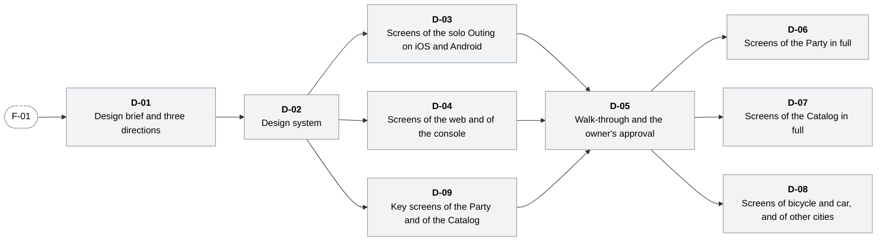
<!-- prettier-ignore-end -->
<!-- /generated -->

### D-01 · Design brief and three directions

- **Status:** todo
- **Depends on:** F-01
- **Requirements:** —
- **Decisions:** ADR-0005, ADR-0007, ADR-0008

**Goal.** The owner has chosen one visual direction out of three that differ in kind.

**Tasks**

- [ ] Write `design/brief.md` from the specification: who uses the product and in what conditions (walking, one hand, sunlight, headphones, the screen locked), what it should feel like, a list of what it must never look like, and scenarios SC-1…SC-7 as the screens they imply.
- [ ] Study what exists and record it with sources: the products named in `docs/research/01-market-competitors-users.md`, and recognised work in maps, audio guides and travel — what to learn from each and what to avoid.
- [ ] Propose three directions that differ in idea, not in colour. Each has a name, a reason tied to the subject (a city, a walk, a voice, company), type for Latin and Cyrillic, colour in light and dark, a treatment of the map and of the Story being played, and motion.
- [ ] Draw the same two screens in each direction — the Route with its map, and the Outing while a Story plays — for iOS, Android and the web, with the names, times and distances of a real Outing in Russian and English. Story text is taken from a cited passage of an open source, or marked as sample text: no history is invented for a mockup.
- [ ] Put the three side by side as static pages under `design/directions/`, opened with one command. `design/README.md` says how to open them and which checks of the repository apply to the folder.

**Done when**

- Each direction shows both screens on all three systems, in light and dark, in both languages, with no filler text.
- Every font and image used has a licence that allows shipping it, recorded in the brief.
- The owner's choice — or the request for another round — is written into `design/brief.md`.

**Owner only.** Choosing the direction.

### D-02 · Design system

- **Status:** todo
- **Depends on:** D-01
- **Requirements:** `NFR-24`, `NFR-25`, `NFR-27`
- **Decisions:** ADR-0005, ADR-0007 (point 6), ADR-0008

**Goal.** One system of tokens and components from which every screen is made, the same idea on each platform and native to each.

**Tasks**

- [ ] Define the tokens in one source file that the applications can later import: colour for light, dark and bright sunlight; a type scale; spacing; radii; elevation; motion.
- [ ] Draw the style of the map for light and dark, for the tile schema of ADR-0008, so that the Route and the person's position read at a glance.
- [ ] Draw the components: buttons, inputs, sheets, lists, the Story player, progress along a Route, map markers, and the states every screen needs — loading, empty, no network, unavailable, error.
- [ ] Write down where iOS and Android differ and why: navigation, back, sheets, system controls, the lock screen.
- [ ] Draw an icon set of the product's own, or choose a licensed one; pictographic characters are not icons.
- [ ] Design the product's own mark in the chosen direction: the application's icon and a wordmark.
- [ ] Study motion for the moments that carry the product — arriving at a Place, a Story starting by itself, the Route recalculating — and keep each as a short animated page.
- [ ] Set the accessibility rules and check them: contrast at WCAG 2.2 level AA, touch targets, text that scales, labels for screen readers, one-handed reach.

**Done when**

- `design/system/` shows every token and every component, in light and dark, in Russian and English, and for iOS and Android wherever they differ.
- A script checks every text-on-background pair of the tokens against level AA, and it passes.
- Every interactive component is at least as large as its platform's minimum touch target.
- The icon, the wordmark and each of the three motion studies exist and are shown on the system's page.

**Room to improve.** Short sounds for arrival and for a Story starting, designed with the motion.

### D-03 · Screens of the solo Outing on iOS and Android

- **Status:** todo
- **Depends on:** D-02
- **Requirements:** —
- **Decisions:** ADR-0005, ADR-0008, ADR-0016, ADR-0017

**Goal.** Every screen that stage S1 builds for the phone exists for both systems, with real content, in every state.

**Tasks**

- [ ] Stage S1, the solo Outing: first launch and the one-minute set-up of the Profile; the Route request with its Wish; "how I understood your request"; the Route options; the Route as a map and a list with "why it is here"; editing with violations listed; the answer when nothing fits, with its one-tap relaxations; the versions of a Route; the download of the Route Pack with its size and the Wi-Fi-only choice; the Outing in Guided and in Quiet Mode; the Story with its text following the audio and its sources one tap away; the lock screen; "Are you at…?"; straying from the Route; skip, shorten, extend and a Break; the battery warning; the end of the Outing with ratings; a Correction on a sentence; saved Routes and past Outings; sign-in, what a Guest keeps and the question about merging; "my Corrections" with their outcomes; the list of notifications; deleting the account; "update required"; settings.
- [ ] The same screens with no network: what needs one is shown as unavailable, never hidden.
- [ ] Use the names, times and distances of a real Outing in Russian and in English. Story text is taken from a cited passage of an open source, or marked as sample text.
- [ ] Note on every screen the requirement IDs it shows, so that a remark of the owner leads back to the specification.

**Done when**

- Every screen of the list exists for iOS and for Android, in light and dark.
- Each screen of stage S1 is drawn in its states: usual, loading, empty, no network, error.
- Scenarios SC-1 and SC-4 can be followed from the first screen to the last without a missing step.

### D-04 · Screens of the web and of the console

- **Status:** todo
- **Depends on:** D-02
- **Requirements:** —
- **Decisions:** ADR-0007

**Goal.** Every key page of the public web and of the internal console exists, for a phone's browser and for a desktop.

**Tasks**

- [ ] The public web: the Route Page as it opens from a messenger; the Invitation page that is answered in a minute; the Route request and editing; playing a Story by hand; sign-in and deleting the account.
- [ ] The preview a messenger shows for a Route Page and for an Invitation.
- [ ] Note on every page the requirement IDs it shows.
- [ ] The console, desktop first: the verification queue; the Dossier editor with facts, sources, sensitivity and the preview of Stories; the pronunciation editor with playback; the Place editor with its map; the queue of Proposed Changes with the history of a Place; the Corrections inbox; starting Preparation and watching its progress and cost; the Sources with doubtful matches and the table of Freshness Checks; Venue selection; the dashboards; Administration with roles, Plans, budgets and the audit log.

**Done when**

- Every page of the public web is drawn at the width of a phone and of a desktop.
- Scenarios SC-5 and SC-6 can be followed through the console's screens without a missing step.
- The console and the public web are visibly one family and are never mistaken for each other.

### D-09 · Key screens of the Party and of the Catalog

- **Status:** todo
- **Depends on:** D-02
- **Requirements:** —
- **Decisions:** ADR-0007, ADR-0018, ADR-0022

**Goal.** The owner sees where the product goes after the solo Outing: the main screens of stages S2 and S3, drawn in the same system, before anything is built.

**Tasks**

- [ ] Stage S2, the Party: creating an Outing with an Invitation; the Invitation page and its answer; the options with what is in each for whom; voting; the Chat; the Meeting Point and who is on the way.
- [ ] Stage S3, the Catalog: the Catalog with its filters; a published Route with its Reviews; the Recap; the personal map of Visits.
- [ ] Draw each for the phone on both systems and, where the web has it, for the web.
- [ ] Note on every screen the requirement IDs it shows.

**Done when**

- Every screen of the two lists exists in light and dark, in Russian and English.
- Scenarios SC-2 and SC-7 can be followed through their main steps; the full sets of screens come with `D-06` and `D-07`.

### D-05 · Walk-through and the owner's approval

- **Status:** todo
- **Depends on:** D-03, D-04, D-09
- **Requirements:** —
- **Decisions:** ADR-0005, ADR-0007

**Goal.** The owner has walked through the product on the mockups and approved the design, and everything the walk showed about the product is written down.

**Tasks**

- [ ] Link the screens into click-through walks of scenarios SC-1, SC-2, SC-4, SC-5, SC-6 and SC-7 under `design/walkthrough/`, opened with one command.
- [ ] Review every screen against the brief's list of what the product must never look like, and against the usual marks of generated design: stock gradients, glass panels for their own sake, pictographic characters as icons, interchangeable grids of cards, filler copy. Correct what is found.
- [ ] Have an independent reviewer do the same review without being told the reasoning behind the direction, and settle each of its findings.
- [ ] Check that every package of stage S1 with a screen to build has that screen among the mockups; draw what is missing.
- [ ] Serve the walks over the local network, so that they open at real size on the owner's iPhone and Android phone, outdoors as well as indoors.
- [ ] Walk the owner through. Sort every remark into a change of design, made here, or a place where the specification was understood differently, listed for the owner to decide.
- [ ] Export each approved screen as an image under `design/approved/`, as the fixed reference that built screens are later compared with.

**Done when**

- Each of the six walks runs from its first screen to its last without a dead end.
- No finding of either review is left open.
- Every stumble of the first-time walkers is either designed out or recorded with the reason it stays.
- The owner's approval is recorded in `design/README.md` with the list of approved screens.
- Every difference in understanding is either corrected in the mockups or handed to the owner as a question about the specification.

**Owner only.** The walk-through on both phones and the approval. Asking two or three people who have never seen the product to go through scenario SC-1 on the mockups while their stumbles are noted. A change to the specification that the walk-through suggests.

**Room to improve.** The images a store listing needs.

### D-06 · Screens of the Party in full

- **Status:** todo
- **Depends on:** D-05
- **Requirements:** —
- **Decisions:** ADR-0007, ADR-0018

**Goal.** Every screen of stage S2 exists for iOS, Android and the web, in the approved design system, and the owner has approved them.

**Tasks**

- [ ] Draw the Invitation page and its answer form, and creating an Outing with a Party.
- [ ] Draw the Route options with the line on what is in each for whom, voting and the Organizer's choice.
- [ ] Draw the Chat with its system events, the Meeting Point with each member's status, and position sharing with its limits visible.
- [ ] Draw the shared Outing on the app and on the web, the Party's notifications with their settings, the rating by each member and "invite the same people".
- [ ] Draw the console's side: Complaints and the Moderator's inbox, and the Party measures.
- [ ] Link the screens into walks of scenarios SC-2 and SC-3, review them as in `D-05`, and walk the owner through.

**Done when**

- Scenarios SC-2 and SC-3 can be followed from the first screen to the last on every system.
- The approved screens are exported under `design/approved/` and the owner's approval is recorded in `design/README.md`.

**Owner only.** The walk-through and the approval.

### D-07 · Screens of the Catalog in full

- **Status:** todo
- **Depends on:** D-05
- **Requirements:** —
- **Decisions:** ADR-0007, ADR-0022

**Goal.** Every screen of stage S3 exists for iOS, Android and the web, in the approved design system, and the owner has approved them.

**Tasks**

- [ ] Draw the Catalog with its filters, a published Route with its rating and Reviews, and publishing a Route.
- [ ] Draw Complaints about publications and how a hidden item looks to its Author and to others.
- [ ] Draw the Recap, the personal map of Visits, and the suggestions for the Profile.
- [ ] Draw "ask the guide" with and without a network, and Story text in Belarusian.
- [ ] Draw Plus, the Pass, the subscription and the checkout with the sandbox provider.
- [ ] Draw the console's side: assembling and publishing Curator Routes, and the review of hidden items.
- [ ] Link the screens into a walk of scenario SC-7, review them as in `D-05`, and walk the owner through.

**Done when**

- Scenario SC-7 can be followed from the first screen to the last on every system.
- The approved screens are exported under `design/approved/` and the owner's approval is recorded in `design/README.md`.

**Owner only.** The walk-through and the approval.

### D-08 · Screens of bicycle and car, and of other cities

- **Status:** todo
- **Depends on:** D-05
- **Requirements:** —
- **Decisions:** ADR-0005, ADR-0009

**Goal.** The screens that stages S4 and S5 add exist in the approved design system, and the owner has approved them.

**Tasks**

- [ ] Draw the Outing while a bicycle or a car is moving: the next Place and one large pause control, and what becomes available at a stop.
- [ ] Draw choosing a Travel Mode, parking, and a Route that drives between Territories and walks inside them.
- [ ] Draw the public Coverage of a city, a Route built at once on light data with "6 of 9 Stories ready", and Preparation started by a User within a quota.
- [ ] Link the screens into walks of scenarios SC-8 and SC-9, review them as in `D-05`, and walk the owner through.

**Done when**

- Scenarios SC-8 and SC-9 can be followed from the first screen to the last.
- The approved screens are exported under `design/approved/` and the owner's approval is recorded in `design/README.md`.

**Owner only.** The walk-through and the approval.

## F — Foundation

The base every other track stands on: the repository and its rules, then the cross-cutting pieces that the skeleton does not have yet and that several tracks need.

<!-- generated:track F -->
<!-- prettier-ignore-start -->
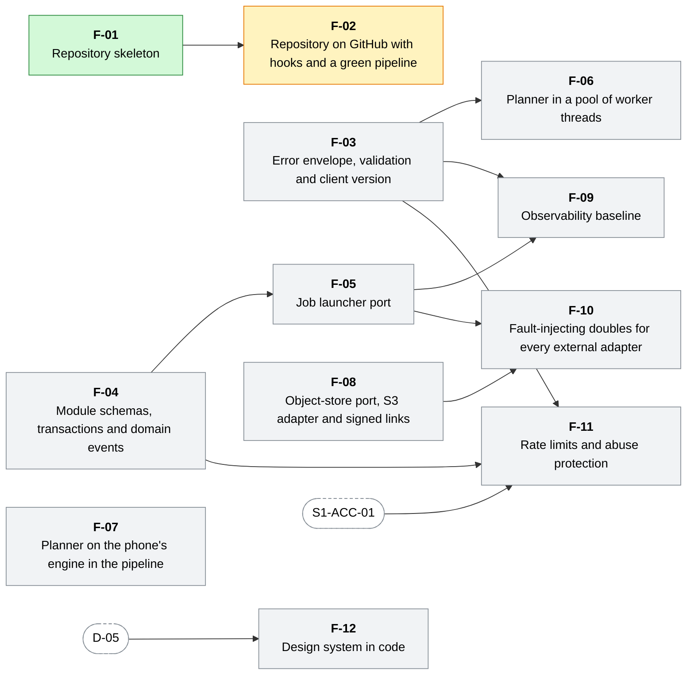
<!-- prettier-ignore-end -->
<!-- /generated -->

### F-01 · Repository skeleton

- **Status:** done
- **Depends on:** —
- **Requirements:** `NFR-33`
- **Decisions:** ADR-0001, ADR-0002, ADR-0003, ADR-0004, ADR-0005, ADR-0006, ADR-0007, ADR-0010, ADR-0014, ADR-0019, ADR-0024, ADR-0026, ADR-0027

**Goal.** An empty but running repository that already enforces the rules of the architecture.

**Tasks**

- [x] The pnpm workspace with strict TypeScript: `apps/api`, `apps/mobile`, `apps/console` and six shared packages as stubs.
- [x] The rules as automated checks, each proven to fail on a deliberate violation: the verifier may not import the planner; no floating-point code in `planner`, `verifier` and `routing`; a module of the API is used only through its `index.ts`.
- [x] One container image with entry points for the API, the worker, a batch job and the migrations; the public web rendered inside the API.
- [x] `docker compose up` with Postgres and PostGIS, the Firebase Authentication emulator, object storage with a public and a private bucket, and a mail catcher.
- [x] Forward-only SQL migrations, the first of which enables PostGIS.
- [x] The `LanguageModel`, `SpeechSynthesis` and `SpeechRecognition` ports, each with an adapter that replays recordings.
- [x] Terraform with providers pinned and no resources.

**Done when**

- `docker compose up --build --wait` starts everything and `node scripts/smoke.mjs` passes every check.
- `pnpm lint` and `pnpm test` pass on a fresh clone, with nothing built.

**Room to improve.** What the skeleton leaves out is listed in the README under "Not here yet"; each item is a package of this plan.

### F-02 · Repository on GitHub with hooks and a green pipeline

- **Status:** in progress
- **Depends on:** F-01
- **Requirements:** `NFR-38`
- **Decisions:** ADR-0002 (point 2)

**Goal.** Every change reaches `main` through a pull request that passed the pipeline.

**Tasks**

- [x] Push the repository; the pipeline runs lint, tests, the compose smoke test and the Terraform checks, and is green.
- [x] Commit-message rules checked by a hook; lint and tests run before every push ([CONTRIBUTING.md](../CONTRIBUTING.md)).
- [x] This work plan, with the script that keeps it in step with the specification.
- [ ] Protect `main`: pull requests only, the three checks required, linear history, no force-push.

**Done when**

- A push straight to `main` is refused, and a pull request cannot be merged while a check is failing.
- A commit whose message breaks the rules is refused locally.

**Owner only.** Switching on the protection of `main` in the repository's settings, and logging the repository's account into the `gh` command so that sessions can open pull requests themselves.

### F-03 · Error envelope, validation and client version

- **Status:** todo
- **Depends on:** —
- **Requirements:** `NFR-29`, `NFR-38`
- **Decisions:** ADR-0025 (points 1, 2, 4, 5)

**Goal.** Every answer of the API that is an error uses the one envelope of `contracts`, every request and response is validated against its schema at the boundary, every request states the client's version, and an OpenAPI document is generated from `contracts`.

**Tasks**

- [ ] Add a global exception filter in `apps/api/src/platform/` that maps every error — validation, not found, refused, unexpected — to `errorEnvelopeSchema`, with a stable `code` and no stack trace or internal detail in the body.
- [ ] Introduce the registry of error codes in `contracts` (a closed list grown per package) and a test that every code the API emits is in it.
- [ ] Add a validation pipe that validates request bodies, parameters and queries against the `contracts` schema of the route, and validates responses in tests (not in production) against their schemas.
- [ ] Define the client-version header in `contracts`; enforce a configurable minimum per client kind (mobile, web, console) and answer below it with the single "update required" code; requests of the three clients to the JSON endpoints without the header are refused with their own code. Pages rendered on the server, link previews, the health checks and the hourly trigger are exempt, and the list of exempt routes is written down.
- [ ] Teach each client (mobile, public web, console) to send its version and to show a plain "update required" message from the code, in both languages of `packages/i18n`; the designed screen arrives with each client's own screens.
- [ ] Generate an OpenAPI document from `contracts` as a build artefact; fail the pipeline when the generated document is out of date with the schemas.

**Done when**

- Every error answer of every endpoint parses with `errorEnvelopeSchema`; a test walks the registered routes and provokes at least a validation error on each.
- A request with a client version below the minimum gets the "update required" code from every endpoint, and each of the three clients shows the update message for it.
- `pnpm lint` fails when the committed OpenAPI document differs from the one generated from `contracts`.

**Room to improve.** Publish the OpenAPI document with the web build for people outside the repository; a lint rule that forbids throwing framework exceptions with free-text messages outside the filter.

### F-04 · Module schemas, transactions and domain events

- **Status:** todo
- **Depends on:** —
- **Requirements:** `NFR-38`, `NFR-29`
- **Decisions:** ADR-0003 (points 1, 5), ADR-0026 (points 1, 2, 5, 7)

**Goal.** Each module of the API owns a Postgres schema of its own, a migration can touch only its module's schema and this is checked automatically, modules share a transaction through one helper, and a module can publish in-process domain events that other modules handle through their interfaces.

**Tasks**

- [ ] Give each existing module (`places`, `planning`) a Postgres schema named after it in a migration, and document the convention in `apps/api/migrations/README.md` and `apps/api/src/modules/README.md`.
- [ ] Add an automated check (in `tools/architecture-tests`) that a migration named `<module>_…` creates and alters objects only in schema `<module>`, and that module code queries only its own schema — the rule "a module reads and writes only its own tables" stops being review-only.
- [ ] Write the transaction helper in `platform/database`: a unit of work that a request opens and passes to the interfaces of several modules, committed once; nested use joins the outer transaction.
- [ ] Write the in-process domain-event bus: a module publishes a typed event (schema in `contracts` or in the module's interface) inside a transaction; handlers registered by other modules run inside the same transaction or, when marked so, right after commit within the same request — never after the response (ADR-0024, rule 2).
- [ ] Add tests: a rolled-back transaction publishes nothing after commit; a handler's failure inside the transaction rolls the whole unit back; no handler runs after the response is sent.
- [ ] Add a test that each migration applied twice in the local environment is a no-op and that migrations only add in the release they appear in (expand), with removals allowed only for objects marked deprecated in an earlier release (contract).

**Done when**

- A deliberate migration that alters another module's schema fails `pnpm test` with a message naming the module, as do the existing architecture rules.
- The transaction and event tests above pass in `pnpm test` and against the compose database in the integration run.
- `docker compose up` applies every migration on a fresh volume and the smoke test passes.

**Room to improve.** A Postgres role per module with grants on its own schema only, so that the rule is enforced by the database as well.

### F-05 · Job launcher port

- **Status:** todo
- **Depends on:** F-04
- **Requirements:** `NFR-33`, `NFR-34`
- **Decisions:** ADR-0003 (points 2, 3), ADR-0012 (point 3), ADR-0024 (rule 2)

**Goal.** The API can start the worker or a named batch job of the same image through one `JobLauncher` port, the same way locally and in the cloud, and never waits for it.

**Tasks**

- [ ] Define the `JobLauncher` port in `apps/api/src/ports/`: start `worker` or `job <name>` with a small argument set; idempotent per key so that two starts within a short window launch one execution.
- [ ] Write the local adapter, which starts the same image's entry point in the compose environment (through the container engine or as a child process of the API container — chosen at implementation, documented in `docs/development.md`).
- [ ] Write the cloud adapter, which starts the Cloud Run job execution by name through the platform's API with the service's own identity.
- [ ] Add a fault-injecting double (fails, times out) and a test that a failed launch is recorded and retried by the next hourly trigger rather than lost.
- [ ] Register the existing `environment-report` job and the worker with the launcher and add a smoke step that launches each through the API in the compose environment.

**Done when**

- In the compose environment a call through the port starts the worker and the `environment-report` job, each exits by itself, and the smoke test checks their exit status.
- Two launches with the same key within the window produce one execution (test).

### F-06 · Planner in a pool of worker threads

- **Status:** todo
- **Depends on:** F-03
- **Needs:** The planner and verifier packages with their request and result types in `contracts` (the stub that exists today is enough to start; the pool wraps whatever `planRoute` is).
- **Requirements:** `NFR-4`, `NFR-13`, `NFR-2`
- **Decisions:** ADR-0003 (point 4), ADR-0006 (point 10)

**Goal.** On the server every planning run executes in a pool of worker threads inside the API process, each run single-threaded, so that planning never blocks other requests on the instance.

**Tasks**

- [ ] Add a thread-pool service in `platform/` that loads the planner and verifier bundles once per thread and runs one request per thread at a time; pool size and queue length are configuration.
- [ ] Route every server-side call of the planner (and of the verifier after it) through the pool; forbid calling `planRoute` directly in the API by an import rule.
- [ ] Transfer only serialisable integer data (the planning problem of `contracts`) between threads; city data is loaded per thread from the published city version when first needed.
- [ ] When the queue is full, answer with a stable "busy" code of the envelope instead of queueing without bound.
- [ ] Add a test that the same request gives byte-identical output in the pool and in the main thread, and a test that a health request is answered while every thread runs a long plan.

**Done when**

- The reproducibility suite (ten repetitions identical) passes with the planner running in the pool.
- With all threads busy on a deliberately long plan, `GET /health/live` and a cheap API request still answer within their normal time (test).

**Room to improve.** Pool size set automatically from the instance's processor count; per-request planning time exported as a metric (picked up by `F-09`).

### F-07 · Planner on the phone's engine in the pipeline

- **Status:** todo
- **Depends on:** —
- **Needs:** The planner, verifier and routing packages and the generator of planning requests used by the property suite (the stubs are enough to set the job up).
- **Requirements:** `NFR-2`, `NFR-38`
- **Decisions:** ADR-0006 (points 2, 9), ADR-0027 (point 2)

**Goal.** On every change the pipeline runs the same fixed set of planning requests on the server's JavaScript engine and on the phone's (the engine the Expo application ships), both from the command line, and fails unless the outputs are byte-identical.

**Tasks**

- [ ] Bundle `planner`, `verifier` and `routing` with a small command-line driver into one script for each engine, from the same sources.
- [ ] Keep the fixed set of planning requests as a corpus in the repository, with the hash of each expected answer; `S1-RTE-08` extends it.
- [ ] Obtain the phone's engine as a command-line binary in the pipeline at the version the pinned React Native ships, pinned and checksummed, without a device or emulator.
- [ ] Commit a fixed corpus of planning requests (generated once from a seed, including Party-shaped and edge-case requests as they appear) and run it on both engines, writing canonical JSON.
- [ ] Compare the outputs byte for byte; on mismatch print the first differing request and the two results.
- [ ] Add the job to `.github/workflows/ci.yml` as a required check.

**Done when**

- The new pipeline job passes on `main` and is listed among the required checks.
- A deliberately introduced engine-dependent expression (for example an iteration order that differs between engines) makes the job fail, shown by a test in `tools/architecture-tests`.

**Owner only.** Adding the new job to the required checks in the repository settings on GitHub.

### F-08 · Object-store port, S3 adapter and signed links

- **Status:** todo
- **Depends on:** —
- **Requirements:** `NFR-23`, `NFR-31`, `NFR-33`
- **Decisions:** ADR-0010 (points 3, 5), ADR-0002 (point 3)

**Goal.** Every file the system writes or serves goes through an `ObjectStore` port with a public and a private bucket, content-addressed immutable keys, and signed links for the private bucket, working against the local SeaweedFS and against Cloudflare R2 by configuration.

**Tasks**

- [ ] Define the `ObjectStore` port: put by content hash (idempotent: an existing key is not rewritten), head, get with byte ranges, delete (for account deletion and dump retention), list by prefix, and `signedLink(key, lifetime)` for the private bucket.
- [ ] Write the S3 adapter with the standard S3 client; endpoint, buckets and credentials are configuration; works with the local emulator and with R2.
- [ ] Return public links for the public bucket and signed links (about a day) for the private bucket; issue fresh links on request so that a resumed download can continue.
- [ ] Write a fault-injecting double for the port (fails, times out, answers slowly) for other packages' tests.
- [ ] Add integration tests against the compose object storage: anonymous read of public, refusal of private, signed link works, altered or expired link is refused, range request returns the range, putting the same content twice writes once.

**Done when**

- The integration tests above pass in the compose environment in the pipeline.
- No module writes files except through the port (import rule in `.dependency-cruiser.cjs`, proven by an architecture test).

### F-09 · Observability baseline

- **Status:** todo
- **Depends on:** F-03, F-05
- **Requirements:** `NFR-28`, `NFR-33`, `NFR-17`
- **Decisions:** ADR-0021 (points 1, 2, 4)

**Goal.** The API, the worker and the batch jobs emit structured logs, metrics and traces through OpenTelemetry with one trace identifier from the client request through a launched job, to a local observability container and, by configuration, to Google Cloud; mobile crashes go to a crash reporter behind a wrapper.

**Tasks**

- [ ] Instrument the API, worker and jobs with the OpenTelemetry SDK: HTTP server and client, database and outgoing port calls; exporter destination is configuration, nothing runs beside the application in the cloud.
- [ ] Structured JSON logs with the trace identifier; a redaction layer that writes a hash in place of a person's identifier and refuses to log fields named or shaped as coordinates, tokens, e-mail addresses or codes.
- [ ] Propagate the trace identifier from the client request into a launched job (`F-05` argument) so that one trace spans the request and the work it started.
- [ ] Add a single observability container to `compose.yaml` that receives logs, metrics and traces and shows them in a browser; document its address in `README.md`.
- [ ] Add the crash reporter wrapper to the mobile application with a no-op local adapter; the report schema has no position field.
- [ ] Add a test that a log line produced from a request carrying a person's identifier and a coarse cell contains neither.

**Done when**

- After `docker compose up` and one request that launches a job, the observability container shows one trace covering the request and the job.
- The redaction test passes; a deliberate log of an e-mail address in a test is written as a hash.

**Owner only.** Choosing the crash reporter's provider, which needs an account; until then the no-op adapter stays.

### F-10 · Fault-injecting doubles for every external adapter

- **Status:** todo
- **Depends on:** F-08, F-05
- **Requirements:** `NFR-11`
- **Decisions:** ADR-0027 (points 6, 12)

**Goal.** Every port to the outside — language model, speech synthesis, speech recognition, object storage, push, e-mail, identity provider, job launcher — has a test double built on one shared harness that can time out, fail and answer slowly, and a test asserting the degraded behaviour the specification names for each.

**Tasks**

- [ ] Write the shared harness in the API's test utilities: wrap any port implementation with configurable failure, timeout and delay, per call or by pattern.
- [ ] Provide doubles for the three model and speech ports by wrapping the replay adapters.
- [ ] Provide doubles for `ObjectStore` (reuse `F-08`) and `JobLauncher` (reuse `F-05`); the push, e-mail and identity ports take the harness when they are introduced (`S1-FBK-01`, `S1-ACC-01`).
- [ ] Add a check that fails when a port in `apps/api/src/ports/` has no registered double.
- [ ] Write the first degraded-behaviour tests for ports that exist now: a model port that fails or times out surfaces as the port's own error with a stable code and never as an unhandled one (the degraded test of Wish interpretation itself is in `S1-RTE-10`); a failing object store answers with a stable code and the system keeps serving what does not need it.

**Done when**

- The check "every port has a double" passes and fails when a port without one is added (architecture test).
- Each degraded-behaviour test passes in `pnpm test`; none calls a paid service.

### F-11 · Rate limits and abuse protection

- **Status:** todo
- **Depends on:** F-03, F-04, S1-ACC-01
- **Needs:** The cost ledger with monthly budgets of Preparation (ADR-0012, points 5–6), to act as the last line.
- **Requirements:** `NFR-31`, `NFR-22`, `NFR-34`
- **Decisions:** ADR-0028 (points 1–3, 5–7)

**Goal.** Cheap endpoints are limited in the process and costly ones are counted in the database inside the transaction that does the work, both keyed by the person's identifier or, before one exists, the coarse network address, with one "too many requests" code.

**Tasks**

- [ ] Write the in-process limiter (token bucket per key and endpoint class) as a guard; limits are configuration.
- [ ] Write the database counter for costly endpoints, incremented in the unit of work of `F-04` so that a rolled-back request does not count; the endpoints named in ADR-0028 point 3 register with it as they are built.
- [ ] Derive the key: Guest or User identifier when a token is present; otherwise the network address truncated to a coarse prefix, never stored in full.
- [ ] Answer over the limit with a stable code and a retry-after hint; record the refusal as a metric.
- [ ] Expose the limits for the Administrator to change without a release (configuration table read by the guard; console screen in `S1-ACC-03`).

**Done when**

- Tests show a costly endpoint refuses the request one over its limit, even under ten concurrent requests from the same identity, and that a rolled-back request does not consume the count.
- A cheap endpoint refuses above its rate and recovers after the window (test).
- No full network address is found in the database or logs after the tests (privacy assertion).

**Room to improve.** Attestation that requests come from the real app (ADR-0028, consequences) if Guests are abused.

### F-12 · Design system in code

- **Status:** todo
- **Depends on:** D-05
- **Requirements:** `NFR-24`, `NFR-27`
- **Decisions:** ADR-0005 (point 2), ADR-0007 (points 1, 4, 6)

**Goal.** The approved design exists as code that the app, the public web and the console import, so that every screen is built from the same tokens and components.

**Tasks**

- [ ] Turn the token file of `D-02` into the source that the three clients import; changing a token changes every screen.
- [ ] Build the base components for the app and the public web: buttons, inputs, sheets, lists, and the states for loading, empty, no network and error — with minimum target sizes, contrast that holds in sunlight, text that scales, and accessibility labels and roles.
- [ ] Build the console's variant of the components on the same tokens.
- [ ] Add a page that shows every component in every state, in both languages, to be set beside `design/system/`.
- [ ] Add a rule that screens take colour, type and spacing from the tokens only, and prove that it fails on a hard-coded value.

**Done when**

- Each component of `design/system/` has its counterpart in code, shown on the components page in light and dark.
- The rule fails on a deliberate hard-coded colour (architecture test).
- The automated accessibility check passes on the components page.

**Owner only.** Accepting a seventh shared package, if the tokens and components need one: ADR-0005 lists six.

## C — Checks before building

Six small checks decide whether a fallback written into a decision record is needed. Each ends in a recorded verdict, not in code, and each is prepared by packages of other tracks: the build that is walked with, the harness that runs a comparison, the environment that is measured. Results are kept under `docs/checks/`.

<!-- generated:track C -->
<!-- prettier-ignore-start -->
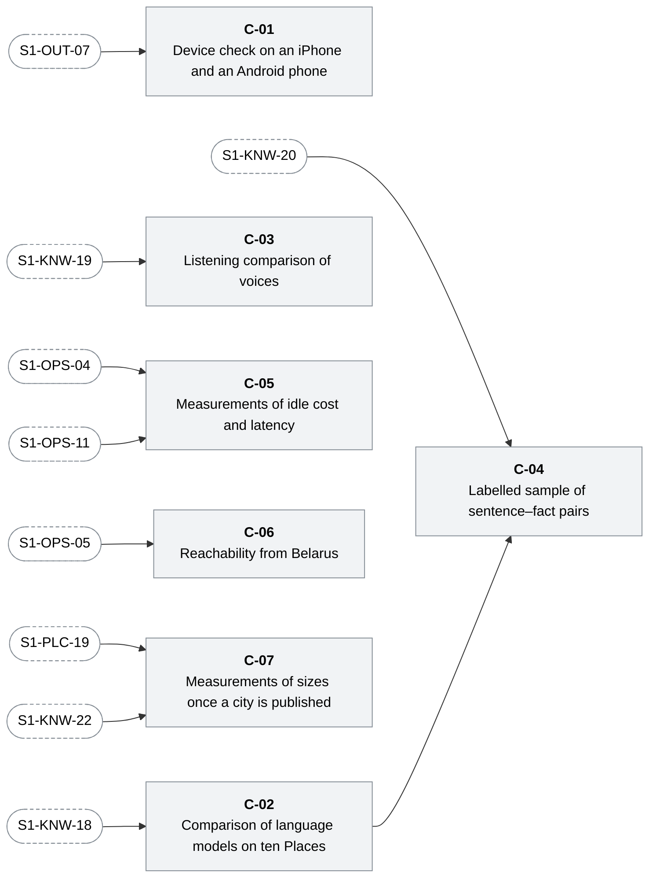
<!-- prettier-ignore-end -->
<!-- /generated -->

### C-01 · Device check on an iPhone and an Android phone

- **Status:** todo
- **Depends on:** S1-OUT-07
- **Requirements:** —
- **Decisions:** ADR-0005 (points 6–7), ADR-0006, ADR-0008

**Goal.** A recorded verdict: the Outing engine stays in TypeScript, or the location session, the trigger engine and the audio session move into a native module.

**Tasks**

- [ ] Write the protocol of the walk in `docs/checks/C-01-device-check.md`: the five conditions of ADR-0005, point 6, what to note for each, and how to hand over the log of the check build.
- [ ] After the walks, read both logs and fill in the result for each condition on each phone, with the evidence.
- [ ] State the verdict. If lock-screen controls forced exclusive audio, write the proposed change to the rule of specification §4.7 for the owner.
- [ ] If the verdict is "TypeScript", set `S1-OUT-21` to `dropped`. If it is "native module", point the packages that waited for this check at `S1-OUT-21`.

**Done when**

- Each of the five conditions is marked passed or failed for the iPhone and for the Android phone, with evidence from the log.
- The verdict is in the plan's change log, and every package that depended on this check points at the path the verdict chose.

**Owner only.** Installing the check build — on the iPhone through the owner's Mac — and walking for an hour with each phone, screen locked.

### C-02 · Comparison of language models on ten Places

- **Status:** todo
- **Depends on:** S1-KNW-18
- **Requirements:** —
- **Decisions:** ADR-0004 (points 2, 4, 5, 7, 11), ADR-0013

**Goal.** The model for Preparation is chosen by the owner from results on ten Places.

**Tasks**

- [ ] Prepare the run so that the owner starts it with one command and their own keys: once per candidate, inside the budget set in the cost ledger, every response kept as a recording.
- [ ] Assemble the reading pack in `docs/checks/C-02-model-comparison.md`: for each Place and candidate — the facts taken from Belarusian-language sources, the share of statements that survive the statement check, the Stories side by side in Russian and English, tokens and cost.
- [ ] Record the owner's choice in configuration and in the results; name the judge model, which must be of another family than the generator.

**Done when**

- The results show all three compared things for every candidate on all ten Places.
- The chosen model is the configured one, and what was spent is in the ledger and within its budget.

**Owner only.** Accounts and keys of the model providers, approval of the spend, reading the Stories and choosing.

### C-03 · Listening comparison of voices

- **Status:** todo
- **Depends on:** S1-KNW-19
- **Requirements:** —
- **Decisions:** ADR-0014 (points 6 and 8), ADR-0003 (point 7)

**Goal.** The voice family is chosen by ear, and it is known whether pronunciation hints work in Russian and whether an automatic stress step is needed.

**Tasks**

- [ ] Prepare the synthesis so that the owner starts it with one command and their own account: the 20–30 phrases with names of Places in each candidate voice family, with and without pronunciation hints, inside the free quota.
- [ ] Prepare a blind listening sheet — samples in random order, the voice hidden — and the form for the answers.
- [ ] Record the outcome in `docs/checks/C-03-listening-comparison.md`: the family chosen, whether hints changed what was heard, how often stress in ordinary words was wrong.
- [ ] If stress is wrong too often, add the package for the stress step to this plan; ADR-0003, point 7 names it as the one case that brings a small Python job back.

**Done when**

- Every phrase exists in every candidate voice, with and without hints.
- The results name the voice family and answer both questions with counts.

**Owner only.** Listening and choosing; the cloud account the voices are synthesised with.

### C-04 · Labelled sample of sentence–fact pairs

- **Status:** todo
- **Depends on:** S1-KNW-20, C-02
- **Requirements:** —
- **Decisions:** ADR-0013 (point 6)

**Goal.** The thresholds of the statement check are set on sentences a person has labelled, and `NFR-18` has its first reading.

**Tasks**

- [ ] Draw the sample from the Stories of the model comparison: sentence–fact pairs in Russian and English, including sentences labelled non-factual.
- [ ] Prepare the labelling sheet: for each pair, does the cited fact support the sentence, and does the passage of the source support the fact.
- [ ] From the labels, set the upper and the lower threshold of the entailment step and report both measures of `NFR-18` with their confidence interval.
- [ ] Keep the labelled sample in the repository as the fixed set that tests and later readings reuse.

**Done when**

- Every pair of the sample carries a label made by a person.
- The thresholds are in configuration, and the results in `docs/checks/C-04-labelled-sample.md` state both measures of `NFR-18` against their targets.

**Owner only.** Labelling the sample.

### C-05 · Measurements of idle cost and latency

- **Status:** todo
- **Depends on:** S1-OPS-04, S1-OPS-11
- **Requirements:** —
- **Decisions:** ADR-0024, ADR-0010, ADR-0008, ADR-0009

**Goal.** It is measured, not assumed, that the deployment stays free while idle and answers within the thresholds after an idle period.

**Tasks**

- [ ] Measure the database's compute hours over an idle day and over a day of tests.
- [ ] Measure the first request after an idle period end to end, against the six seconds of `NFR-4`, and a warm request against three.
- [ ] Record every figure in `docs/checks/C-05-measurements.md` next to its allowance or threshold, and set the budgets and the alert thresholds from them.

**Done when**

- Each measurement of the list has a figure, the date it was taken and the allowance or threshold it is compared with.
- Every figure that leaves less than a safe margin has a decision recorded for the owner.

**Owner only.** The cloud accounts the environment runs in.

The sizes that exist only once a city is published and prepared are measured by `C-07`.

### C-06 · Reachability from Belarus

- **Status:** todo
- **Depends on:** S1-OPS-05
- **Requirements:** —
- **Decisions:** ADR-0001, ADR-0010, ADR-0019, ADR-0020

**Goal.** It is known, from a network in Belarus, whether each service a phone or a browser talks to directly answers.

**Tasks**

- [ ] Build one test page that calls each such service — sign-in, the address of the API and of the web, the console's address, push, public files and a signed link to a private file — and shows a result per service, sending nothing about the person who opens it.
- [ ] Publish it with the environment and write the instruction for whoever opens it.
- [ ] Record the results in `docs/checks/C-06-reachability.md`; for a service that does not answer, name what replaces it behind its port.

**Done when**

- The results hold an outcome for every service from at least one network in Belarus.
- Every service that failed has a replacement named, and the package that makes the replacement is in this plan.

Identity (`S1-ACC-01`), push (`S1-FBK-01`) and the object store (`F-08`) are built behind their ports without waiting for this check: if a service does not answer, its adapter is replaced and nothing else changes.

**Owner only.** Finding a person in Belarus to open the page; and the choice to make those three packages wait for this check instead.

### C-07 · Measurements of sizes once a city is published

- **Status:** todo
- **Depends on:** S1-PLC-19, S1-KNW-22
- **Requirements:** —
- **Decisions:** ADR-0024, ADR-0010, ADR-0008, ADR-0009

**Goal.** The sizes that the decisions estimated are measured on the first real city, in the cloud.

**Tasks**

- [ ] Measure on a cloud instance the memory taken by the pedestrian graph and the matrix of the published city, and the time of a search.
- [ ] Measure the size of the city's map file, of a Route Pack with and without audio, and of the database after the first Preparation.
- [ ] Record every figure in `docs/checks/C-07-sizes.md` next to the estimate of its decision record and the limit it must stay under: the free storage of the database and of the object store, the size of a Route Pack of `NFR-8`, the memory of an instance.

**Done when**

- Each measurement has a figure, the date it was taken and the limit it is compared with.
- Every figure that leaves less than a safe margin has a decision recorded for the owner.

## S1-PLC — The base of Places and the data of a city

This track turns the stub `places` module into the base of Places of ADR-0030 and ADR-0031 and into the published city versions of ADR-0010. It goes in this order: the model of cities, areas and Places; change records as the one path every writer uses (history, Proposed Changes, undo); the tree of Territories with inherited Access Rules; the connectors to the Sources; matching and the gathering job; names, status rules and the table of what is applied without a person; the Curator's operations on Places; Freshness Checks, the website one included. Then come the city data the planner reads: the city calendar and opening-hour intervals, the pedestrian graph and its matrix, the base map, the published immutable city version and its daily refresh. After that come Key Places, Coverage and freshness by area. The track ends with the small fixed city for the local environment and with the first gathering of the country and publication of the first city in the cloud.

<!-- generated:track S1-PLC -->
<!-- prettier-ignore-start -->
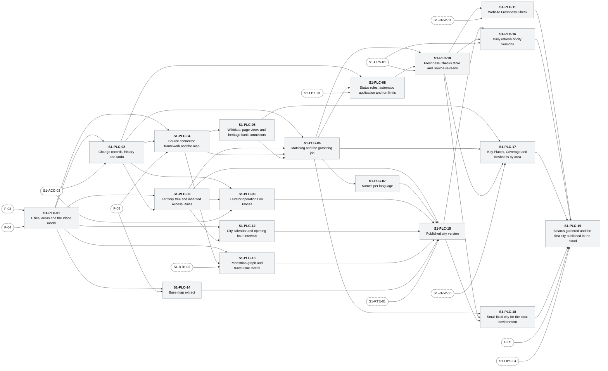
<!-- prettier-ignore-end -->
<!-- /generated -->

### S1-PLC-01 · Cities, areas and the Place model

- **Status:** todo
- **Depends on:** F-03, F-04
- **Needs:** The API contract conventions and the error envelope in `packages/contracts`; the fixed list of themes that the Profile uses (theme identifiers only).
- **Requirements:** `PLC-1`, `PLC-4`, `PLC-5`, `PLC-8`, `PLC-9`, `NFR-21`, `NFR-26`, `NFR-37`
- **Decisions:** ADR-0030 (points 1, 4, 14, 15, 20), ADR-0031 (point 22), ADR-0029 (points 1, 8), ADR-0010 (point 1), ADR-0003 (point 5), ADR-0026

**Goal.** The `places` module owns tables and shared types for regions, cities, areas and Places. Every attribute of §3.2 can be stored, and no city is fixed in code.

**Tasks**

- [ ] Add migrations of the `places` module for regions, cities and areas. A city carries its boundary, its time zone, a reference to its holiday calendar, the margin by which its graph is cut, and its languages. An area can be marked "opened to a Curator".
- [ ] Add the Place table with identifiers of our own that are issued once and never reused. Columns: kind, outside or inside, typical visit duration, status (open, temporarily closed, permanently closed, unknown), parent Territory, manual flag, trigger radius, hidden flag, a parking point for cars and one for bicycles, and a point or boundary in PostGIS.
- [ ] Add names per Place and language with the local name always kept. Each name has a mark of how it was obtained: from a source, transliterated, generated, or set by a Curator. The table takes any language code, with no column per language.
- [ ] Define the kinds as data: sights, nature, Venues, markets, memorial plaques, lodging, entertainment without sessions and entertainment by sessions. Give each kind its role in a Route (stop, start or finish only, shown near a Route), its default for outside or inside, and "excluded by default" for memorial plaques.
- [ ] Add Access Rules (opening hours as written in the source, with a confidence of known or unknown; price; ticket required) and Entrances of Territories.
- [ ] Give every attribute two references to change records, the one that set it and the one that last confirmed it. Leave them as nullable foreign keys to be filled by S1-PLC-02.
- [ ] Export the types through `places/index.ts` and `packages/contracts`. Travel Mode is an enumeration of three values wherever a Place field depends on it (parking points), and areas outside a city's boundary are allowed.

**Done when**

- Migrations apply forward on an empty database, and the previous release's suite passes against the new schema.
- A test inserts two cities with different time zones, languages and calendars from data alone, with no code change.
- A test stores names of one Place in three languages plus a fourth, invented language code with no schema change.
- No identifier, boundary or language of a real city appears in code or tests (checked by a test that searches the module's sources for the city names of the seed data).

**Room to improve.** A lint rule that rejects city or country names in code across the repository, not only in this module.

### S1-PLC-02 · Change records, history and undo

- **Status:** todo
- **Depends on:** S1-PLC-01, S1-ACC-03
- **Needs:** The account-deletion workflow of the identity track calls a hook of this module (`ACC-6`); the audit-log interface for Curator actions.
- **Requirements:** `PLC-12`, `PLC-13`, `PLC-1`
- **Decisions:** ADR-0031 (points 1–7), ADR-0030 (points 3, 4), ADR-0027 (point 11)

**Goal.** Every change to the data of a Place is an append-only change record that starts as a Proposed Change and ends as applied, accepted, rejected or superseded. The records form the Place's history, and a recent change can be undone.

**Tasks**

- [ ] Add the change-record table. A record holds the subject (an attribute from one value to another, or a Place created, closed, reopened, merged or split), its origin (Source, Freshness Check, Correction, Curator), its evidence, its time and its state. Records are only ever added.
- [ ] Check that the evidence matches the origin. A Source gives its record and revision or date. A Freshness Check gives the address, time, hash and fragment, never a copy of the page. A Correction is referred to by identifier only, with no text and no author. A Curator may add a note.
- [ ] Implement applying a record. It updates the Place, sets the attribute's "set by" reference, and renews "last confirmed" only when the confirming origin's value equals the current one.
- [ ] Keep at most one open Proposed Change per Place, attribute and origin; a newer one supersedes it. Remember a rejection by Place, attribute, origin and value, and propose the value again only when that origin's value changes.
- [ ] Implement undo as a new record that restores the earlier value. Refuse undo when a later record changed the same thing.
- [ ] Expose through `places/index.ts`: read the history of a Place; list, accept, reject, and edit-and-accept Proposed Changes; and record a Curator's edit, accepted as it is made.
- [ ] Implement the account-deletion hook: records whose origin was a Correction keep only that fact.

**Done when**

- The change-record tests of ADR-0027 point 11 pass. A Place's state equals its snapshot plus its applied records (property test over generated sequences). Undo restores the earlier value and is refused after a later change. A rejected value is not proposed again after an unrelated change at its origin. No text or author of a Correction survives account deletion in any record.
- Every accept, reject, edit or undo made by a Curator writes one entry to the audit log.

### S1-PLC-03 · Territory tree and inherited Access Rules

- **Status:** todo
- **Depends on:** S1-PLC-01, S1-PLC-02
- **Requirements:** `PLC-2`, `PLC-3`
- **Decisions:** ADR-0010 (point 1), ADR-0029 (point 2), specification §3.2 and the edge cases of §4.3

**Goal.** Every Place has at most one parent, the smallest Territory that contains it. The tree can be of any depth, and Access Rules resolved for a Place combine those of every Territory above it.

**Tasks**

- [ ] Compute the parent of each Place with PostGIS as the smallest containing Territory. Overlapping Territories resolve to the smaller one, and ties are broken by Place identifier.
- [ ] Recompute parents when a boundary changes, and write each change of parent as a change record.
- [ ] Flag a Territory with no known Entrance for the Curator and treat it as open on all sides.
- [ ] Combine Access Rules down the tree. Hours become the intersection of the Place's own hours with those of every ancestor, prices add up, and "ticket required" is true if any level needs one. Keep the result as a rule set that is resolved into intervals in S1-PLC-12.
- [ ] Reject a nested Place that is not outdoors-positionable (inside a building) as a stop: it stays in the base marked manual.

**Done when**

- A fixture with three levels of nesting and overlapping Territories gives the expected parents, also after the input order is shuffled.
- The Botanical Garden example of §3.2, as a fixture with invented names, resolves to: no availability for the greenhouse on Mondays, both tickets summed, and availability inside both sets of hours on other days.
- A Territory without an Entrance appears in the list of Territories flagged for the Curator.

### S1-PLC-04 · Source connector framework and the map

- **Status:** todo
- **Depends on:** S1-PLC-01, S1-PLC-02, F-08
- **Needs:** The `ObjectStore` port (private bucket) for snapshots; the batch-job entry point of the image exists.
- **Requirements:** `PLC-1`, `NFR-19`, `PLC-5`
- **Decisions:** ADR-0030 (points 5, 6, 10), ADR-0011 (points 1, 8, 11), ADR-0031 (point 16), ADR-0027 (points 6, 11)

**Goal.** A Source connector interface exists, with a ledger of runs, snapshots in object storage, and a test double for every Source. The first connector reads the OpenStreetMap extract of the country with DuckDB.

**Tasks**

- [ ] Define the connector interface. It fetches for an area, returns typed source records with the reference needed to fetch them again (dated extract, revision), and states the Source's licence.
- [ ] Write fetched records as a filtered snapshot in the private bucket, and keep a full copy only of what cannot be fetched again identically. Add a retention rule for old snapshots.
- [ ] Add the ledger of runs: Source, area, records fetched and changed, matched and unmatched, throttled or failed requests, and the snapshot produced.
- [ ] Add a shared HTTP client for Sources. It identifies the client by the repository address and no personal data, keeps each Source's stated limit, and obeys "retry after".
- [ ] Write the map connector: download the dated extract of the country and read it with DuckDB into source records of the kinds the base keeps, memorial plaques included as their own kind. Carry the lifecycle prefixes (`disused:`, `was:` and the others) and the `opening_hours` "closed" or "off" values as signals.
- [ ] Write a test double for the connector interface that can serve fixtures, time out, fail and answer slowly.
- [ ] Add a small fixture extract of an invented town (a few dozen objects, among them a garden Territory with a greenhouse, a café, a hotel, a cinema, a plaque and an unnamed artwork).

**Done when**

- The map connector, run against the fixture extract, writes a snapshot and one ledger line whose counts match the fixture.
- With the double failing or timing out, the run records the failure in the ledger and leaves the last snapshot in force (`NFR-11` fault test).
- Every source record carries its Source, licence and retrieval reference.

### S1-PLC-05 · Wikidata, page views and heritage bank connectors

- **Status:** todo
- **Depends on:** S1-PLC-04
- **Requirements:** `PLC-1`, `NFR-19`, `PLC-7`
- **Decisions:** ADR-0011 (points 2, 9, 10, 11), ADR-0030 (points 14, 16, 17), ADR-0031 (point 15)

**Goal.** Connectors exist for Wikidata items in an area, the last revision of linked items, monthly page views of articles, and the state heritage bank. Each has a test double.

**Tasks**

- [ ] Write the Wikidata connector: items with coordinates in an area, labels per language, class, heritage identifiers, article links, and the closure properties (P576, P3999, P5817). Fetch 50 items per request.
- [ ] Write the page-views connector: monthly views of a Place's linked articles. Store an integer popularity value derived from them, to be read together with the kind.
- [ ] Write the heritage bank connector: dating and description of listed objects, each as a citable record. Mark the description "material for facts, not published as text".
- [ ] Record the licence of each Source (CC0, CC BY-SA, heritage bank "terms not stated") on every record.
- [ ] Write a test double for each with recorded answers, plus failure, timeout and slow-answer modes.

**Done when**

- Each connector, run against its double, produces source records with Source, revision or date, and licence.
- A test shows that each connector stays within its configured request rate and waits on "retry after".
- With each Source failing, a run changes nothing in the base (`NFR-11`).

**Owner only.** Accept that the heritage bank is read while its terms are unknown; this is already recorded as a limitation in ADR-0011 and needs no new decision unless the owner wants to revisit it.

### S1-PLC-06 · Matching and the gathering job

- **Status:** todo
- **Depends on:** S1-PLC-02, S1-PLC-03, S1-PLC-04, S1-PLC-05
- **Needs:** The planning and Outing tracks answer, through an interface they expose, whether a Route or a Visit refers to a Place (to know which Places are protected).
- **Requirements:** `PLC-11`, `PLC-8`, `PLC-1`
- **Decisions:** ADR-0030 (points 1–3, 7, 8, 13, 15), ADR-0031 (points 1, 11), ADR-0027 (point 11)

**Goal.** One batch job gathers every Source for the country and matches records to Places of our own. It creates Places only for named records of a kept kind, and never overrides a Curator or touches a protected Place.

**Tasks**

- [ ] Add the table linking source records to Places, kept between runs.
- [ ] Implement matching in three steps. First, explicit links, accepted only when the linked item's class fits the Place's kind. Second, position and name, accepted above a strict threshold. Third, pairs between the two thresholds go to the doubtful-match queue in areas opened to a Curator, and stay unmatched records elsewhere.
- [ ] Create a new Place only for a record of a kind the base keeps that has a name in at least one Source. Write one creation record per Place that refers to the snapshot it came from.
- [ ] Fill only what no Curator has set. Everything else becomes a Proposed Change through S1-PLC-02.
- [ ] Never merge, split or remove a protected Place (one with a Dossier, a decision of a Curator, or a Route or Visit referring to it) by the job; propose instead. Leave a marker on a merged or removed Place so that old identifiers resolve.
- [ ] Build a labelled set of match decisions from the fixture and from a sample of real pairs, with thresholds set on it.
- [ ] Register the job `places-gather` in the job registry: gather for the country, match, then recompute the tree.

**Done when**

- The Base of Places suite of ADR-0027 point 11 passes for matching. Matching agrees with the labelled set at the set thresholds. The order of input does not matter, a second run changes nothing, a Curator's decisions survive a run, and identifiers stay put when a source record is renamed, moved or deleted (property tests).
- A protected Place is never merged, split or removed by the job (property test).
- `docker compose run --rm job places-gather` on the fixture creates the expected Places and no Place for the unnamed artwork.

**Owner only.** Confirm the labels of the doubtful pairs in the labelled set of match decisions.

### S1-PLC-07 · Names per language

- **Status:** todo
- **Depends on:** S1-PLC-06
- **Requirements:** `NFR-26`, `I18N-2`
- **Decisions:** ADR-0030 (points 4, 19), ADR-0031 (point 11, last row), ADR-0012 (point 12)

**Goal.** Every Place has a name in each output language. The name is taken from the Sources by a fixed rank, or else transliterated and marked, until a generated or Curator-set name replaces it.

**Tasks**

- [ ] Implement the rank of Sources per language as configuration, and the choice of name from it.
- [ ] Implement a deterministic transliteration from the local name, marked as transliterated, for a language with no name.
- [ ] Accept a name proposed by Preparation as a change record that is applied and marked as generated. Never let it replace a name set by a Curator.
- [ ] Expose the name and its mark per language through `places/index.ts`.

**Done when**

- A test over the fixture gives every named Place a name in each configured language, each with the right mark.
- A generated name never overwrites a Curator's name, and a Source's name replaces a transliteration but not a Curator's name.

### S1-PLC-08 · Status rules, automatic application and run limits

- **Status:** todo
- **Depends on:** S1-PLC-02, S1-PLC-06, S1-FBK-01
- **Needs:** The notification outbox to send an alert; the feedback track's Correction, delivered to this module through an intake call with its identifier and the claimed change.
- **Requirements:** `PLC-13`, `PLC-7`
- **Decisions:** ADR-0031 (points 8–14), ADR-0030 (point 2), ADR-0027 (point 11)

**Goal.** Signals from Sources become status proposals through a table kept as data. The table of ADR-0031 point 11 decides, row by row, what is applied without a person, and a run that would apply too much applies nothing.

**Tasks**

- [ ] Keep the signal-to-status table as data, with the starting values of ADR-0031 point 8. This includes "gone from the extract": temporarily closed, then permanently closed after 30 days still absent.
- [ ] Implement the routing table of ADR-0031 point 11, with its distances and limits as settings. It covers Correction, protected Place, Place in an opened area or elsewhere, disagreeing origins, website evidence, plain fill-ins and generated names.
- [ ] Count origins that disagree in areas no Curator looks at, for the freshness of the area.
- [ ] Treat a move beyond the set distance as the old Place closed and a new one created. Leave re-linking the Dossier to the Curator.
- [ ] Hold a run that would close more than the set number of Places, or change more than the set share of an area. Apply nothing from it, and raise an alert through the outbox.
- [ ] Turn a Correction about the data of a Place into a Proposed Change, and report the Curator's decision as the Correction's outcome through an interface the feedback track reads.

**Done when**

- The table of ADR-0031 point 11 is exercised row by row by tests, and a protected Place is never closed without a Curator.
- A generated run that exceeds the limit applies nothing, leaves its changes held, and emits one alert.
- A Correction about a Place produces one Proposed Change, and accepting it marks the Correction's outcome.

### S1-PLC-09 · Curator operations on Places

- **Status:** todo
- **Depends on:** S1-PLC-02, S1-PLC-03, S1-ACC-03
- **Needs:** The planning and Outing tracks resolve references to merged or split Places through the markers this module exposes.
- **Requirements:** `PLC-6`, `PLC-11`, `PLC-12`
- **Decisions:** ADR-0030 (points 2, 3), ADR-0031 (points 2, 5, 10, 22), ADR-0010 (point 1)

**Goal.** The places module offers, as change records, every Place operation the console needs: edit attributes, merge, split, hide, select or deselect a Venue, and move with a re-linked Dossier.

**Tasks**

- [ ] Implement merge and split. They carry Routes, Visits and Dossiers through markers and are reversible by the opposite operation.
- [ ] Implement hide and unhide. A hidden Place is never in a city version.
- [ ] Implement Venue selection: a Venue enters city versions as a Place only while it is selected, and lodging and entertainment are never Venues.
- [ ] Implement edits of every Curator-editable attribute: boundary, Entrances, Access Rules, kind, outside or inside, manual flag, trigger radius, parking points and names. Each edit is recorded as an accepted change record and outranks every Source.
- [ ] Re-link the Dossier of a moved Place to the new Place through the knowledge module's interface.

**Done when**

- Merge then split restores the original Places, and old identifiers resolve to the right Place after a merge.
- A Venue that is not selected appears in no city version, and a selected one does.
- After any Curator edit, a gathering run on the fixture leaves the edited attribute unchanged (part of the Base of Places suite).

### S1-PLC-10 · Freshness Checks table and Source re-reads

- **Status:** todo
- **Depends on:** S1-PLC-06, S1-PLC-08, S1-OPS-01
- **Needs:** The single hourly trigger endpoint, with a way for a module to register work that is due by a stated interval; starting a batch job from the API in the cloud and locally.
- **Requirements:** `PLC-7`, `PLC-13`
- **Decisions:** ADR-0031 (points 7, 15, 16), ADR-0011 (point 6), ADR-0024 (rules 1–3), ADR-0030 (point 8)

**Goal.** Freshness Checks are rows of a table that the hourly trigger dispatches as jobs. The map, Wikidata, page views and the heritage bank are re-read at their intervals, and what they find becomes change records or confirmations.

**Tasks**

- [ ] Add the Freshness Check table: what, how often, last run, next run, on or off. Seed it with the map weekly, Wikidata weekly, page views monthly and the heritage bank quarterly.
- [ ] Register with the hourly trigger: start as a job whatever is due, and allow a Curator to start a check by hand.
- [ ] Compare the new map extract with the previous snapshot by the content of the attributes kept, not by version. A missed run loses nothing.
- [ ] Re-read the last revision of every linked Wikidata item and its closure properties.
- [ ] Write confirmations only when evidence was read. A Place found unchanged writes nothing, and the ledger line says what was read.

**Done when**

- A test with a fake clock shows each check dispatched at its interval and never twice in one period. Nothing runs between trigger calls.
- Two fixture extracts that differ in one café's hours, one deletion and one lifecycle prefix produce exactly the expected change records.
- A Source double that does not answer changes nothing (`NFR-11`).

### S1-PLC-11 · Website Freshness Check

- **Status:** todo
- **Depends on:** S1-PLC-10, S1-KNW-01
- **Requirements:** `PLC-7`, `PLC-13`
- **Decisions:** ADR-0031 (points 3, 17, 18), ADR-0012, ADR-0027 (point 11)

**Goal.** In areas opened to a Curator, a durable workflow reads once a quarter the website that belongs to one Place alone. It turns markup into a confirmation or a Proposed Change, and a text fragment into evidence for the Curator. No language model is used.

**Tasks**

- [ ] Select eligible Places: an address that belongs to that Place alone, not a social network, map, listing service, chain or directory.
- [ ] Fetch with one request that obeys the robots file and identifies the client, and accept a refusal. Keep the address, time, hash and fragment, never the page.
- [ ] Treat a page that names neither the Place nor its street as no evidence, and propose removing the address.
- [ ] Read schema.org opening hours with a program. Otherwise find a time range beside a word about working time in Russian, Belarusian and English, and take the fragment around it.
- [ ] Confirm hours equal to the base, propose different hours from markup, and attach a fragment as evidence beside the current value.
- [ ] Mark the step between "find the fragment" and "propose" as the place for a later model step, with no model called.
- [ ] Add recorded pages as fixtures, covering markup, text only, a refusal, a vanished host and a page about something else.

**Done when**

- The website Freshness Check runs against recorded pages and produces the expected confirmation, Proposed Change or evidence for each (Base of Places suite).
- No stored record contains page text beyond the fragment.
- A website that no longer exists puts the Place on the list of Places to check in person and does not change its status.

### S1-PLC-12 · City calendar and opening-hour intervals

- **Status:** todo
- **Depends on:** S1-PLC-01, S1-PLC-03
- **Requirements:** `PLC-4`, `PLC-3`
- **Decisions:** ADR-0029 (points 1–3, 6, 8)

**Goal.** For every Place of a city, the opening hours with the rules inherited from Territories above it resolve into absolute integer intervals for a two-week horizon, in the city's time zone and calendar. Unknown hours stay unknown.

**Tasks**

- [ ] Store the holiday calendar of a city as data (holidays and moved working days per year).
- [ ] Expand public-holiday rules into dates from the city's calendar before parsing, so that the parser's built-in table never decides.
- [ ] Resolve hours into intervals for the horizon in the city's time zone, whatever the zone of the process, and intersect them down the tree.
- [ ] Mark hours the parser cannot read as unknown, never guessed. Keep the weekly pattern for requests beyond the horizon.
- [ ] Apply "unknown hours raise a warning" only to Places visited inside, with the default by kind.

**Done when**

- A test runs the resolver under two different process time zones and gets identical intervals.
- A rule with a public holiday resolves from the city's calendar, including a holiday and a moved working day that the parser's own table lacks.
- The greenhouse fixture has no Monday interval, and its other intervals lie inside the garden's.

**Owner only.** Confirm the holiday calendar of the first city for the coming year against the official list.

### S1-PLC-13 · Pedestrian graph and travel-time matrix

- **Status:** todo
- **Depends on:** S1-PLC-01, S1-PLC-04, S1-RTE-02
- **Needs:** The integer one-to-many search of `packages/routing`, which `S1-RTE-02` owns; this package uses it and adds nothing to that package.
- **Requirements:** `NFR-37`
- **Decisions:** ADR-0009 (points 1–4, 9, 10), ADR-0006 (point 2)

**Goal.** For each city, a compact pedestrian graph with integer costs is built from the map extract, cut with the city's margin, and a sparse matrix of walking times between its Places is computed with the same `routing` code. Both are keyed by Travel Mode.

**Tasks**

- [ ] Port the walkability rules of the spike into the city-data build. Edges carry integer costs and the stairs attribute.
- [ ] Cut the graph with the margin stored on the city, and check that every Place of the city reaches the rest.
- [ ] Write the graph's binary format, versioned, with Travel Mode in its header (only "on foot" is built).
- [ ] Compute the sparse matrix between Places with the walking cut-off as a setting, using the `routing` search, in integers only.
- [ ] Declare the travel-time and path interfaces with Travel Mode as a parameter, so that bicycle and car slot in behind them in S4.

**Done when**

- The fixture town yields a connected graph, and every Place reaches every other within the cut-off or is listed as unreachable.
- Two builds of the same extract produce byte-identical graph and matrix files.
- The `no-floating-point` rule passes on `routing`, and no coordinate enters `routing`.

**Room to improve.** The offline comparison against Valhalla's pedestrian times on a sample (ADR-0009, point 7).

### S1-PLC-14 · Base map extract

- **Status:** todo
- **Depends on:** S1-PLC-01, F-08
- **Needs:** The `ObjectStore` port (public bucket); the map style, glyphs and sprites if another track owns the map component.
- **Requirements:** `NFR-23`, `NFR-19`
- **Decisions:** ADR-0008 (points 1, 3, 6, 7)

**Goal.** The city-data build cuts the city's area from a daily Protomaps build with `pmtiles extract` and copies it into the public bucket as part of the city version. The source of the map can be replaced by configuration.

**Tasks**

- [ ] Add the `pmtiles` command-line tool to the image at a pinned version with a checked hash.
- [ ] Cut the city's area plus its margin from the pinned daily build, and fall back to an error that names Planetiler when the build is unavailable.
- [ ] Copy the extract content-addressed into the public bucket, with the OpenStreetMap attribution as metadata.
- [ ] Keep the map source behind one configuration value, so replacing it touches nothing else.

**Done when**

- Against a local fixture archive, the build writes a content-addressed `.pmtiles` file to the local public bucket that is readable by range requests.
- Changing the configured source to another fixture archive changes the output without a code change.

### S1-PLC-15 · Published city version

- **Status:** todo
- **Depends on:** S1-PLC-03, S1-PLC-07, S1-PLC-09, S1-PLC-12, S1-PLC-13, S1-PLC-14, S1-RTE-01
- **Needs:** The planner track reads the version through `PlacesApi`. The shape of the planning problem in `packages/contracts` is shared with that track.
- **Requirements:** `PLC-8`, `PLC-5`, `NFR-21`
- **Decisions:** ADR-0010 (points 4, 5), ADR-0015 (points 1, 2, 7), ADR-0006 (point 12), ADR-0029 (points 2, 4), ADR-0009 (point 9)

**Goal.** A city version is published as an immutable, content-addressed set. It contains Places with resolved intervals, theme scores and popularity values, the graph, the matrix and the base map. `PlacesApi.publishedCityVersion` returns it.

**Tasks**

- [ ] Compute the deterministic fallback theme score of each Place from its kind and tags, as integers, and take the model's score where a Dossier provides one through the knowledge module.
- [ ] Assemble the version. It holds routable Places only (no hidden Places, no unselected Venues, plaques flagged excluded by default, lodging as start or finish only, entertainment by sessions as "near a Route"), with resolved intervals, outside or inside, status and the date each was last checked.
- [ ] Write the manifest listing blobs by hash, and give the version an identifier that changes whenever any input changes.
- [ ] Register the job `city-build` for one city: resolve hours, build graph and matrix, cut the map, publish.
- [ ] Replace the placeholder in `places.service.ts` with the real lookup of the latest published version of a city.

**Done when**

- Building the same inputs twice gives the same version identifier and byte-identical blobs, and any changed input gives a new identifier.
- A second invented city is added and published by loading its data only (acceptance of §4.3, "a new city can be added … by loading data only", up to the planner's part).
- Each kept kind lands in the version with its stated role, which a test checks kind by kind.

### S1-PLC-16 · Daily refresh of city versions

- **Status:** todo
- **Depends on:** S1-PLC-15, S1-PLC-10, S1-OPS-01
- **Needs:** The hourly trigger (daily dispatch).
- **Requirements:** `PLC-7`
- **Decisions:** ADR-0029 (point 7), ADR-0031 (point 9), ADR-0024 (rule 3)

**Goal.** Once a day each city's horizon is refreshed. A new version is published only when intervals changed or when an applied change touched anything the planner reads, so a closure reaches Routes within a day.

**Tasks**

- [ ] Register the daily refresh with the trigger.
- [ ] Compare the would-be version with the current one and publish only on a difference in intervals, status or another planner-read attribute.
- [ ] Keep earlier versions readable so that Routes built on them stay reproducible, and apply a retention rule to versions that nothing refers to.

**Done when**

- A test with a fake clock and an unchanged base publishes nothing, and one applied closure publishes exactly one new version on the next daily run.

### S1-PLC-17 · Key Places, Coverage and freshness by area

- **Status:** todo
- **Depends on:** S1-PLC-05, S1-PLC-06, S1-PLC-10, S1-KNW-06
- **Requirements:** `PLC-10`, `PLC-14`
- **Decisions:** ADR-0030 (points 11, 17, 20), ADR-0031 (points 4, 19, 21)

**Goal.** Each city has a Key Place list seeded from page views and heritage category, and its Coverage is computed. Freshness by area and kind is computed, and the list of Places to check in person exists. All of it is read by the console.

**Tasks**

- [ ] Seed the Key Place list of a city from page views and the highest heritage categories, and let a Curator add and remove entries as change records.
- [ ] Compute Coverage: the share of Key Places with a verified Dossier (from the knowledge module) and the share with known hours over Venues and Places visited inside.
- [ ] Compute freshness by area and kind: the share confirmed within the period, open Proposed Changes, how much was applied without review, and disagreements counted.
- [ ] Build the list of Places to check in person, ordered by age of confirmation and importance.
- [ ] Show areas not opened to a Curator as reviewed by nobody.

**Done when**

- On the fixture, Coverage and the freshness table match values computed by hand, and changing one confirmation changes exactly one cell.

### S1-PLC-18 · Small fixed city for the local environment

- **Status:** todo
- **Depends on:** S1-PLC-06, S1-PLC-10, S1-PLC-15
- **Needs:** The compose environment and smoke test (exists).
- **Requirements:** `PLC-8`, `NFR-21`
- **Decisions:** ADR-0030 (point 13), ADR-0027 (points 5, 11), ADR-0002

**Goal.** `docker compose up` followed by one job builds the invented fixed town from the Source doubles and publishes its city version, so every other track can plan, prepare and walk against it locally.

**Tasks**

- [ ] Bundle the fixtures of every Source double as the fixed town's data. It has the garden Territory, Venues, lodging, a plaque, a sensitive memorial and a Place without facts.
- [ ] Add a job `fixed-city` that runs gather, match and city-build against the doubles with no network.
- [ ] Extend `scripts/smoke.mjs` to check that a published version of the fixed town exists.
- [ ] Document the fixed town's Places and their purpose for other tracks' tests in `docs/development.md`.

**Done when**

- In the pipeline's compose environment, `docker compose run --rm job fixed-city` publishes a version and the smoke test passes.
- The job sends no request outside the compose network.

### S1-PLC-19 · Belarus gathered and the first city published in the cloud

- **Status:** todo
- **Depends on:** S1-PLC-11, S1-PLC-16, S1-PLC-17, S1-PLC-18, C-05, S1-OPS-04
- **Needs:** The cloud environment: Cloud Run jobs, the database on Neon with a direct connection, both buckets, secrets, the hourly trigger deployed.
- **Requirements:** `PLC-7`, `PLC-8`
- **Decisions:** ADR-0030 (points 14, 15), ADR-0031 (point 15), ADR-0010 (point 4)

**Goal.** In the cloud deployment the map and Wikidata are gathered for the whole country. Minsk is opened to a Curator, its first city version is published, and the Freshness Checks are switched on.

**Tasks**

- [ ] Write the configuration data of the country, its regions and the first city (boundary, margin, time zone, calendar, languages), as data only.
- [ ] Run `places-gather` for the country and `city-build` for the first city in the cloud.
- [ ] Measure the database size, the run's compute time and the size of the city version, and record them beside the estimates of ADR-0030 and ADR-0010.
- [ ] Switch on the Freshness Checks and confirm the first dispatch by the trigger.

**Done when**

- The cloud API answers `publishedCityVersion` for the first city with a version whose blobs are in the buckets.
- The measured sizes are written down beside the estimates (71 MB of the base, 36 MB of city files).

**Owner only.** Open the first city's area to a Curator, and approve running the jobs in the cloud account.

## S1-KNW — Knowledge: Preparation, Dossier, Story, Narration

This track builds Preparation as durable workflows run by the worker job. It goes in this order: the workflow runtime, the cost ledger with monthly budgets, and the cloud adapters of the language-model and speech ports with the way recordings are made. Then come the steps of Preparation of a Place — sources, the Dossier of atomic facts, theme scores and proposed names, Stories in their forms, the statement check, the pronunciation dictionary, Narration with back-transcription — and the workflow that chains them. Next come stale Dossiers, the Venue Dossier, photos, the read side for clients, and introductions, finales and bridge connectives. Three packages prepare the material and harnesses of the checks C-02, C-03 and C-04. One package applies their results, and the last runs the first real Preparation of Minsk.

<!-- generated:track S1-KNW -->
<!-- prettier-ignore-start -->
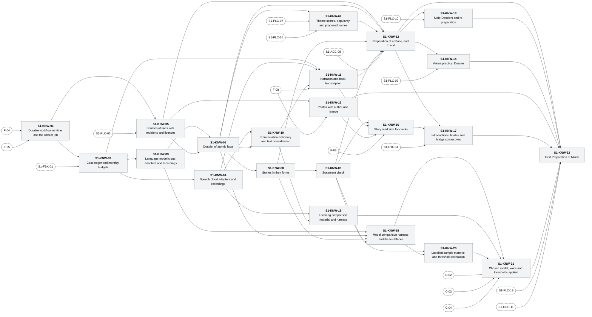
<!-- prettier-ignore-end -->
<!-- /generated -->

### S1-KNW-01 · Durable workflow runtime and the worker job

- **Status:** todo
- **Depends on:** F-04, F-05
- **Needs:** A port that starts the worker job (Cloud Run job execution in the cloud, `docker compose run` locally) from the API; the direct database connection for the worker.
- **Requirements:** `KNW-2`, `KNW-3`, `NFR-12`, `NFR-6`
- **Decisions:** ADR-0012 (points 1–4, 7, 8), ADR-0024 (rules 1, 2), ADR-0003 (point 2), ADR-0027 (point 7)

**Goal.** The worker runs DBOS durable workflows from a Postgres queue until the queue is empty, then exits. The API enqueues a workflow and starts the worker, a workflow identifier de-duplicates concurrent starts, and nothing polls while idle.

**Tasks**

- [ ] Add the DBOS TypeScript library pinned to a version, with its tables owned by the worker's module and migrated by the library.
- [ ] Replace the placeholder in `worker.ts`: launch, drain the queues, shut down, exit. Use the direct connection.
- [ ] Add an enqueue-and-start call for modules. It enqueues with a given workflow identifier and starts the worker through the job-start port.
- [ ] Write a test workflow with five steps, each writing content-hashed output, and a harness that kills the worker process at each step and restarts it.
- [ ] Add a harness that starts the same workflow ten times concurrently.
- [ ] Assert that an idle worker process makes no database query after it has exited, and that the API holds no queue connection.

**Done when**

- Ten concurrent starts with one identifier produce one execution (Preparation suite of ADR-0027 point 7, on the test workflow).
- Killing the worker at each step and restarting it finishes the workflow with no duplicated or corrupted output.
- `docker compose run --rm worker` with an empty queue exits with code 0.

### S1-KNW-02 · Cost ledger and monthly budgets

- **Status:** todo
- **Depends on:** S1-KNW-01, S1-FBK-01
- **Needs:** The notification outbox for the "budget exceeded" alert; the Administrator role for changing a budget.
- **Requirements:** `KNW-19`, `NFR-22`
- **Decisions:** ADR-0012 (points 5, 6), ADR-0024 (rules 6, 7), ADR-0004 (point 7), ADR-0014 (points 7, 8)

**Goal.** Every paid call through a model or speech port is metered into a cost ledger: provider, model, task, Place, tokens, characters or audio seconds. A monthly budget per provider and quantity is a hard stop.

**Tasks**

- [ ] Add the ledger and budget tables. Keep them with the ports rather than inside `knowledge`, so that Wish interpretation by the planning track is metered by the same ledger.
- [ ] Wrap each port in a metering decorator that writes one row per call with the task and, when given, the Place.
- [ ] Check the budget before a call. A step that would exceed it is not started, and the workflow waits for the next period or a raised budget.
- [ ] Raise one alert through the outbox when a budget is reached.
- [ ] Add the budget per Place that an Administrator sets (`NFR-22`): after each Preparation compare the cost of the Place with it, and raise one alert through the outbox when it is exceeded.
- [ ] Record the other components of `KNW-19`: source requests ("search") per Place, and Curator review time per Place from console actions.
- [ ] Expose cost per Place and per component, and the state of every budget.

**Done when**

- With a budget set below one call's cost, the step is not started, the workflow waits, and one alert is emitted; raising the budget lets it resume.
- The cost of a replayed Preparation of a fixture Place is reported per component.

### S1-KNW-03 · Language-model cloud adapters and recordings

- **Status:** todo
- **Depends on:** S1-KNW-02
- **Needs:** Secrets in the cloud environment for the Groq key; the Vertex AI service enabled on the Google Cloud project.
- **Requirements:** `NFR-23`
- **Decisions:** ADR-0004 (points 1, 2, 5, 6, 9–12), ADR-0027 (points 6, 12)

**Goal.** The `LanguageModel` port has a Vertex AI adapter and an OpenAI-compatible adapter (Groq first). Configuration maps each task to a model, and a recorder mode writes recordings in the replay format.

**Tasks**

- [ ] Write the Vertex AI adapter with JSON-schema output, reporting model, version and usage.
- [ ] Write the OpenAI-compatible adapter with a configurable address and key, strict JSON-schema output, and "retry after" obeyed.
- [ ] Map each task to an adapter and model in configuration, including a judge of a different family from the generator.
- [ ] Add a recorder mode that calls a cloud adapter and writes `recordings/language-model/<key>.json` in the documented format. It refuses to record a request containing anything that looks like a key, an identifier of a person or a precise location.
- [ ] Add a test double with failure, timeout and slow-answer modes, and the degraded behaviour: steps wait and resume.
- [ ] Test the adapters against recorded HTTP exchanges, so that no test calls a provider.

**Done when**

- The fault-injection suite of ADR-0027 point 6 passes for the language-model port.
- Switching a task from one adapter to the other is a configuration change, with a test that runs the same task through both on recordings.
- A test proves that the recorder refuses a request carrying an e-mail address or coordinates.

**Owner only.** Create the Groq account, enable Vertex AI, and store the keys. Any real recording run is started by the owner with their key.

### S1-KNW-04 · Speech cloud adapters and recordings

- **Status:** todo
- **Depends on:** S1-KNW-02
- **Needs:** Secrets and the Text-to-Speech service enabled in the cloud project.
- **Requirements:** `NFR-23`, `KNW-11`
- **Decisions:** ADR-0014 (points 1, 4, 5, 7), ADR-0027 (points 6, 12)

**Goal.** `SpeechSynthesis` has a Google Cloud Text-to-Speech adapter that turns pronunciation hints into SSML (with respelling as the fallback inside the adapter). `SpeechRecognition` has a hosted Whisper adapter on Groq that returns word timings. Both have recorder modes and fault doubles.

**Tasks**

- [ ] Write the synthesis adapter, which returns AAC mono in M4A and translates hints into `<phoneme>` or stressed spelling according to configuration.
- [ ] Implement the respelling fallback, switched by configuration, which keeps the displayed text unchanged.
- [ ] Write the recognition adapter, returning the text and word-level timings.
- [ ] Add recorder modes that write `recordings/speech-synthesis` and `recordings/speech-recognition` in the documented format.
- [ ] Add test doubles with failure, timeout and slow-answer modes.

**Done when**

- The fault-injection suite of ADR-0027 point 6 passes for both speech ports.
- The adapters pass tests against recorded HTTP exchanges, and the replay adapters serve the recorder's output unchanged.

**Owner only.** Enable the speech service and store the keys. Real recordings are made by the owner.

**Room to improve.** An adapter for an open speech model as the second, replaceability-proving synthesis adapter of ADR-0014 point 1.

### S1-KNW-05 · Sources of facts with revisions and licences

- **Status:** todo
- **Depends on:** S1-KNW-01, S1-PLC-05
- **Requirements:** `KNW-4`, `KNW-20`, `NFR-19`
- **Decisions:** ADR-0011 (points 3, 5, 9, 11), ADR-0012 (point 11), ADR-0030 (point 9)

**Goal.** The "collect" step of Preparation reads the records the base of Places holds for a Place. It fetches only what is missing (Wikipedia articles in Belarusian, Russian and English, and heritage bank records) and stores each source with its revision or retrieval date and licence.

**Tasks**

- [ ] Add the knowledge module's source table: kind, address, language, revision identifier, retrieval date, licence, and content hash.
- [ ] Read the Place's gathered records through `places/index.ts`.
- [ ] Fetch missing article revisions through the Sources' official interfaces, with the shared client's identification and limits, caching by revision.
- [ ] Strip article markup into plain text with section boundaries for extraction.
- [ ] Add test doubles serving recorded articles in all three languages, including a Belarusian-only Place.

**Done when**

- Collecting for a fixture Place stores every source with revision, date and licence, and a repeated collect fetches nothing new.
- With the Source double failing, the step waits and resumes, and nothing already stored changes.

### S1-KNW-06 · Dossier of atomic facts

- **Status:** todo
- **Depends on:** S1-KNW-03, S1-KNW-05
- **Requirements:** `KNW-4`, `KNW-5`, `KNW-14`, `KNW-20`
- **Decisions:** ADR-0012 (points 2, 9), ADR-0004 (points 4, 9), specification §3.3 and the edge cases of §4.4

**Goal.** A Dossier per Place holds atomic facts. Each fact has one or more confirming sources, theme tags and a sensitivity flag, with contradictions noted. The Dossier is draft when compiled and verified only through a Curator.

**Tasks**

- [ ] Add the Dossier, fact and fact–source tables. A Dossier has a version and a state (draft or verified), and a Place carries a sensitivity flag with its category.
- [ ] Write the extraction step: the language model reads source text in any of the three languages and returns facts as JSON, each citing the source passage. The model and version are recorded.
- [ ] Admit a fact only if a cited source confirms it. When sources contradict each other, admit the fact with the contradiction noted, or drop it.
- [ ] Flag facts and the Place as sensitive by category (war, repression, contested twentieth-century history, religion, living persons), from the model's labels and the Place's tags.
- [ ] Never change a verified Dossier in a workflow: a re-preparation produces a proposal for the Curator's queue.
- [ ] Expose the Dossier, its state and Coverage inputs through `knowledge/index.ts`.

**Done when**

- On replayed extraction for fixture Places, every stored fact has at least one source with revision, date and licence, and a fact without a source is rejected.
- A test shows that a workflow run on a verified Dossier changes no fact and creates one proposal.
- A Belarusian-only fixture Place gets facts usable for Russian and English Stories.

### S1-KNW-07 · Theme scores, popularity and proposed names

- **Status:** todo
- **Depends on:** S1-KNW-06, S1-PLC-07, S1-PLC-15
- **Needs:** The fixed list of themes shared with the Profile.
- **Requirements:** `KNW-20`, `NFR-26`
- **Decisions:** ADR-0015 (points 1, 2), ADR-0012 (point 12), ADR-0030 (point 19)

**Goal.** Preparation scores a Place on every theme from its Dossier and proposes its name in each output language that no Source supplies. The scores reach the next city version, and the names reach the base as generated names.

**Tasks**

- [ ] Write the scoring step: integer scores per theme with the model version, adjustable later by a Curator.
- [ ] Make the city version read model scores where they exist, replacing the fallback score in the next version.
- [ ] Write the name-proposal step for output languages with no Source name, sent to the places module as a generated name.
- [ ] Seed pronunciation dictionary entries for the proposed name (handed to S1-KNW-10 through the dictionary's interface once it exists).

**Done when**

- After a replayed Preparation of a fixture Place, the next city version carries its model scores with the model version, and its English name is marked generated.

### S1-KNW-08 · Stories in their forms

- **Status:** todo
- **Depends on:** S1-KNW-06
- **Requirements:** `KNW-6`, `KNW-7`, `KNW-8`, `KNW-10`, `KNW-20`
- **Decisions:** ADR-0013 (point 1), ADR-0016 (point 1), ADR-0015 (point 6), ADR-0004 (point 9)

**Goal.** From the Dossier alone, Preparation generates per output language a Place Story, thematic "More" blocks and bridge fragments. Each is a list of sentences labelled factual or non-factual, and factual ones cite fact identifiers. A Place without confirmed facts gets nothing.

**Tasks**

- [ ] Add the Story table: form, Place, language, sentences with labels and fact identifiers, theme tags of "More" blocks, the model and version, and the state (not verified or verified).
- [ ] Write the generation step for the Place Story with a hook first. Check its length automatically against the target (about 90 seconds, 250–300 words) and retry or withhold when outside it.
- [ ] Generate "More" blocks tagged with themes from the fixed list.
- [ ] Generate bridge fragments (the spoken name and a one- or two-sentence teaser). A sensitive Place whose Dossier is not verified gets a name-only fragment.
- [ ] Generate nothing for a Place without confirmed facts, and record why.
- [ ] Mark a Story that changed after its Dossier was verified as not verified, except for changes caused by the Curator's own edit.

**Done when**

- On replay, every factual sentence of every generated Story cites at least one fact of its own Dossier, and a Place without facts has no Story in either language.
- The length check rejects a recorded Story outside the target.
- A sensitive unverified fixture Place has no teaser.

### S1-KNW-09 · Statement check

- **Status:** todo
- **Depends on:** S1-KNW-08
- **Requirements:** `KNW-8`, `KNW-9`, `KNW-16`, `NFR-18`, `NFR-23`
- **Decisions:** ADR-0013 (points 1–7), ADR-0004 (point 5), ADR-0027 (point 12)

**Goal.** Behind a verifier port, each factual sentence is checked against its cited facts. A multilingual entailment model runs under ONNX in the worker, and sentences between two thresholds go to a judge of another model family. Failed sentences are removed, a Story with too little left is withheld, and non-factual sentences are spot-checked.

**Tasks**

- [ ] Define the statement-verifier port, and write its entailment-then-judge implementation.
- [ ] Run the multilingual entailment model under ONNX Runtime for Node in the worker. Pin the model file by hash, and load it from the image or from the private bucket.
- [ ] Make both thresholds and the minimum Story length configuration, with provisional values until C-04.
- [ ] Route sentences between the thresholds to the judge task through the `LanguageModel` port, with the sentence and cited facts only.
- [ ] Remove failed sentences. Withhold a Story that falls below the minimum or loses its hook, and record the reason.
- [ ] Spot-check non-factual sentences for numbers, dates and names with the entailment model.
- [ ] Compute the automatic measure of `NFR-18` (the share of factual statements with a Dossier fact) per Story and over a set.

**Done when**

- On recorded sentences, a smuggled date in a "non-factual" sentence is caught, a contradicted sentence is removed, and a Story reduced below the minimum is withheld.
- The automatic `NFR-18` measure is reported for a replayed set.
- The judge runs on a model family different from the generator's, by configuration, and a test fails if they are the same.

**Room to improve.** Cache entailment results by sentence and fact hash, so that regenerated Stories recheck only new sentences.

### S1-KNW-10 · Pronunciation dictionary and text normalisation

- **Status:** todo
- **Depends on:** S1-KNW-04, S1-KNW-06
- **Requirements:** `KNW-12`
- **Decisions:** ADR-0014 (points 2, 3, 6)

**Goal.** Our own pronunciation dictionary holds, per entity and language, the stressed spelling and an optional phonetic reading. Text is normalised and the entries applied before synthesis, and a correction regenerates every affected Narration.

**Tasks**

- [ ] Add the dictionary table (entity, language, written form, stressed spelling, phonetic reading, origin, unknown-stress flag) and per-Story overrides for an ordinary word.
- [ ] Seed entries from the stress marks in the lead of Russian articles where present. Otherwise flag the stress as unknown, which marks the Story for listening.
- [ ] Write the normaliser for numbers, dates, years, Roman numerals and abbreviations in Russian and English.
- [ ] Apply entries as `PronunciationHint`s to the synthesis request.
- [ ] On a correction, find every Narration that contains the entity and enqueue its regeneration.

**Done when**

- A test changes one entry and finds exactly the Narrations containing that entity enqueued for regeneration.
- The normaliser turns the abbreviation-and-numbers line of the listening material (report 06 §8.3, line 26) into the expected spoken text.

### S1-KNW-11 · Narration and back-transcription

- **Status:** todo
- **Depends on:** S1-KNW-02, S1-KNW-04, S1-KNW-10, F-08
- **Needs:** The `ObjectStore` port (private bucket).
- **Requirements:** `KNW-11`, `KNW-13`
- **Decisions:** ADR-0014 (points 4, 5, 7, 8), ADR-0010 (points 3, 5), ADR-0012 (point 8)

**Goal.** Every Story has a Narration in Russian and English, stored content-addressed in the private bucket. Each Narration is transcribed back, its word timings are stored, and mismatches with the text are flagged for the Curator.

**Tasks**

- [ ] Write the synthesis step per Story and language, stopping at the synthesis budget.
- [ ] Store audio under its content hash, so a repeated step overwrites nothing.
- [ ] Write the back-transcription step and store word timings with the Narration for the text that follows the audio.
- [ ] Compare the transcript with the normalised text and flag mismatching words for the Curator.
- [ ] Keep the Story text always alongside the Narration in the read model.

**Done when**

- On replay, each fixture Story has a Narration in both languages, with timings, in the local private bucket.
- A recorded transcript with a substituted name produces one flag.
- A synthesis budget of zero stops the step and leaves the Story with text and no audio.

### S1-KNW-12 · Preparation of a Place, end to end

- **Status:** todo
- **Depends on:** S1-KNW-05, S1-KNW-06, S1-KNW-07, S1-KNW-08, S1-KNW-09, S1-KNW-11, S1-ACC-08
- **Needs:** The entitlement check for "Preparation beyond the free quota" exists as an interface (open access on).
- **Requirements:** `KNW-1`, `KNW-2`, `KNW-3`
- **Decisions:** ADR-0012 (points 1, 2, 7, 9, 11), ADR-0027 (point 7)

**Goal.** One durable workflow per Place and Dossier version chains collect, extract, score, name, generate, check, synthesise and transcribe. It can be started for a city, an area or a list of Places, shows progress and failures, and resumes after a failure.

**Tasks**

- [ ] Compose the workflow from the steps, with the identifier "Place plus Dossier version".
- [ ] Add start for a city, an area or a list of Places, skipping Places whose result is current.
- [ ] Expose progress, failures and the last step reached per Place from workflow state.
- [ ] Isolate failure: one Place failing leaves the others running and existing data intact.
- [ ] Queue a Correction that arrives during re-preparation against the new version.

**Done when**

- The Preparation suite of ADR-0027 point 7 passes on the real workflow with replayed ports: ten concurrent starts yield exactly one Dossier and one set of Stories, and killing the worker at each step and restarting it finishes without duplicates or corruption.
- A batch of the fixed town's Places where one Place's double fails completes for the rest.

### S1-KNW-13 · Stale Dossiers and re-preparation

- **Status:** todo
- **Depends on:** S1-KNW-12, S1-PLC-10
- **Requirements:** `KNW-1`, `KNW-3`
- **Decisions:** ADR-0011 (point 6), ADR-0012 (point 9), specification §4.4 rules on freshness

**Goal.** Article revisions are compared monthly by a Freshness Check row. A material change, or an accepted Correction, marks a Dossier stale. A stale draft is re-prepared, and a stale verified Dossier goes to the Curator as a proposal.

**Tasks**

- [ ] Add the monthly article-revision Freshness Check row and its comparison.
- [ ] Define "material change" as configuration (share of changed text, and changed sentences containing cited passages).
- [ ] Mark the Dossier stale and enqueue its re-preparation, or a proposal when it is verified.

**Done when**

- Two recorded revisions, one cosmetic and one material, mark only the material one stale, and a verified Dossier is not changed by the re-preparation.

### S1-KNW-14 · Venue practical Dossier

- **Status:** todo
- **Depends on:** S1-KNW-12, S1-PLC-09
- **Requirements:** `KNW-18`
- **Decisions:** specification §3.3

**Goal.** A selected Venue gets a short practical Dossier (what it is, price level if known, hours) and a one-line "why here", and no historical Story.

**Tasks**

- [ ] Add the Venue variant of Preparation, which builds the practical facts from the base of Places and generates the "why here" line.
- [ ] Prevent the Place Story, "More" and teaser forms for Venues.
- [ ] Prepare only Venues the Curator has selected.

**Done when**

- A selected fixture Venue gets a practical Dossier and a "why here" in both languages and no Story, and an unselected Venue gets nothing.

### S1-KNW-15 · Photos with author and licence

- **Status:** todo
- **Depends on:** S1-KNW-05, F-08
- **Needs:** The `ObjectStore` port (public bucket).
- **Requirements:** `KNW-17`, `NFR-19`
- **Decisions:** ADR-0011 (point 4), ADR-0010 (points 3, 5)

**Goal.** A Place can have photos from Wikimedia Commons, copied content-addressed into the public bucket at fixed sizes, each with author, licence and source page.

**Tasks**

- [ ] Fetch Commons file metadata (author, licence, page) for the Place's linked image, and refuse files without a licence that allows reuse.
- [ ] Resize to fixed sizes and store under content hashes.
- [ ] Expose photos with attribution through `knowledge/index.ts`.

**Done when**

- Every stored photo of the fixed town has author, licence and source, and a fixture file with an unknown licence is refused.

### S1-KNW-16 · Story read side for clients

- **Status:** todo
- **Depends on:** S1-KNW-09, S1-KNW-11, S1-KNW-15, F-03
- **Needs:** The error envelope and API versioning; the Route Pack and Route Page tracks consume this read side.
- **Requirements:** `KNW-14`, `KNW-15`, `KNW-16`, `NFR-20`
- **Decisions:** ADR-0013 (point 1), ADR-0016 (point 1), ADR-0025

**Goal.** The knowledge module offers what clients show of a Place: Story text per sentence with its sources one tap away, the "generated automatically" mark with "verified by a Curator" or "not verified", Narration references with timings, and photos. It holds nothing for a sensitive Place whose Dossier is not verified.

**Tasks**

- [ ] Define the read contract in `packages/contracts`: sentences, the facts and sources behind each, labels, Narration blob hashes and timings, and photos.
- [ ] Withhold every Story form of a sensitive Place until its Dossier is verified, in both languages.
- [ ] Exclude withheld Stories and Places without facts, with the reason available to the console.

**Done when**

- A sensitive, unverified fixture Place appears with no Story in both languages, and gets its Stories after verification (acceptance of §4.4).
- Every factual sentence returned resolves to at least one source with licence.

### S1-KNW-17 · Introductions, finales and bridge connectives

- **Status:** todo
- **Depends on:** S1-KNW-12, S1-KNW-16, S1-RTE-11
- **Needs:** The planning track signals that a Route was chosen (with its version and Places); the Route Pack track adds the results to the Pack; the notification outbox tells the person that Stories are ready (`NTF-1`).
- **Requirements:** `KNW-7`, `KNW-11`
- **Decisions:** ADR-0016 (points 1–5), ADR-0013, ADR-0014

**Goal.** A fixed set of connective phrases is voiced once per language. For a chosen Route, the worker generates, checks and voices an introduction and a finale from the facts of its Places, leaving out sensitive unverified Places.

**Tasks**

- [ ] Write the connective phrases per language as data, marked non-factual, and synthesise them once.
- [ ] Add the Route workflow: generate the introduction and finale from the Places' facts, check them, synthesise them, and hand them to the Route Pack.
- [ ] Leave the facts of sensitive unverified Places out of both.
- [ ] Mark the result as tied to its Route version, so that a changed Route falls back to assembled ones.

**Done when**

- For a replayed chosen Route of the fixed town, the introduction and finale exist in both languages with Narration, and none cites a fact of the sensitive unverified Place.
- Their cost is recorded per Route in the ledger.

### S1-KNW-18 · Model comparison harness and the ten Places

- **Status:** todo
- **Depends on:** S1-KNW-03, S1-KNW-06, S1-KNW-08, S1-KNW-09
- **Requirements:** `KNW-20`, `NFR-18`
- **Decisions:** ADR-0004 (points 4, 11)

**Goal.** A command runs extraction, generation and the statement check for the ten Places of report 06 §8.2 (and its reserve) on two configured models. It writes a report the owner reads: facts from Belarusian sources, the share of statements surviving the check, the Stories side by side, and cost.

**Tasks**

- [ ] Add the ten Places and the reserve as a data file outside the product's code (data, not code).
- [ ] Write the harness that runs both configurations, caches responses by model and prompt, and refuses to run past a cost cap.
- [ ] Write a Markdown report of facts per source language, surviving share, Stories in both languages and cost (a document, not a page).
- [ ] Test the harness on replayed responses.

**Done when**

- The harness produces the full report from replayed responses with no network.
- A real run is one command, needs only the owner's keys, and stops at its cost cap.

**Owner only.** Run the comparison with real models (cents) and read the report; this is check C-02.

### S1-KNW-19 · Listening comparison material and harness

- **Status:** todo
- **Depends on:** S1-KNW-04, S1-KNW-10
- **Requirements:** `KNW-12`, `KNW-11`
- **Decisions:** ADR-0014 (point 6)

**Goal.** A command synthesises the thirty lines of report 06 §8.3 in each candidate Google voice family, with and without pronunciation hints. It writes a blind listening set: audio files under shuffled names, a marking sheet (CSV) and a separate key file. Files from an open model that the owner supplies are shuffled in the same way.

**Tasks**

- [ ] Add the thirty lines with their sourced stresses as a data file.
- [ ] Write the harness to synthesise each line per voice family, with hints on and off, within the free quota, and cap the characters.
- [ ] Write the blind set: shuffled file names, a marking sheet, and the key in a separate file that the harness reveals only after marking. Build no page: this is data only.
- [ ] Test it on replayed audio.

**Done when**

- The set is built from replayed audio with no network, and neither the file names nor the sheet reveal the key.

**Owner only.** Produce the open-model samples, run the real synthesis, listen and mark; this is check C-03.

### S1-KNW-20 · Labelled sample material and threshold calibration

- **Status:** todo
- **Depends on:** S1-KNW-09, S1-KNW-18
- **Requirements:** `NFR-18`, `KNW-9`
- **Decisions:** ADR-0013 (point 6), ADR-0027 (point 13)

**Goal.** Sentence–fact pairs in Russian and English are drawn from the comparison output into a labelling sheet. A calibration command sets the two thresholds from the labels and reports agreement and the first reading of `NFR-18`.

**Tasks**

- [ ] Draw a stratified sample of sentence–fact pairs in both languages from the comparison's output, covering pass, fail and borderline cases.
- [ ] Write the labelling sheet as a CSV file with, in each row, the sentence, its cited facts and the passage of the source each fact came from. Two links are labelled (supports, does not support, partly): sentence to fact, and fact to source — `NFR-18` asks whether the source supports the statement. Build no page: this is data only.
- [ ] Write the calibration command, which picks thresholds for the target precision and reports agreement of the automatic check with the labels and the lower bound of the confidence interval.

**Done when**

- The calibration command runs on a synthetic labelled file and outputs thresholds and agreement.

**Owner only.** Label the sample; this is check C-04.

### S1-KNW-21 · Chosen model, voice and thresholds applied

- **Status:** todo
- **Depends on:** S1-KNW-18, S1-KNW-19, S1-KNW-20, C-02, C-03, C-04
- **Requirements:** `NFR-18`, `KNW-9`, `KNW-12`
- **Decisions:** ADR-0004 (points 4, 5), ADR-0013 (point 6), ADR-0014 (points 6, 8)

**Goal.** The model of C-02, the voice family and hint mode of C-03, and the thresholds of C-04 are the configuration of Preparation, and the recordings of the fixed town are regenerated to match.

**Tasks**

- [ ] Set the task-to-model configuration for extraction, scoring, naming and generation, and set the judge to a different family.
- [ ] Set the voice per language and the hint mode (SSML or respelling) from C-03.
- [ ] Set the thresholds and minimum length from C-04, and record the first reading of `NFR-18` in the ADR's "measured since" list through a pull request the owner approves.
- [ ] Replace the synthetic recordings the fixed town's tests rely on with ones shaped like the chosen model's outputs.

**Done when**

- Every suite passes with the new configuration on replay, and the configuration names the C-02 model, the C-03 voices and the C-04 thresholds.

**Owner only.** If C-03 shows that ordinary-word stress needs an automatic step, decide whether to add the small Python job of ADR-0003 point 7. That is a separate package not drafted here.

### S1-KNW-22 · First Preparation of Minsk

- **Status:** todo
- **Depends on:** S1-KNW-12, S1-KNW-13, S1-KNW-14, S1-KNW-15, S1-KNW-17, S1-KNW-21, S1-PLC-19, S1-CUR-11
- **Needs:** The cloud environment with the worker as a Cloud Run job.
- **Requirements:** `KNW-1`, `KNW-19`, `NFR-22`
- **Decisions:** ADR-0012, ADR-0024 (spending envelope), ADR-0014 (point 8)

**Goal.** Preparation of the first city's area runs in the cloud with real providers inside the monthly budgets, and the Curator receives Dossiers in the verification queue.

**Tasks**

- [ ] Set the monthly budgets per provider from the spending envelope of ADR-0024.
- [ ] Start Preparation for the first area from the console and let synthesis follow the free quota.
- [ ] Measure the cost per Place and per component, the database size after the run and the compute hours used, and record them beside the estimates of ADR-0004, ADR-0010 and ADR-0012.

**Done when**

- The console shows cost per Place and component for the prepared Places, and no budget was exceeded.
- The measured figures are written down beside the estimates.

**Owner only.** Approve the spend and start the run. Verifying Dossiers is the Curator's work, done by the owner.

## S1-CUR — The internal console for stage S1

This track turns the console stub in `apps/console` into the Curator's and Administrator's tool for stage S1. A foundation comes first: sign-in with an internal role, the API client on the shared contracts, a map, and an audit entry for every action. Then come the screens over the base of Places (Place editor, merge, split and history, the queue of Proposed Changes, Sources and Freshness Checks, Venue selection) and over knowledge (verification queue, Dossier editor, pronunciation editor, Corrections inbox, Preparation control). Dashboards and administration follow. The track ends with SC-5 and SC-6 passing through the console alone.

<!-- generated:track S1-CUR -->
<!-- prettier-ignore-start -->
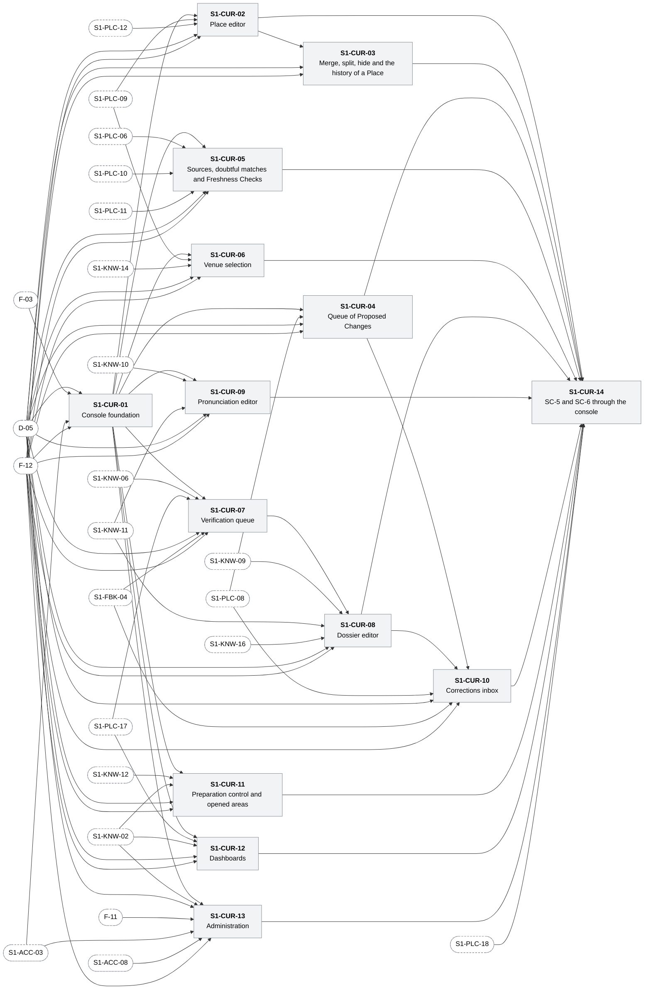
<!-- prettier-ignore-end -->
<!-- /generated -->

### S1-CUR-01 · Console foundation

- **Status:** todo
- **Depends on:** D-05, F-03, S1-ACC-03, F-12
- **Needs:** Sign-in and internal roles (Curator, Administrator) with a guard for console endpoints; the audit-log write interface; the error envelope and the API contract conventions; the console application shell (stub exists); a module `console` in the API is allowed by the module rules.
- **Requirements:** `CUR-9`
- **Decisions:** ADR-0007 (console separate), ADR-0003 (point 1), ADR-0008 (point 2), ADR-0025

**Goal.** The console signs a person in, shows only what their internal roles allow, calls the API through typed clients generated from the shared contracts, renders a MapLibre map from the city's PMTiles, and writes an audit entry for every action.

**Tasks**

- [ ] Add routing, layout and navigation by role, and the role guard on the API's console endpoints.
- [ ] Add a typed API client validated against `packages/contracts`, with the error envelope handled.
- [ ] Add a map component with MapLibre GL JS reading the city version's PMTiles and showing OpenStreetMap attribution.
- [ ] Add a server-side check that fails any console endpoint without an audit-log write (a test that enumerates the routes).
- [ ] Add interface texts to `packages/i18n` in both languages.

**Done when**

- A person without an internal role is refused by every console endpoint.
- The route-enumeration test finds no console action without an audit entry.

### S1-CUR-02 · Place editor

- **Status:** todo
- **Depends on:** S1-CUR-01, S1-PLC-09, S1-PLC-12, D-05, F-12
- **Requirements:** `CUR-5`, `PLC-9`, `PLC-1`
- **Decisions:** ADR-0030 (points 3, 4), ADR-0031 (point 2), ADR-0029 (point 8)

**Goal.** A Curator edits a Place on a map: Territory boundary, Entrances, Access Rules with confidence, kind, outside or inside, manual flag, trigger radius, parking points, and names per language. The Curator sees each attribute's source, licence and last-checked date, and the resolved intervals.

**Tasks**

- [ ] Add the Place page with all attributes, each showing provenance, licence and last confirmation.
- [ ] Add drawing and editing of Territory boundaries and Entrances on the map.
- [ ] Add the Access Rules editor with a preview of the resolved intervals for the next two weeks.
- [ ] Add edits for kind, outside or inside, manual flag, trigger radius, the parking points per Travel Mode, and names with their marks.
- [ ] Save each edit through S1-PLC-09 as an accepted change record.

**Done when**

- An integration test edits each attribute through the console API and finds an accepted change record and an audit entry for each.
- Every attribute shown can be traced to its source in the console (acceptance of §4.3).

### S1-CUR-03 · Merge, split, hide and the history of a Place

- **Status:** todo
- **Depends on:** S1-CUR-02, D-05, F-12
- **Requirements:** `CUR-12`, `PLC-11`, `PLC-12`
- **Decisions:** ADR-0031 (points 5, 21), ADR-0030 (point 2)

**Goal.** The Place page shows the Place's history with undo, and the Curator can merge two Places, split one, and hide or unhide a Place.

**Tasks**

- [ ] Show the history of a Place: change records in order, with origin, evidence and state.
- [ ] Add undo where allowed, with the reason shown where it is refused.
- [ ] Add merge (pick a duplicate on the map), split, and hide or unhide, each with a confirmation.

**Done when**

- An integration test merges, splits, hides and undoes through the console API, and the history shows each step.

### S1-CUR-04 · Queue of Proposed Changes

- **Status:** todo
- **Depends on:** S1-CUR-01, S1-PLC-08, D-05, F-12
- **Requirements:** `CUR-12`, `PLC-13`
- **Decisions:** ADR-0031 (points 6, 12, 13, 21)

**Goal.** The Curator works through Proposed Changes grouped by Place and by run and ordered by Key Place, popularity and age. Evidence is shown beside the current value, and the Curator can accept, reject, edit and accept, batch-accept a group of one low-risk sort, or release a held run.

**Tasks**

- [ ] Add the queue view with grouping, ordering and filters (area, origin, kind).
- [ ] Show evidence beside the current value, with origins that disagree side by side.
- [ ] Add accept, reject, edit-and-accept, batch-accept of a low-risk group, and release or discard of a held run.

**Done when**

- An integration test on the fixed town accepts, rejects, edits and batch-accepts through the console API, with the expected change records and audit entries.

### S1-CUR-05 · Sources, doubtful matches and Freshness Checks

- **Status:** todo
- **Depends on:** S1-CUR-01, S1-PLC-06, S1-PLC-10, S1-PLC-11, D-05, F-12
- **Requirements:** `CUR-12`, `PLC-7`
- **Decisions:** ADR-0030 (points 10, 11), ADR-0031 (points 15, 17, 19, 21)

**Goal.** A Sources tab shows each Source with its licence, last run, records, share matched and errors. It also holds the queue of doubtful matches, the table of Freshness Checks with their switches, intervals, manual start and ledger, the website fragments to read, and the list of Places to check in person.

**Tasks**

- [ ] Add the Sources view from the ledger of runs.
- [ ] Add the doubtful-match queue: two records on a map, with match or keep-apart.
- [ ] Add the Freshness Check table: switch on or off, change interval, start now, and see the runs.
- [ ] Add the fragments from websites beside current hours, with "enter hours" and "dismiss".
- [ ] Add the list of Places to check in person, with confirm or correct.

**Done when**

- An integration test switches a Freshness Check, starts it by hand, decides a doubtful match and confirms a Place from the in-person list through the console API.

### S1-CUR-06 · Venue selection

- **Status:** todo
- **Depends on:** S1-CUR-01, S1-PLC-09, S1-KNW-14, D-05, F-12
- **Requirements:** `CUR-6`, `PLC-6`
- **Decisions:** ADR-0030 (point 3), ADR-0031 (point 22)

**Goal.** A Curator sees the Venues of an area on a map and in a list with hours and their known state. The Curator selects or deselects each Venue and sees the selected Venues' practical Dossiers and "why here".

**Tasks**

- [ ] Add the Venue view with filters by area and kind, and hours confidence shown.
- [ ] Add select and deselect, which enqueues the Venue Dossier on selection.
- [ ] Show the practical Dossier and "why here" of selected Venues.

**Done when**

- Selecting a fixture Venue through the console makes it appear in the next city version, and deselecting removes it.

### S1-CUR-07 · Verification queue

- **Status:** todo
- **Depends on:** S1-CUR-01, S1-KNW-06, S1-PLC-17, D-05, S1-FBK-04, F-12
- **Needs:** The count of open Corrections per Place from the feedback track.
- **Requirements:** `CUR-1`
- **Decisions:** ADR-0015 (point 7), ADR-0030 (point 17)

**Goal.** Draft Dossiers of opened areas wait in a queue ordered by expected popularity, sensitivity and open Corrections, with Key Places first.

**Tasks**

- [ ] Add the ordering as configuration over Key Place, popularity, sensitivity and open Corrections.
- [ ] Add the queue view with filters by area, kind and sensitivity, and the reason for each Place's rank.

**Done when**

- On the fixed town, the queue order matches the configured rule, and a sensitive Key Place with an open Correction comes first.

### S1-CUR-08 · Dossier editor

- **Status:** todo
- **Depends on:** S1-CUR-07, S1-KNW-09, S1-KNW-11, S1-KNW-16, D-05, F-12
- **Requirements:** `CUR-2`, `KNW-14`, `KNW-15`
- **Decisions:** ADR-0012 (point 9), ADR-0013, ADR-0015 (point 1), specification §4.4 rules

**Goal.** A Curator sees facts with their sources one click away, themes and sensitivity. The Curator adds, edits and removes facts, adjusts theme scores and proposed names, previews Stories per language with each sentence's facts and check result, regenerates Stories and Narration, listens with the text, and marks the Dossier verified.

**Tasks**

- [ ] Add the fact list with sources (address, revision, licence), themes, the sensitivity flag and the contradiction note.
- [ ] Add, edit and remove facts. Edits to a verified Dossier are Curator actions that mark dependent Stories for re-check.
- [ ] Add the Story preview per form and language, with per-sentence facts, check outcome and removed sentences.
- [ ] Add "regenerate Stories and Narration" for this Place, the Narration player with following text, and back-transcription flags.
- [ ] Add "mark verified", which records the Curator's review time for the cost ledger.
- [ ] Add theme-score adjustment and proposed-name editing.

**Done when**

- An integration test on a fixture Place removes a fact, regenerates on replay, finds the dependent sentence gone, and marks the Dossier verified.
- After verification, no workflow changes the Dossier (checked by re-running Preparation).

### S1-CUR-09 · Pronunciation editor

- **Status:** todo
- **Depends on:** S1-CUR-01, S1-KNW-10, S1-KNW-11, D-05, F-12
- **Requirements:** `CUR-3`, `KNW-12`, `KNW-13`
- **Decisions:** ADR-0014 (points 2, 3)

**Goal.** A Curator finds entries by entity and language, edits the stressed spelling or phonetic reading, plays a preview, and saves. Affected Narrations are regenerated, and back-transcription mismatches and unknown stresses are listed for review.

**Tasks**

- [ ] Add the entry list with filters (unknown stress, flagged by back-transcription).
- [ ] Add the editor with playback of a preview synthesis, which counts against the synthesis budget.
- [ ] Save, then show the Narrations enqueued for regeneration and their progress.
- [ ] Add a per-Story ordinary-word override.

**Done when**

- An integration test corrects an entry on replay and finds the regenerated Narration's request carrying the new hint (acceptance of §4.4, the audible check being the owner's).

### S1-CUR-10 · Corrections inbox

- **Status:** todo
- **Depends on:** S1-CUR-04, S1-CUR-08, S1-PLC-08, D-05, S1-FBK-04, F-12
- **Needs:** Corrections as filed by the feedback track (statement, its source, the claim, or a claim about a Place), and their status and outcome shown to the author by that track and the notifications track.
- **Requirements:** `CUR-7`
- **Decisions:** ADR-0031 (point 14), ADR-0012 (point 9)

**Goal.** A Curator sees Corrections in one inbox. A Correction about a Place opens as a Proposed Change. A Correction about a statement shows the sentence, its facts and sources and the claim, and leads into the Dossier editor. Each decision becomes the Correction's outcome.

**Tasks**

- [ ] Add the inbox as the Proposed-Change queue filtered by origin, plus statement Corrections from the knowledge module.
- [ ] Add the statement view (sentence, facts, sources, claim) with "fix the fact", "reject" and "accept without change".
- [ ] Record the outcome for the feedback track.

**Done when**

- An integration test of SC-6 on the fixed town: a Correction to a statement is fixed in the console, the Story and Narration are regenerated on replay, and the Correction carries its outcome.

### S1-CUR-11 · Preparation control and opened areas

- **Status:** todo
- **Depends on:** S1-CUR-01, S1-KNW-12, S1-KNW-02, D-05, F-12
- **Requirements:** `CUR-4`
- **Decisions:** ADR-0012 (point 7), ADR-0030 (point 15)

**Goal.** A Curator opens an area to a Curator, starts Preparation for a city, an area or a list of Places, and sees progress, failures and cost per Place. The Curator can resume a failed Preparation.

**Tasks**

- [ ] Add opening and closing an area to a Curator.
- [ ] Add starting Preparation by city, area (drawn or picked) or list, with an estimate from the ledger's averages.
- [ ] Add a progress view per Place: step, failure, cost and resume.

**Done when**

- An integration test starts Preparation for the fixed town through the console API on replay, sees each Place complete, fails one through its double, and resumes it.

### S1-CUR-12 · Dashboards

- **Status:** todo
- **Depends on:** S1-CUR-01, S1-PLC-17, S1-KNW-02, D-05, F-12
- **Requirements:** `CUR-8`, `PLC-10`, `PLC-14`, `NFR-22`
- **Decisions:** ADR-0024 (rule 7), ADR-0030 (point 11), ADR-0031 (point 21)

**Goal.** Dashboards show Coverage per city (the Curator's view of `PLC-10`), the freshness table by area and kind, and cost per Place against its budget, with room for the views that the feedback and operations tracks add.

**Tasks**

- [ ] Add Coverage per city and region, with areas reviewed by nobody marked.
- [ ] Add the freshness table by area and kind with its counts.
- [ ] Add cost per Place and per component against the budget an Administrator set (`NFR-22`).
- [ ] Leave named places in the dashboard area for the views of ratings and measures (`S1-FBK-07`) and of operations (`S1-OPS-07`), which those packages fill.

**Done when**

- On the fixed town after a replayed Preparation, every panel shows values equal to those the modules report, and a Place whose cost is above the budget per Place of `S1-KNW-02` is marked as such.

### S1-CUR-13 · Administration

- **Status:** todo
- **Depends on:** S1-CUR-01, S1-KNW-02, D-05, F-11, S1-ACC-03, S1-ACC-08, F-12
- **Needs:** Granting and revoking internal roles (identity track); Plans and what they grant, editable without a release (entitlements track); reading the audit log (identity track).
- **Requirements:** `CUR-9`
- **Decisions:** ADR-0012 (point 6), ADR-0024 (rule 6)

**Goal.** An Administrator grants and revokes internal roles, sets the limits on Preparation and the monthly budgets, edits what each Plan grants, and reads the audit log.

**Tasks**

- [ ] Add the roles view over the identity track's interface.
- [ ] Add limits on Preparation, monthly budgets per provider and quantity, and the budget per Place.
- [ ] Add the Plans editor over the entitlements track's interface.
- [ ] Add the audit log with filters by person, action and object.

**Done when**

- An integration test changes a budget, a limit, a role and a Plan's grant through the console API, and each change appears in the audit log.

### S1-CUR-14 · SC-5 and SC-6 through the console

- **Status:** todo
- **Depends on:** S1-CUR-02, S1-CUR-03, S1-CUR-04, S1-CUR-05, S1-CUR-06, S1-CUR-08, S1-CUR-09, S1-CUR-10, S1-CUR-11, S1-CUR-12, S1-CUR-13, S1-PLC-18
- **Needs:** The integration test harness of the pipeline (compose environment).
- **Requirements:** `CUR-1`, `CUR-2`, `CUR-3`, `CUR-4`, `CUR-7`
- **Decisions:** ADR-0027 (point 5), specification §4.11 acceptance

**Goal.** SC-5 and SC-6 pass on the fixed town through the console's API alone, with replayed models and speech, and every action is in the audit log.

**Tasks**

- [ ] Write the SC-5 scenario test: start Preparation, take Dossiers from the queue in order, fix a stress, remove a doubtful fact, play the Narration, and mark verified. The sensitive Place stays without a Story until then.
- [ ] Write the SC-6 scenario test from a filed Correction to its outcome.
- [ ] Assert that the audit log holds one entry per action of both scenarios.
- [ ] Add a browser-level smoke of the console's main screens in the pipeline.

**Done when**

- Both scenario tests pass in the pipeline's compose environment with no direct storage access.

**Owner only.** Walk SC-5 by hand in the console on the first city (§7.4).

## S1-RTE — From a request to a Route a person can keep

This track turns a request into Routes that are provably feasible and lets a person keep and change them. It starts with the shared description of a planning problem in `packages/contracts`. Pedestrian travel times (`routing`) and the independent verifier come next, because the planner is written against them. The planner follows in three steps: preselection and scoring, the iterated local search, then options with their explanations and the answer when nothing fits. The suites that gate every change then lock that behaviour in. After that come the server's planning API, Wish interpretation, Route versions and the collection, editing, the Profile, the screens for requesting and editing, and the public Route Page. The track ends with two hand-run yardsticks of quality. Throughout, Travel Mode is a parameter of every travel-time calculation and the request names a Party, of one member in S1 (specification §7.3).

<!-- generated:track S1-RTE -->
<!-- prettier-ignore-start -->
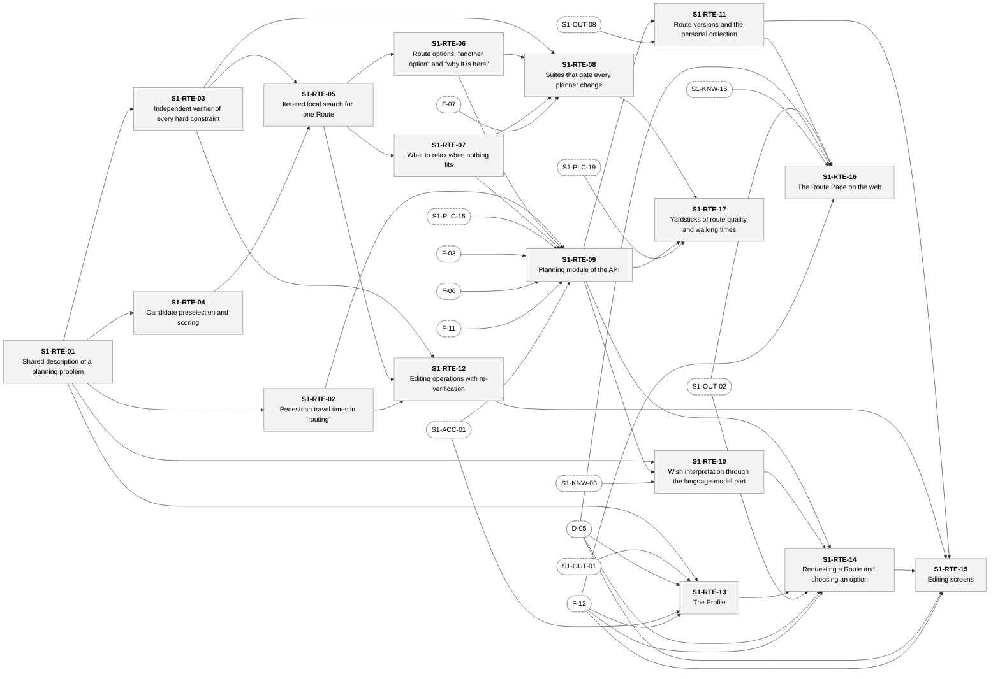
<!-- prettier-ignore-end -->
<!-- /generated -->

### S1-RTE-01 · Shared description of a planning problem

- **Status:** todo
- **Depends on:** —
- **Requirements:** `RTE-1`, `RTE-4`, `NFR-37`, `PTY-1`
- **Decisions:** ADR-0006 (points 2, 3, 4, 7, 11, 12), ADR-0009 (point 1), ADR-0015 (points 1–3, 7), ADR-0025 (points 2, 3, 5), ADR-0029 (points 3, 5)

**Goal.** `packages/contracts` holds the full, integer-only description of a planning problem and of its answer, which both the planner and the verifier are written against.

**Tasks**

- [ ] Replace the PLACEHOLDER types in `packages/contracts/src/planning.ts`. Define a problem as: a Travel Mode (`foot`, `bicycle`, `car`); a Party whose members each bring theme weights, Dealbreakers and pace (one member in S1); start and finish nodes; the start time and time budget in seconds; the buffer; whether going inside is allowed; the familiar ↔ unusual setting; whether Places with unknown hours are excluded; pinned Places; a Break request; the option number; and references to the city version, the score versions and the planner configuration.
- [ ] Define a candidate as: Place identifier, kind, seen-from-outside or visited-inside, status, visit seconds before pace, opening intervals already intersected with every Territory above it, hours confidence (known or unknown), the flags each Dealbreaker needs (alcohol, inside, stairs, paid entry, religious, cemetery or memorial), fixed-point theme scores, the popularity value and the manual flag. A Break option is a candidate of its own kind.
- [ ] Define the travel-time part of the problem: integer seconds between every pair of the problem's nodes (start, finish, candidates), with "no path" stated explicitly. The verifier may depend on `contracts` only, so it must find every travel time inside the problem.
- [ ] Define the answer: stops with arrival, start of visit and departure in seconds; legs with their travel seconds; Breaks; per-stop warnings (unknown hours, temporarily closed); per-stop "why" features (the leading themes and their contributions); and the option's character. Separately, define the infeasible answer: which constraint to relax and by how much.
- [ ] Define the closed list of violation codes that the verifier reports and an edited Route lists (`EDT-1`), and the stable error codes of the planning API in the envelope of ADR-0025.
- [ ] Write zod schemas for the wire form of the request and the answer. The wire request is a shape of its own, apart from the integer planning problem: a start or a finish arrives as a tagged value — a coarse cell, or a point the person picked on the map — and only the wire shape may hold a coordinate. Accept `bicycle` and `car` in the type but refuse them on the wire with a stable "travel mode not offered yet" code until S4.
- [ ] Add a test-only entry point that generates planning problems (fast-check arbitraries), so the planner's and the verifier's suites share one generator without the verifier importing the planner.
- [ ] Move the planner and verifier stubs and their tests onto the new types, keeping them passing.

**Done when**

- `pnpm lint` passes. `promenade/no-floating-point` and the import boundaries report nothing for `contracts`, `planner` and `verifier`.
- Every schema round-trips each generated problem and answer unchanged, and rejects a value with a fractional number in each integer field (a named test per schema).
- A request with Travel Mode `bicycle` or `car` is refused by the wire schema with the stable code.
- No type of the planning problem — what the planner and the verifier receive — has a field that can hold a coordinate; the wire request lives apart from it.

**Room to improve.** Generate the OpenAPI fragment for the planning endpoints from the schemas now rather than waiting for the API package.

### S1-RTE-02 · Pedestrian travel times in `routing`

- **Status:** todo
- **Depends on:** S1-RTE-01
- **Needs:** The format of the pedestrian graph and of the sparse matrix as the city-data build writes them. This package can start on a synthetic graph and adopt that format when it is fixed.
- **Requirements:** `RTE-4`, `PRF-4`, `NFR-2`, `NFR-37`
- **Decisions:** ADR-0009 (points 1–5, 8, 10), ADR-0006 (point 2)

**Goal.** `packages/routing` computes walking times and paths deterministically in integers, on the server and on the device, behind a travel-times port and a paths port that take the Travel Mode.

**Tasks**

- [ ] Define the compact graph in memory: nodes by index, edges with integer seconds and the attributes the planner needs (stairs at least). Write a loader from the city version's binary form.
- [ ] Implement shortest paths with an integer priority queue and explicit tie-breaking by node index, plus a variant that avoids stairs edges for the "no stairs" Dealbreaker.
- [ ] Apply pace as an integer percentage of walking time with one stated rounding rule, used by both the server and the device.
- [ ] Implement sparse-matrix lookup: a pair beyond the walking cut-off is "no path", never guessed and never free. Replaces the PLACEHOLDER `travelSeconds`.
- [ ] Implement the two ports with the Travel Mode as a parameter. `foot` is served; `bicycle` and `car` return a typed "mode not available" result.
- [ ] Cut a subgraph around a set of nodes by walking time (not by coordinates), for the Route Pack and for replanning on the device.
- [ ] Build the matrix among a problem's nodes for S1-RTE-01 from the sparse matrix plus on-demand searches from the start and the finish.

**Done when**

- Property tests over generated graphs: times are symmetric where edges are; the triangle inequality holds; the stairs-free time is never shorter than the unrestricted one; and the same query gives the same answer when the edges are given in a different order.
- A pair with no stored time and no path returns "no path" (named test).
- `promenade/no-floating-point` passes on `routing`. No function of the package takes latitude or longitude.
- A search from one node over a fixture graph of the size of the Minsk graph (about 11 MB) finishes, and its time is printed by a benchmark script (not a gate).

**Room to improve.** A bidirectional or contraction-based search if server latency demands it; a binary graph layout readable without copying.

### S1-RTE-03 · Independent verifier of every hard constraint

- **Status:** todo
- **Depends on:** S1-RTE-01
- **Requirements:** `RTE-6`, `RTE-4`, `RTE-5`, `RTE-13`, `NFR-1`
- **Decisions:** ADR-0006 (points 3, 7), ADR-0029 (point 3), ADR-0027 (point 1)

**Goal.** `packages/verifier` lists every hard constraint a Route breaks, written from the problem description alone, and is the guarantee behind every Route shown.

**Tasks**

- [ ] Recompute the schedule from the stops, the problem's travel times and the pace-scaled visit times. Never trust the planner's totals.
- [ ] Check: start and finish; time budget less the buffer; each visit inside one known opening interval from arrival to departure; Dealbreaker flags of every member; pinned Places present; each Place at most once; Travel Mode matches; a Break present when the problem requires one; a permanently closed Place never present; a temporarily closed Place never as an inside stop; a Place with unknown hours present only if not excluded, and then carrying its warning.
- [ ] Report each breach with its code, the stop and the size of the breach in seconds where it has one, so that an edited Route can say "over by 12 minutes" (`EDT-1`).
- [ ] Accept a Route marked as edited by hand and return its violations instead of rejecting it; the caller decides what to show.
- [ ] Write the nested-hours test from specification §3.2 and §4.3. A greenhouse inside a garden, closed on Mondays, is refused as a Monday stop and accepted on a Tuesday inside both sets of hours.

**Done when**

- Every violation code of S1-RTE-01 has at least one test that produces it and one that does not.
- The nested-hours test passes.
- `pnpm lint:boundaries` still proves that the verifier imports nothing but `contracts`.

### S1-RTE-04 · Candidate preselection and scoring

- **Status:** todo
- **Depends on:** S1-RTE-01
- **Requirements:** `RTE-14`, `PRF-2`, `RTE-3`, `RTE-13`
- **Decisions:** ADR-0006 (points 2, 12), ADR-0015 (points 1–3, 7)

**Goal.** The planner reduces any number of candidates to at most the configured limit (150) by a fixed rule, and scores each in fixed-point integers for the request.

**Tasks**

- [ ] Score a candidate for a Party member as the sum of the member's theme weights × the Place's theme scores, in fixed point. Like is positive, neutral is zero, dislike is a soft negative. Apply Wish adjustments as further weights.
- [ ] Apply the familiar ↔ unusual setting as a signed weight on the popularity value, which separates only the most-viewed quarter (ADR-0015, point 7).
- [ ] Exclude before the search: Dealbreaker flags; permanently closed Places; memorial plaques unless the request asks for them; Places with unknown hours when the person excluded them; inside Places when going inside is not allowed.
- [ ] Preselect: keep the pinned Places; keep the Places reachable within the budget from the start and to the finish; order by score, then popularity, then Place identifier; apply a ceiling per kind; cut at the limit.
- [ ] Put the score scale, the ceiling per kind and the limit in a versioned planner configuration, which is part of what makes a Route reproducible.

**Done when**

- On a generated problem of 709 candidates (the measured size of a three-hour area of Minsk), preselection returns at most 150, every pinned Place among them, no kind above its ceiling.
- Shuffling the candidate list never changes the preselection (property test, 1 000 runs).
- No excluded Place is ever preselected (property test over generated Dealbreakers and flags).

**Owner only.** Set the ceiling per kind and the weight of popularity after looking at real Routes of Minsk (ADR-0006, "Not verified").

### S1-RTE-05 · Iterated local search for one Route

- **Status:** todo
- **Depends on:** S1-RTE-03, S1-RTE-04
- **Requirements:** `RTE-3`, `RTE-4`, `RTE-5`, `RTE-11`, `RTE-15`, `NFR-2`
- **Decisions:** ADR-0006 (points 1–3, 12)

**Goal.** `packages/planner` builds one feasible Route by a seeded iterated local search with an iteration budget, integers only, single-threaded.

**Tasks**

- [ ] Write an integer pseudo-random generator seeded from the request hash and the option number (built from `Math.imul` and shifts only).
- [ ] Write schedule evaluation for an order: arrival times, waiting for an opening interval, pace-scaled visit times, buffer, Breaks. Reject an order that breaks any window.
- [ ] Construct a start by cheapest feasible insertion with the pinned Places first. Improve with insert, remove, swap and two-opt moves, perturbation and acceptance. Stop on an iteration budget, never on elapsed time. Break ties by Place identifier.
- [ ] Insert a Break when the Outing exceeds the configured length or the request asks for one: reserved time plus nearby options, with no endorsement (specification §3.2).
- [ ] Penalise monotony: a run of the same kind longer than the configured length lowers the objective, unless the request asks for that kind (`RTE-15`).
- [ ] Allow a Route of a single Place (`RTE-11`), and return an empty answer, handed to S1-RTE-07, when not even that fits.
- [ ] Replace the PLACEHOLDER planner and keep its existing tests.

**Done when**

- Every Route produced over 1 000 generated problems is accepted by the verifier (the first gate of ADR-0027, run here before S1-RTE-08 makes it permanent).
- The same problem gives byte-identical output ten times and when the candidate list is reversed.
- With a pinned Place that fits, every Route contains it. With one candidate that fits, the Route has exactly that stop.
- On generated problems where one kind dominates the scores, no Route has a run longer than the configured length unless the request asks for that kind.

**Owner only.** Set the starting values the specification does not give: the Outing length that triggers a Break, the buffer, and the run length for monotony.

**Room to improve.** Or-opt and relocation-chain moves; adaptive perturbation strength; a separate iteration budget for the phone and the server (ADR-0006, Consequences).

### S1-RTE-06 · Route options, "another option" and "why it is here"

- **Status:** todo
- **Depends on:** S1-RTE-05
- **Requirements:** `RTE-7`, `RTE-8`, `RTE-9`
- **Decisions:** ADR-0006 (point 5), ADR-0015 (point 4)

**Goal.** One request returns two or three Routes of distinct character, a further option is a number in the request, and every stop carries a one-line reason derived from the planner's own numbers.

**Tasks**

- [ ] Define the weight profiles of the options (for example classic, unusual, relaxed) in the planner configuration.
- [ ] Require a minimum difference from the options already produced (shared stops below a threshold). When no distinct option exists, return fewer rather than duplicates.
- [ ] Treat "another option" as an option number above the first three. The same number always gives the same Route.
- [ ] Derive "why it is here" from the top-contributing themes and, where relevant, the popularity term. Emit it as structured features, rendered into Russian and English text by `i18n`, never by a model.
- [ ] Tag each option with its character for the interface.

**Done when**

- Over 1 000 generated problems, the options of one request are pairwise different by the configured threshold or fewer options are returned. Every option is accepted by the verifier.
- Option number n gives the same Route on every repetition (property test).
- Every stop of every option has at least one "why" feature, and its text exists in both languages (named test over `i18n` keys).

### S1-RTE-07 · What to relax when nothing fits

- **Status:** todo
- **Depends on:** S1-RTE-05
- **Requirements:** `RTE-10`, `RTE-4`
- **Decisions:** ADR-0006 (point 6), ADR-0025 (point 5)

**Goal.** When no Route fits, the planner names the constraint to relax and by how much, from an exact search over the mandatory core.

**Tasks**

- [ ] Write the exact search over start, pinned Places and finish: the minimal budget, and which pinned Place or window blocks.
- [ ] Produce the relaxations: "add N minutes", "allow going inside", "include Places with unknown hours", "unpin this Place", "start later or earlier". A Dealbreaker is never offered as a relaxation to anyone but its owner (specification §4.5 rule; in S1 the owner is the only member).
- [ ] Give each edge case of specification §4.5 its own stable code and message: budget shorter than start-to-finish travel (with the minimal budget stated); every candidate closed at the time asked; outside any city with data; Wish not understood (the Route is still built from the Profile); "near me" without location permission.
- [ ] Write the messages in Russian and English in `i18n`, keyed by code (ADR-0025, point 5).

**Done when**

- Each edge case of §4.5 has a named test that produces its specific code, and for the budget case the stated minimal budget makes the request feasible when applied.
- Applying the first suggested relaxation to a generated infeasible problem yields a Route the verifier accepts (property test, 1 000 runs).

### S1-RTE-08 · Suites that gate every planner change

- **Status:** todo
- **Depends on:** S1-RTE-03, S1-RTE-06, S1-RTE-07, F-07
- **Needs:** The pipeline job that runs a script on the phone's JavaScript engine from the command line, for the comparison across engines.
- **Requirements:** `NFR-1`, `NFR-2`
- **Decisions:** ADR-0006 (point 9), ADR-0027 (points 1, 2)

**Goal.** The pipeline refuses any change that lets the planner produce a Route the verifier rejects, that makes results vary between runs or engines, or that blinds the verifier.

**Tasks**

- [ ] Write the acceptance suite: at least 1 000 generated problems covering pins, Breaks, unknown hours, Territories, Dealbreakers, single-Place budgets and infeasible cases. Every option shown is accepted by the verifier.
- [ ] Write the reproducibility suite: ten repetitions give identical answers, and shuffled candidates give identical answers.
- [ ] Write a set of deliberately broken planners (ignores a window by one second, drops the buffer, ignores a Dealbreaker, double-counts a leg, skips a pin), each of which the verifier must catch on the generated set.
- [ ] Extend the fixed corpus of `F-07` with problems that exercise every constraint, with their expected answers hashed. The job of `F-07` runs the corpus on Node and on the phone's engine and compares the hashes byte for byte.
- [ ] Make the suites part of `pnpm test` and therefore of the required check `Lint and tests`.

**Done when**

- `pnpm test` runs the acceptance suite over at least 1 000 problems and fails if one Route is rejected.
- Each broken planner fails the suite (a test asserts that the suite catches it).
- The cross-engine job prints identical hashes for the corpus on both engines and fails the pipeline otherwise.

**Room to improve.** Shrinking output that prints the smallest failing problem as a ready-to-paste fixture.

### S1-RTE-09 · Planning module of the API

- **Status:** todo
- **Depends on:** S1-RTE-02, S1-RTE-06, S1-RTE-07, S1-PLC-15, F-03, F-06, F-11, S1-ACC-01
- **Needs:**
  - A published city version: Places with resolved opening intervals, theme scores, popularity, kinds and flags; the pedestrian graph; the sparse matrix.
  - The places module's interface that reads it.
  - The pool of worker threads for the planner.
  - The error envelope and client-version rules applied to every answer.
  - Identity (Guest and User).
  - Counting of costly requests (ADR-0028).
- **Requirements:** `RTE-1`, `RTE-6`, `RTE-8`, `RTE-12`
- **Decisions:** ADR-0006 (points 7, 10, 11), ADR-0009 (points 4, 8), ADR-0003 (point 4), ADR-0025 (points 1–5), ADR-0028 (point 3), ADR-0029 (point 5)

**Goal.** `POST /api/routes/requests` turns a request into verified Route options, and every answer can be rebuilt from what is stored with it.

**Tasks**

- [ ] Validate the request with the schema of S1-RTE-01. Accept the start or finish as a coarse cell or a picked point, and route from the cell's centre (invariant 8 of §3.6). Write the snapping of a point to a node of the graph — the centre of a cell, a picked point, a Custom Place — in a module that both the API and the app import and that lies outside `planner`, `verifier` and `routing`, because it works with coordinates.
- [ ] Build the planning problem from the published city version through the places module's interface: candidates, intervals for the requested time, the problem's travel-time matrix (S1-RTE-02).
- [ ] Run the planner in the worker-thread pool, then the verifier on every option. Never return an option the verifier rejects: log it as an incident and return the remaining options or the infeasible answer.
- [ ] Re-check the status and hours of the chosen Places when the Route is built, and store the check date (`RTE-12`).
- [ ] Store the request parameters, the city version, the score versions, the planner configuration version and the option number with each Route offered (§3.4).
- [ ] Count Route requests in the transaction that does the work (ADR-0028), and answer every error with a stable code.
- [ ] Replace the PLACEHOLDER `PlanningService` and `PlanningApi`.

**Done when**

- An integration test against the compose environment and a small fixed city requests the same Route ten times and gets identical options.
- An integration test with a planner stub that returns a breaking Route shows that the endpoint never returns it.
- A request whose start is tagged as the person's position and carries exact coordinates instead of a cell is refused, and a point picked on the map is accepted as picked (named tests).
- The stored record of a Route is enough to rebuild the same option offline in a test.

**Room to improve.** Cache plans by request hash and city version.

### S1-RTE-10 · Wish interpretation through the language-model port

- **Status:** todo
- **Depends on:** S1-RTE-01, S1-RTE-09, S1-KNW-03
- **Needs:**
  - The `LanguageModel` port with the OpenAI-compatible adapter (Groq) and its replay adapter.
  - The budget and request counting of the spending envelope.
- **Requirements:** `RTE-2`, `PRF-6`, `NFR-36`, `NFR-11`
- **Decisions:** ADR-0004 (points 3, 9–12), ADR-0015 (point 3), ADR-0028 (point 3), ADR-0027 (points 6, 12, 13)

**Goal.** A Wish becomes a closed set of constraints and weights, shown back to the person as "how I understood your request" and correctable before planning; with no model reachable it degrades to the Profile alone.

**Tasks**

- [ ] Define the closed interpretation schema in `contracts`: theme weight changes, Dealbreaker-like exclusions for this request only, inside allowed, kinds asked for (memorial plaques included), a requested Break, and "not understood" parts.
- [ ] Write the prompt and call through the port with strict JSON-schema output. Send no identifier of the person and no location finer than the city (`NFR-16`).
- [ ] Merge the interpretation with the Profile: the Wish wins for this request, except that a Dealbreaker can be lifted only by its owner (specification §4.5). Never store the Wish in the Profile.
- [ ] Add `POST /api/routes/wish-interpretations`, returning the interpretation as editable fields. The Route request carries the corrected interpretation, not the text.
- [ ] Inject faults with a test double that times out, fails or answers slowly: the answer is "not understood" and the Route is built from the Profile alone.
- [ ] Draft a labelled set of Wishes in Russian and English with their expected fields, and a by-hand script that scores a model against it field by field. Record its responses as replay recordings.

**Done when**

- The replayed labelled set passes in `pnpm test` with the recorded responses, and no automated check calls a model.
- Each fault of the double produces "not understood" and a Route from the Profile (named tests).
- A Wish that tries to lift a Dealbreaker leaves it in force (named test).

**Owner only.** Review and approve the labelled set. Run the scoring script against the real model with the owner's key, inside the budget, and accept the ≥ 90 % field-by-field result of `NFR-36` or ask for a prompt change.

### S1-RTE-11 · Route versions and the personal collection

- **Status:** todo
- **Depends on:** S1-RTE-09, S1-OUT-08
- **Needs:**
  - Identity of Guests and Users, with the Guest upgraded in place.
  - Fetching and caching conventions of the API client.
- **Requirements:** `EDT-6`, `EDT-8`
- **Decisions:** ADR-0017 (points 1, 4, 5, 6), ADR-0026

**Goal.** Every edit of a Route is a new version with a pointer to its parent, created on the device and kept both on the device and on the server, for a Guest as for a User. Routes can be saved, renamed and deleted.

**Tasks**

- [ ] Add the planning module's tables: Route, Route version (parent, request parameters, data versions, stops, "edited by hand" mark and its violations), personal collection. Use forward-only migrations.
- [ ] Define journal entry types for "Route version created", "Route renamed" and "Route deleted", versioned in `contracts`.
- [ ] Apply those entries on the server idempotently. When two devices diverge, keep both versions and make the later current, without overwriting.
- [ ] Store versions and the collection in the device's SQLite, so that a saved Route opens with no network (`ACC-2`), and deliver them to the server through the journal for every identity. The first save is the remembered action that creates the Guest (ADR-0019, point 1), and the server needs the Route for its Route Page, its Route Pack and its introduction.
- [ ] Deleting a Route keeps the Outings that used it and the versions they are bound to (specification §4.6).
- [ ] Add read endpoints for the collection and a version, used on focus.

**Done when**

- Editing a Route three times yields four versions on the device and on the server, for a Guest and for a User, each with its parent (integration test).
- Two diverging edits from two devices of one User both survive and the later is current (named test).
- Deleting a Route that an Outing used leaves that Outing and its version readable (named test).

### S1-RTE-12 · Editing operations with re-verification

- **Status:** todo
- **Depends on:** S1-RTE-03, S1-RTE-05, S1-RTE-02
- **Requirements:** `EDT-1`, `EDT-3`, `EDT-4`, `EDT-5`
- **Decisions:** ADR-0006 (point 7), ADR-0015 (point 5), ADR-0009 (point 4)

**Goal.** Shared code performs every manual change to a Route, re-times it and returns the verifier's list of violations, so the device and the server give the same answer.

**Tasks**

- [ ] Write remove, add at position and move operations. Re-time the result with the planner's schedule evaluation and run the verifier on it, marking it "edited by hand".
- [ ] Write pin and unpin, and "rebuild around pinned Places" as a fresh plan with pins as mandatory.
- [ ] Write "replace with similar": rank candidates by closeness of theme scores, kind and travel time. Offer only those that keep the Route feasible, and never a closed Place.
- [ ] Write the Custom Place: a node with a name, a default visit duration the person can change, no Access Rules and no Story. Its travel times come from an on-demand search from the snapped point.
- [ ] Return, for every edit, the violations with their size ("over the budget by 12 minutes").

**Done when**

- Removing a stop from a verified Route always yields a verified Route that is not longer (property test).
- Adding a stop that breaks the budget lists exactly the "over budget" violation with its size (named test).
- Over generated Routes, "replace with similar" never offers a closed Place or a Place that would make the Route infeasible (property test).

### S1-RTE-13 · The Profile

- **Status:** todo
- **Depends on:** S1-RTE-01, S1-OUT-01, D-05, S1-ACC-01, F-12
- **Needs:**
  - The profile module of the API with its storage for Users.
  - Identity.
- **Requirements:** `PRF-1`, `PRF-2`, `PRF-3`, `PRF-4`, `PRF-5`, `PRF-7`
- **Decisions:** ADR-0015 (points 1, 3), ADR-0017 (points 1, 5)

**Goal.** A person sets up Interests, Dealbreakers, pace and languages in under a minute or skips it, can edit them at any time, and the planner receives them as weights and hard exclusions.

**Tasks**

- [ ] Define the theme list and the Dealbreaker list as data in `contracts` with their texts in `i18n`. A skipped set-up yields a neutral Profile: all themes neutral, no Dealbreakers, normal pace.
- [ ] Build the first-launch set-up screen: like, neutral or dislike per theme, Dealbreakers, pace. Make it skippable, with large targets, and make it obvious that dislike is soft and a Dealbreaker is hard.
- [ ] Let the person choose the interface language and the Story language separately (`PRF-7`).
- [ ] Store the Profile in SQLite on the device. Keeping a User's Profile the same on every device is added by `S1-ACC-02`, through its versioned endpoint.
- [ ] Map the Profile to a Party member of the planning problem: weights, Dealbreaker flags, pace percentage.
- [ ] Add a Profile editing screen reachable at any time, on the app and the web.

**Done when**

- A Guest's Profile is readable on the device with the network off (device-side test).
- A skipped set-up produces the neutral Profile (named test).
- Over generated Profiles with Dealbreakers, no planned Route violates one (included in the S1-RTE-08 suite).
- Switching the Story language changes the language of the next Story played (test on the playback queue of S1-OUT-14, or a unit test on the Narration choice).

**Owner only.** Fix the final theme list and Dealbreaker list (specification §4.2, "to be fixed in S1"). Time the set-up in a usability run with at least one person, against 60 seconds.

### S1-RTE-14 · Requesting a Route and choosing an option

- **Status:** todo
- **Depends on:** S1-RTE-09, S1-RTE-10, S1-RTE-13, S1-OUT-02, D-05, F-12
- **Needs:**
  - The API client with the client-version header.
  - The list of cities and districts from the published city data.
- **Requirements:** `RTE-1`, `RTE-2`, `RTE-7`, `RTE-9`, `RTE-10`, `RTE-13`, `NFR-24`
- **Decisions:** ADR-0006 (point 11), ADR-0007 (point 1), ADR-0025 (point 5)

**Goal.** On the app and the web a person states a request, sees and corrects the interpretation of the Wish, gets two or three options with reasons and warnings, can ask for another, and saves the one they pick.

**Tasks**

- [ ] Build the request screen with these fields:
  - where: city, district or "near me";
  - when: now or a date and time;
  - how long;
  - start and finish, picked on the map or taken from the position;
  - whether going inside is allowed;
  - the familiar ↔ unusual setting;
  - Travel Mode, shown with only "on foot" available;
  - whether to exclude Places with unknown hours;
  - an optional Wish.
- [ ] Coarsen a start or finish taken from the position to a 100–150 m cell on the device before sending. Send a point picked on the map as picked.
- [ ] Show "how I understood your request" as editable fields before planning, and "not understood" honestly.
- [ ] Show the options on the map with their character, timing, per-stop reasons, warnings for unknown hours and temporary closure, and "another option".
- [ ] Show an infeasible answer as its message with one-tap relaxations. "Near me" without permission asks the person to pick a point.
- [ ] Save the chosen option to the collection (S1-RTE-11).

**Done when**

- On the web build and in the Android emulator, a request with a Wish goes from form to saved option against the compose environment (end-to-end test with the replayed model).
- Each edge-case code of S1-RTE-07 renders its own message in both languages (component test).
- No request sent from the device contains a position finer than the cell (test on the request builder).

**Owner only.** Walk the screen on a real phone in sunlight with one hand (`NFR-24`).

### S1-RTE-15 · Editing screens

- **Status:** todo
- **Depends on:** S1-RTE-11, S1-RTE-12, S1-RTE-14, D-05, F-12
- **Needs:** Places near a point, read from the published city data, for adding by map.
- **Requirements:** `EDT-1`, `EDT-2`, `EDT-3`, `EDT-4`, `EDT-5`, `EDT-6`
- **Decisions:** ADR-0006 (point 7), ADR-0017 (point 4)

**Goal.** On the app and the web a person removes, adds (also from the map), reorders, pins, replaces and adds Custom Places, sees times recalculated and every violation listed, and manages the collection.

**Tasks**

- [ ] Build the stop list with remove, drag to reorder, pin, and "replace with similar" showing feasible suggestions.
- [ ] Add a Place by choosing it on the map, and add a Custom Place by a point and a name with an editable duration.
- [ ] Show the "edited by hand" mark and the list of violations with their size after every change. Offer "rebuild around pinned Places".
- [ ] Save each edit as a new version through S1-RTE-11, and show the version history.
- [ ] Let the person rename and delete Routes in the collection.

**Done when**

- Removing a Place shortens the Route and shows it verified. Adding one past the budget shows exactly that violation (end-to-end test on the web build).
- Every edit made in the test creates exactly one new version.
- A full request, edit and save by a Guest on the web creates exactly one person record (end-to-end test against the emulator).
- The automated WCAG 2.2 AA check passes on the editing screens of the web build.

### S1-RTE-16 · The Route Page on the web

- **Status:** todo
- **Depends on:** S1-RTE-11, S1-OUT-02, D-05, S1-KNW-15, F-12
- **Needs:**
  - The public web mounted in the API.
  - Photos with author and licence.
  - The city's map file in the public bucket.
  - Names of Places per language.
- **Requirements:** `EDT-7`, `CAT-1`, `NFR-27`, `I18N-2`
- **Decisions:** ADR-0007 (points 1–3, 6), ADR-0008 (points 3, 5, 6)

**Goal.** Every Route has a public page that renders on the server with a link preview and shows map, Places, photos, timing and Travel Mode, without an account or an installation.

**Tasks**

- [ ] Add the Expo Router page for a Route by an unguessable link. Use `generateMetadata` for the title, description and Open Graph image or map preview, in the language of the request.
- [ ] Render the map with MapLibre GL JS from the public PMTiles, with OpenStreetMap attribution visible.
- [ ] List the Places with their names in the reader's language, falling back to the local name or a transliteration (`I18N-2`), with photos and their attribution, timing and Travel Mode.
- [ ] Make the page readable on a phone browser and keyboard and screen-reader accessible.
- [ ] Show a Route that has been deleted or is unavailable with a specific message, not an error page.
- [ ] Offer "take a copy": the copy becomes a Route in the recipient's own collection, a Guest's included, and no later change to either Route touches the other (`CAT-1`).

**Done when**

- Fetching the page without cookies returns HTML containing the Open Graph tags and the names of the stops (integration test against the compose environment).
- The automated WCAG 2.2 AA check passes on the page.
- The page renders at a 375-pixel viewport with no horizontal scroll (browser test).
- A copy taken from a shared Route is unchanged after the original is edited and after it is deleted (integration test).

**Owner only.** Paste a link into a messenger and confirm the preview.

### S1-RTE-17 · Yardsticks of route quality and walking times

- **Status:** todo
- **Depends on:** S1-RTE-08, S1-RTE-09, S1-PLC-19
- **Needs:** A published city version of Minsk with its graph.
- **Requirements:** `NFR-3`, `NFR-1`
- **Decisions:** ADR-0006 (point 8), ADR-0009 (point 7), ADR-0027 (point 13)

**Goal.** Two scripts, run by hand, measure how far the planner is from an exact solver and how far our walking times are from a reference engine.

**Tasks**

- [ ] Export generated planning problems to a neutral file format, and write a by-hand tool that solves them exactly with CP-SAT and prints the planner's gap per problem. Keep the tool outside the workspace and the pipeline.
- [ ] Write a by-hand script that compares our walking times on a sample of pairs of the Minsk graph with Valhalla's pedestrian times, from a locally started Valhalla container. Store the sample and the result as a fixture and a report.
- [ ] Record the results with the date and the versions used.

**Done when**

- Each script runs from one documented command and prints its summary (median and 90th-percentile gap, median and 90th-percentile time difference).
- Neither script is called by `pnpm test` or the pipeline.

**Owner only.** Decide whether the measured gap and the time difference are acceptable. Calibrate `NFR-3` on real Outings (S1-OUT-22).

## S1-OUT — The Outing on the device

This track delivers the Outing on the phone and the little of it that the web shows in S1. The first seven packages come before `C-01`:

- the application shell;
- the map from a local file;
- the trigger rules as a pure function;
- the location session;
- the audio session;
- one build that combines them on a test area for the device check.

What does not depend on the native question comes next, before or beside the check: Outing state and the journal in SQLite, the journal intake on the API with its exactly-once suite, and the Route Pack. Everything that would have to be rebuilt if the engine moved into a native module depends on `C-01`: the Outing screen, Guided and Quiet Mode, bridges, replanning on the device, straying, airplane mode, battery. A conditional package holds that native fallback. The track ends with the field protocol, which only the owner can walk. An Outing belongs to a Party of one and carries its Travel Mode from the first version.

<!-- generated:track S1-OUT -->
<!-- prettier-ignore-start -->
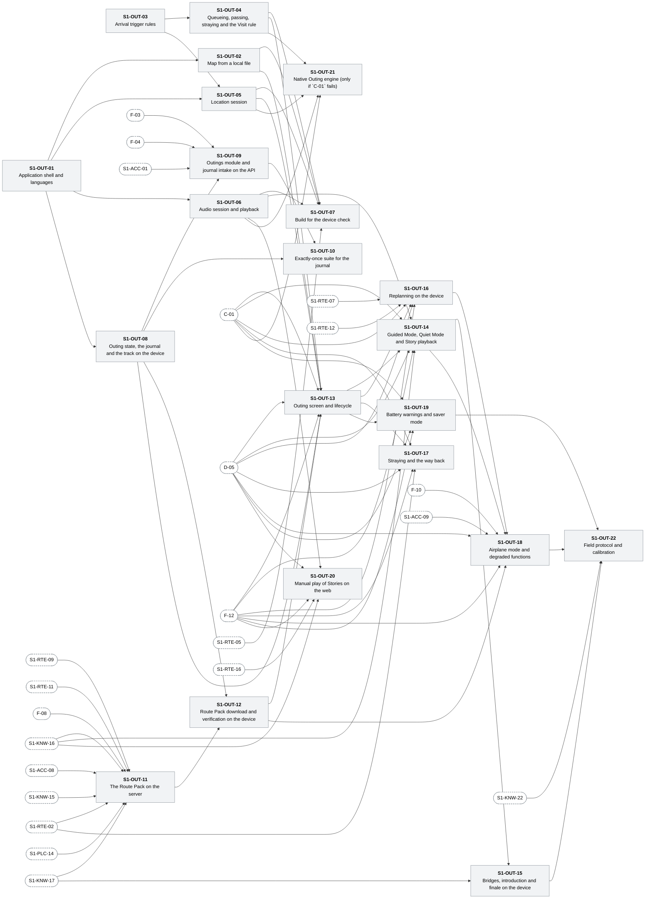
<!-- prettier-ignore-end -->
<!-- /generated -->

### S1-OUT-01 · Application shell and languages

- **Status:** todo
- **Depends on:** —
- **Requirements:** `I18N-1`, `I18N-3`, `PRF-7`
- **Decisions:** ADR-0005 (points 1, 2, 4), ADR-0007 (point 1)

**Goal.** The Expo application has its navigation skeleton, its two interface languages, a local SQLite database with migrations, and a development build for Android made on Linux. Visual design waits for the approved mockups, so the device-check build does not.

**Tasks**

- [ ] Set up the navigation of the app and the web with Expo Router: Routes, Outing, Profile and settings, as unstyled placeholder screens. Replace the PLACEHOLDER home screen.
- [ ] Keep locale codes as open strings in data schemas, so that adding a language changes no data structure (`I18N-3`). Extend `packages/i18n` with the shell's texts in Russian and English; choosing the language is wired by `S1-ACC-10`.
- [ ] Add `expo-sqlite` with forward-only migrations on the device, and a small data-access layer the screens read from.
- [ ] Give every placeholder control an accessibility label and role, so that the designed components inherit the habit.
- [ ] Add a development-build configuration (`expo-dev-client`), with the Expo SDK pinned exactly. Document the Android build on Linux and the iOS build on the owner's Mac.

**Done when**

- `pnpm lint` and `pnpm test` pass. The web build renders every tab in Russian and English (component tests).
- A test opens the device database, applies the migrations twice, and finds the same schema.
- The Android development build is produced on Linux by one documented command.

**Owner only.** Build and install on the iPhone through the Mac.

### S1-OUT-02 · Map from a local file

- **Status:** todo
- **Depends on:** S1-OUT-01
- **Needs:** None for the test area, which this package cuts. The city's PMTiles extract and style published with the city version are needed later.
- **Requirements:** `OUT-2`, `I18N-2`, `OUT-15`
- **Decisions:** ADR-0008 (points 1, 2, 4–7)

**Goal.** One map component renders a PMTiles file, style, glyphs and sprites from local files on the phone and from the public bucket on the web, with labels in the person's language and OpenStreetMap attribution.

**Tasks**

- [ ] Add `@maplibre/maplibre-react-native` on the phone and MapLibre GL JS on the web behind one component interface (layers for the Route, stops, position and the way back).
- [ ] Write a working style in the Protomaps schema (replaced by the approved design's style in the screens that depend on `D-05`) with labels in the person's language and the local name otherwise. Bundle glyph ranges for Latin and Cyrillic and the sprites as local files.
- [ ] Read a `pmtiles://file://` source on the phone. If the binding does not pass it through, side-load an offline database (the documented fallback) and record which path works.
- [ ] Add a script that cuts a small test area from a public build with `pmtiles extract` into a fixture, with no city named in code: the area is a parameter.
- [ ] Keep the OpenStreetMap attribution visible at all times.

**Done when**

- In the Android emulator with networking switched off, the test area renders with Cyrillic and Latin labels (screenshot test or recorded manual check in the PR).
- The web build renders the same area from the local object store.

**Owner only.** Confirm the map from a local file on the iPhone and the Android phone in airplane mode (part of `C-01`).

### S1-OUT-03 · Arrival trigger rules

- **Status:** todo
- **Depends on:** —
- **Requirements:** `OUT-3`, `OUT-4`, `NFR-37`
- **Decisions:** ADR-0005 (point 3), ADR-0027 (point 3)

**Goal.** `packages/triggers` decides arrival at a Place from a stream of positions, by rules T1–T4, T7 and T10, as a pure function (state, fix) → (state, events), tested against tracks.

**Tasks**

- [ ] Define the trigger configuration as data: radius bounds (25–60 m), the confirmation rule, the leave factor (1.5), the uncertainty limit (50 m) and a per-Place radius override. Key it by Travel Mode.
- [ ] T2: adapt the radius to the reported accuracy within the bounds, with the per-Place override winning.
- [ ] T3: confirm arrival by two consecutive fixes inside the radius or a dwell of a few seconds. Above the uncertainty limit, emit "ask: are you at …?" instead of an arrival (`OUT-4`).
- [ ] T4: register leaving only beyond 1.5 × the radius. Emit an automatic start at most once per Place per Outing.
- [ ] T7: group Places closer than two radii into a scene with one arrival and an ordered list. T10: never emit an automatic start for a manual Place; emit a prompt.
- [ ] Define the format of a recorded track (fixes with time, position, accuracy) and a generator of synthetic tracks with noise, jumps and gaps. Replace the PLACEHOLDER `advance`.

**Done when**

- Each rule has named fixtures that make it fire and not fire.
- Property tests over synthetic tracks: no Place is auto-started twice; no arrival is emitted while accuracy is worse than the limit; the events of a track do not depend on how the fixes are split across calls.
- No fixture is a track of a person using the product (a header field in each fixture states its origin).

### S1-OUT-04 · Queueing, passing, straying and the Visit rule

- **Status:** todo
- **Depends on:** S1-OUT-03
- **Requirements:** `OUT-8`, `OUT-12`, `OUT-3`
- **Decisions:** ADR-0005 (point 3), ADR-0027 (point 3)

**Goal.** The trigger function also places triggers on the approach, queues and offers Stories, marks passed Places, allows out-of-order arrival, detects straying, and decides Visits by the Visit rule.

**Tasks**

- [ ] T5: allow a trigger at a point on the approach along the Route's path, for Places with poor reception (and for vehicles in S4).
- [ ] T6: when a trigger fires while a Story plays, queue the next Story. If the person has walked on, emit "tell me on the way".
- [ ] T8: mark a passed Place "skipped — listen anyway?" without interrupting playback. T9: accept out-of-order arrival and emit "replanning offered".
- [ ] Detect straying by distance from the Route's path beyond a threshold, and its end on return. Straying never resets the Outing.
- [ ] Evaluate the Visit rule: a trigger plus a stay of the smaller of 60 s and 30 % of the planned visit; or half the Story heard within two radii; or marked by hand. Emit a Visit event with the time rounded to five minutes, the method and the share heard, and no coordinates.

**Done when**

- Each of T5, T6, T8, T9, straying and each branch of the Visit rule has fixtures that make it fire and not fire.
- Property test: a Visit event never carries a position.
- The suite runs in `pnpm test`.

### S1-OUT-05 · Location session

- **Status:** todo
- **Depends on:** S1-OUT-01, S1-OUT-03
- **Requirements:** `OUT-1`, `OUT-3`
- **Decisions:** ADR-0005 (points 4, 6, 7)

**Goal.** Location runs only between an explicit Start and the end of an Outing, under the "while using the app" permission, keeps delivering fixes with the screen locked, and feeds the trigger function.

**Tasks**

- [ ] Request the foreground ("while using") permission only, at Start. Never request "always".
- [ ] Start the documented session (iOS live updates with a background activity session; Android foreground service) on the Start tap, and stop it at pause or finish.
- [ ] Hide the session behind a small interface (start, stop, fix stream) so that a native module can replace it if `C-01` fails.
- [ ] Feed each fix to `advance` and persist the resulting events. Log gaps between fixes for the device check.
- [ ] Add a simulated source that plays a recorded track, for the emulator and for tests.

**Done when**

- In the Android emulator, a played-back track produces arrival events with the screen off (recorded in the PR).
- No code path requests location before Start (unit test on the session wrapper).

**Owner only.** Confirm fixes keep arriving with the screen locked on the iPhone and the Android phone (part of `C-01`).

### S1-OUT-06 · Audio session and playback

- **Status:** todo
- **Depends on:** S1-OUT-01
- **Needs:** None for the test area, which uses synthetic recorded Narrations. Real Narrations in AAC, with word timings, are needed later.
- **Requirements:** `OUT-5`, `OUT-7`
- **Decisions:** ADR-0005 (points 6, 7), ADR-0014 (point 5)

**Goal.** A playback engine plays Narrations from local files with lock-screen and headset controls, changes speed, rewinds, and behaves correctly around calls, other audio and headphones.

**Tasks**

- [ ] Add `expo-audio` with lock-screen metadata and the controls play, pause, replay and next, also from a headset.
- [ ] Make "lower other audio" or "pause other audio" a configuration choice, so that the result of `C-01` is a setting, not a rewrite.
- [ ] Pause on a phone call and resume after it. Pause when headphones disconnect, never switching to the loudspeaker.
- [ ] Add speed (slower and faster) and rewind by a fixed step.
- [ ] Hide the engine behind an interface (load, play, pause, seek, speed, events) that a native module can replace.

**Done when**

- In the Android emulator, a Narration plays from a local file and the media notification controls it (recorded in the PR).
- Unit tests of the engine's state machine cover the call, headphones and speed transitions.

**Owner only.** Confirm on both phones that a Story starts by itself from the background with working lock-screen controls, and whether other audio is lowered or must be paused (part of `C-01`).

### S1-OUT-07 · Build for the device check

- **Status:** todo
- **Depends on:** S1-OUT-02, S1-OUT-04, S1-OUT-05, S1-OUT-06, S1-RTE-05
- **Requirements:** `OUT-3`, `OUT-5`, `NFR-25`
- **Decisions:** ADR-0005 (point 6), ADR-0006 (Not verified), ADR-0008 (Not verified)

**Goal.** One development build exercises location, triggers, automatic audio and the local map on a test area for an hour with the screen locked, and times the planner on the phone, so that the owner can run `C-01`.

**Tasks**

- [ ] Assemble a test Outing from a parameterised test area: a handful of synthetic Places with synthetic Narrations and a Route through them. No city is named in code.
- [ ] Wire fixes → triggers → automatic playback, with the map showing position and stops.
- [ ] Add a timing screen that runs the planner on a fixture problem of 150 candidates and shows the time.
- [ ] Write a log on the device of fix gaps, trigger events, automatic starts, audio session errors and battery level, which the owner can export by hand. The log stays on the device unless exported.
- [ ] Write a one-page check sheet in the PR with the five criteria of ADR-0005 point 6 and where each is read in the log.

**Done when**

- The build runs in the Android emulator with a played-back track, auto-starts Stories at the test Places and fills the log.
- The planner timing screen shows a result for the fixture problem.

**Owner only.** Build for the iPhone on the Mac, install on both phones, walk an hour with the screen locked on a test area, and record the outcome of `C-01`.

### S1-OUT-08 · Outing state, the journal and the track on the device

- **Status:** todo
- **Depends on:** S1-OUT-01
- **Needs:**
  - Identity of the Guest or User, carried by journal entries.
  - The product-event schemas that travel through the same journal.
- **Requirements:** `OUT-13`, `OUT-16`, `OUT-19`, `NFR-10`, `PTY-1`, `NFR-37`
- **Decisions:** ADR-0017 (points 1–3, 6, 7), ADR-0025 (point 3)

**Goal.** The device keeps every Outing's state and every action in SQLite, restores the Outing exactly after a kill, sends the journal in order and removes entries only after acknowledgement. The detailed track stays on the device for at most 30 days.

**Tasks**

- [ ] Model an Outing on the device: belongs to a Party with one Organizer; has a Travel Mode, a Route version and a mode (Guided or Quiet); follows the lifecycle of §3.4 (Chosen, Packed, InProgress, Paused, Finished, Abandoned).
- [ ] Persist the current stop, the Story and the position within it at every change, and restore them at start-up.
- [ ] Add the journal table: device identifier, stream, sequence number, entry type and version, Outing, payload. Define the entry types in `contracts`: Visit, skip, shorten, extend, Break inserted, Route version created, Outing started, paused, finished. Ratings, Corrections and product events reuse the same envelope.
- [ ] Add the sender: in order per stream, retries with back-off only while the app is in the foreground, removal on acknowledgement.
- [ ] Store the detailed track in its own table. Delete fixes older than 30 days at start-up and at the end of an Outing, and give the person a "delete my track" action.
- [ ] Ensure that no journal entry type has a field that can hold a coordinate.

**Done when**

- A test kills the process (by abandoning the database handle mid-transaction) at every step of a scripted Outing and restores the same stop, Story and position.
- A test with a fake server that drops, duplicates and reorders acknowledgements shows the device sending each entry until it is acknowledged, and never out of order.
- A test advances the clock 31 days and finds no older fix. "Delete my track" leaves none.

### S1-OUT-09 · Outings module and journal intake on the API

- **Status:** todo
- **Depends on:** S1-OUT-08, F-03, F-04, S1-ACC-01
- **Needs:**
  - Identity and token verification.
  - The feedback module's interface for ratings and Corrections.
  - The staging table of product events.
  - The error envelope and minimum client version.
- **Requirements:** `OUT-16`, `OUT-8`, `NFR-9`, `PTY-1`
- **Decisions:** ADR-0017 (points 2, 7), ADR-0025 (points 3, 4), ADR-0003 (point 5), ADR-0021 (point 6), ADR-0026

**Goal.** The API accepts journal entries idempotently by a high-water mark per device and stream, and the outings module records Outings, their Party of one and Visits without coordinates.

**Tasks**

- [ ] Create the outings module: tables for Outing (Party, Travel Mode, Route version, mode, state), Party with members (one Organizer in S1) and Visit (Place, time rounded to five minutes, method, share heard).
- [ ] Add `POST /api/journal`. For each device and stream, apply entries in order in one transaction with advancing the high-water mark, ignore anything at or below it, and acknowledge.
- [ ] Dispatch entries to their owning module through its interface: Route versions to planning, ratings and Corrections to feedback, events to the staging table.
- [ ] Accept every entry version still on devices. Refuse an unknown version with a stable code.
- [ ] Add a read endpoint for a person's Outings, used on focus and to resume on another device.

**Done when**

- Sending the same batch twice changes nothing the second time (integration test).
- An entry with a coordinate-like field is refused by the schema (named test).
- A test proves that the outings module reads only its own tables and calls other modules through their `index.ts`, as `pnpm lint:boundaries` checks.

### S1-OUT-10 · Exactly-once suite for the journal

- **Status:** todo
- **Depends on:** S1-OUT-08, S1-OUT-09
- **Needs:** The compose environment in the pipeline.
- **Requirements:** `NFR-9`, `OUT-16`
- **Decisions:** ADR-0017 (point 8), ADR-0027 (point 4)

**Goal.** A suite that gates every change cuts the network, resends and kills the process on both sides, and asserts zero lost and zero duplicated Visits, ratings and Corrections.

**Tasks**

- [ ] Drive the device-side sender from Node against the API in the compose environment, through a proxy that can drop, delay and cut connections.
- [ ] Kill and restart the API process mid-batch, and kill the sender between send and acknowledgement.
- [ ] Generate scripts of actions (Visits, ratings, Corrections, skips, edits) and compare the server's state with the script.
- [ ] Run it in the pipeline's integration step.

**Done when**

- Over at least 200 generated scripts with faults injected at random points, the server holds each action exactly once (the suite fails on one loss or duplicate).
- The suite is part of the required checks.

### S1-OUT-11 · The Route Pack on the server

- **Status:** todo
- **Depends on:** S1-RTE-09, S1-RTE-11, S1-RTE-02, F-08, S1-ACC-08, S1-KNW-15, S1-KNW-16, S1-KNW-17, S1-PLC-14
- **Needs:**
  - The `ObjectStore` port with signed links.
  - The entitlement check "Route Packs" and the signed entitlement snapshot.
  - Narrations with word timings, Story texts and sources per language, photos with attribution, bridge fragments and connectives, and introductions and finales when ready.
  - The city's PMTiles extract, style, glyphs and sprites.
- **Requirements:** `OUT-14`, `RTE-12`, `NFR-8`
- **Decisions:** ADR-0010 (points 3, 5), ADR-0009 (point 5), ADR-0016 (points 3–5), ADR-0029 (point 4), ADR-0022 (points 4, 5), ADR-0008 (point 4)

**Goal.** `GET /api/routes/{id}/versions/{v}/pack` returns a manifest that lists every blob of the Route Pack by hash, with signed links, its total size and the date its hours were re-checked.

**Tasks**

- [ ] Define the manifest in `contracts`. It lists, each blob by hash and size:
  - the map extract, style, glyphs and sprites;
  - Narrations and texts with word timings per language;
  - sources;
  - photos with attribution;
  - bridge fragments and connective phrases;
  - the introduction and finale if ready;
  - the spare Places with their candidate data;
  - the matrix and graph cut around the Route and the spares;
  - the opening intervals for the day of the Outing;
  - the entitlement snapshot.
- [ ] Choose the spare Places by a fixed rule from the preselection of the Route's request within the graph cut, and record the rule in the planner configuration.
- [ ] Build and store the content-addressed blobs that are per Route (graph cut, matrix, intervals). Blobs already stored are not written again.
- [ ] Re-check the status and hours of the Route's Places when the manifest is requested, and store the check date (`RTE-12`).
- [ ] Check the entitlement for Route Packs through the single entitlement function. Issue new signed links when a download resumes.
- [ ] Report the total size. Refuse with a stable code a Pack that would exceed 150 MB.

**Done when**

- For a fixture Route of three hours, the manifest lists every kind of blob above, and every hash matches its blob (integration test).
- The reported size of the fixture Pack is printed and is at most 150 MB.
- A person without the entitlement is refused with the stable code. With open access on, they are not.

**Room to improve.** Pre-cut map tiles per district so that the map blob is shared between Routes.

### S1-OUT-12 · Route Pack download and verification on the device

- **Status:** todo
- **Depends on:** S1-OUT-11, S1-OUT-08
- **Requirements:** `OUT-14`, `NFR-8`, `OUT-15`
- **Decisions:** ADR-0010 (point 5)

**Goal.** The device downloads only the blobs it lacks, resumes after interruption, verifies every hash, and marks the Pack usable only when complete. The size is shown first, with a Wi-Fi-only option.

**Tasks**

- [ ] Add a content-addressed blob store on the device, shared between Routes.
- [ ] Compute the size of what is missing before download and expose it, with a Wi-Fi-only setting, to the interface (the screen is built in S1-OUT-13).
- [ ] Download with resumption: on interruption or expired links, fetch a fresh manifest and continue from what was stored.
- [ ] Verify each blob's hash, and mark the Pack usable only when all are present and verified. Record Packed in the Outing state.
- [ ] Delete a Pack, keeping blobs that other Packs still use.

**Done when**

- A test interrupts the download at random points 100 times and always ends with a complete, verified Pack and no blob fetched twice after it was stored.
- A blob with a wrong hash is never marked usable (named test).
- A second Pack sharing a Narration does not download it again (named test).

### S1-OUT-13 · Outing screen and lifecycle

- **Status:** todo
- **Depends on:** C-01, D-05, S1-OUT-02, S1-OUT-04, S1-OUT-05, S1-OUT-08, S1-OUT-12, F-12
- **Requirements:** `OUT-1`, `OUT-2`, `OUT-13`, `OUT-18`, `OUT-8`, `NFR-24`, `NFR-27`
- **Decisions:** ADR-0005 (points 4, 5), ADR-0029 (points 4, 5), ADR-0017 (point 3)

**Goal.** A person starts an Outing by an explicit tap after a plain-words check, sees position, next Place, remaining distance and time, whether they will reach it before it closes, and progress. They can pause, resume and finish early, and Visits are journalled.

**Tasks**

- [ ] Build the screen from the components of `F-12`, adding those that this screen alone needs (`NFR-24`, `NFR-27`).
- [ ] Before Start, re-time the first and the last leg of the Route from the true position (ADR-0006, point 11).
- [ ] Run a pre-Start check of the Route Pack, the audio output and the location permission, and say in plain words what is missing. Show the Pack's size and the Wi-Fi-only choice before download.
- [ ] Show position, the next Place, remaining distance and time, and "you will (not) reach it before it closes" from the Pack's intervals in the city's time zone.
- [ ] Show progress along the Route at all times.
- [ ] Add pause, resume and finish early. Mark an Outing Abandoned after no activity for the configured time.
- [ ] Turn Visit events into journal entries. Offer marking a Place by hand.
- [ ] If the person starts far from the planned start, offer to replan from here (hand over to S1-OUT-16).

**Done when**

- In the Android emulator, a played-back track takes a test Outing from Start to Finished, with Visits journalled and progress shown (end-to-end test).
- Killing the app mid-Outing and reopening it resumes at the same stop (emulator test).
- Times shown are in the city's time zone when the device is set to another (unit test).

**Owner only.** Walk a test Outing with the screen locked.

### S1-OUT-14 · Guided Mode, Quiet Mode and Story playback

- **Status:** todo
- **Depends on:** C-01, D-05, S1-OUT-06, S1-OUT-13, S1-KNW-16, F-12
- **Needs:**
  - Stories with "verified" or "not verified" status, sources per statement, "More" blocks with themes, and word timings.
  - Correction and "liked" actions of the feedback track, which this screen offers.
- **Requirements:** `OUT-5`, `OUT-6`, `OUT-7`, `OUT-4`, `NFR-25`, `NFR-27`, `I18N-1`
- **Decisions:** ADR-0005 (point 6), ADR-0014 (point 4), ADR-0015 (point 6)

**Goal.** Trigger events drive Story playback in Guided Mode and prompts in Quiet Mode, switchable at any moment. The text follows the audio, and the whole Outing can be done with the screen locked after Start.

**Tasks**

- [ ] Build a playback queue fed by trigger events:
  - automatic start once per Place;
  - a queued next Story;
  - "tell me on the way";
  - "skipped — listen anyway?";
  - "Are you at …?";
  - a prompt for manual Places.
- [ ] Add a Guided or Quiet switch at any time. In Quiet Mode nothing starts by itself and a Story can still be started by hand. Add a separate switch for automatic start.
- [ ] Append "More" blocks whose theme the Profile likes. Offer the others on request.
- [ ] Show the Story text in step with the audio from the word timings, with speed and rewind. Make the text available to screen readers.
- [ ] Play in the Story language of the Profile. Show "generated automatically" and verified or not verified, with sources one tap away.

**Done when**

- In the Android emulator, a test Outing with a played-back track and the screen off plays every Story without a touch after Start (end-to-end test).
- Switching mode mid-Outing changes the behaviour at the next trigger (unit test of the queue).
- The highlighted word follows the audio position within one word on a fixture Narration (unit test).

**Owner only.** Confirm by ear that a whole test Outing works from the pocket.

### S1-OUT-15 · Bridges, introduction and finale on the device

- **Status:** todo
- **Depends on:** S1-OUT-14, S1-KNW-17
- **Needs:** Bridge fragments (the spoken name and a teaser, with no teaser for a sensitive unverified Place), connective phrases in each language, and the introduction and finale with their readiness.
- **Requirements:** `OUT-6`, `NFR-25`
- **Decisions:** ADR-0016 (points 3–5)

**Goal.** In Guided Mode the device plays an introduction at the start, a bridge assembled from fragments on each leg (also after replanning), and a finale at the last stop, falling back to assembled ones when the generated ones are not ready.

**Tasks**

- [ ] Assemble a bridge for the next leg: a connective, the name, the teaser, and a spoken distance or direction where the Route gives one. Select the parts by a fixed rule.
- [ ] Play the generated introduction and finale when the Pack has them and they match the current Route version. Otherwise assemble them from fragments.
- [ ] Use the same assembly for spare Places after replanning.
- [ ] Play the parts back to back without audible gaps (gapless queue of local files).

**Done when**

- For every pair of a fixture Route and its spares, a bridge can be assembled (property test).
- A Route changed after its introduction was generated plays the assembled introduction (named test).
- A sensitive unverified Place's bridge contains only a connective and its name (named test).

**Owner only.** Judge by ear whether assembled bridges sound continuous (ADR-0016, "Not verified").

### S1-OUT-16 · Replanning on the device

- **Status:** todo
- **Depends on:** C-01, D-05, S1-OUT-13, S1-RTE-12, S1-RTE-07, F-12
- **Requirements:** `OUT-9`, `OUT-10`, `OUT-11`
- **Decisions:** ADR-0006 (points 1, 7, 11), ADR-0009 (point 5), ADR-0017 (point 4)

**Goal.** Skip, shorten, extend, "coffee now", replanning offered after an out-of-order arrival, and "replan from here" all produce a Route on the device from the Route Pack, verified on the device before it is shown and bound to the Outing as a new version.

**Tasks**

- [ ] Build the planning problem on the device from the Pack: remaining stops, spare Places, matrix, graph cut, intervals of the day, and the current position snapped to the cut.
- [ ] Re-time the first leg from the true position (ADR-0006, point 11).
- [ ] Implement skip, shorten by N minutes, extend by N minutes and "Break now". Rerun the planner with the visited stops fixed, and offer the relaxation when nothing fits.
- [ ] Run the verifier on the device. Never show a Route that fails it.
- [ ] Save the result as a new Route version bound to the Outing, and journal it.
- [ ] When a Place closes earlier today than planned, warn and offer a replacement.

**Done when**

- Over 1 000 generated mid-Outing situations, every replanned Route is accepted by the verifier (property test in `pnpm test`).
- Skip, shorten, extend and "Break now" each work in airplane mode in the emulator (end-to-end test).

**Owner only.** Measure the replanning time on a mid-range phone against the 2 seconds of `NFR-4`.

### S1-OUT-17 · Straying and the way back

- **Status:** todo
- **Depends on:** C-01, D-05, S1-OUT-13, S1-RTE-02, F-12
- **Requirements:** `OUT-12`, `OUT-4`
- **Decisions:** ADR-0009 (point 5)

**Goal.** When the person strays, the app shows the way back to the Route on the map and in words, without resetting the Outing. When the position is uncertain, it asks instead of guessing.

**Tasks**

- [ ] On a straying event, compute a path back on the graph cut to the nearest useful point of the Route, and draw it.
- [ ] Clear the way back on return, and keep every Visit and the Story position.
- [ ] Show "Are you at …?" with yes and no. Treat yes as a Visit by hand.
- [ ] Offer "replan from here" when the way back is longer than the configured detour.

**Done when**

- A synthetic track that strays and returns ends with the same Outing state as one that did not stray, plus no lost Visit (emulator or unit test).
- The way back is computed with the network off (emulator test).

### S1-OUT-18 · Airplane mode and degraded functions

- **Status:** todo
- **Depends on:** S1-OUT-12, S1-OUT-14, S1-OUT-16, D-05, F-10, S1-ACC-09, F-12
- **Needs:** The entitlement snapshot honoured offline. Test doubles of the object store that fail, time out and answer slowly.
- **Requirements:** `OUT-15`, `NFR-11`, `NFR-10`
- **Decisions:** ADR-0005 (point 5), ADR-0017 (point 1), ADR-0027 (point 6)

**Goal.** With a complete Route Pack the whole Outing works in airplane mode. Functions that need the network are shown as unavailable, not hidden, and the app recovers when the network returns.

**Tasks**

- [ ] Add a connectivity state that the interface reads, and mark the network-dependent functions as unavailable while offline. In S1 that is everything but the Outing itself; Chat, shared positions and ask the guide arrive later as placeholders.
- [ ] Make every screen of the Outing read from SQLite and the Pack only.
- [ ] Inject faults: object store failing or slow during download; API unreachable during journal sending. Assert the messages and the resumption.
- [ ] Rehearse SC-4 in the emulator: cut the network mid-Outing, skip a Place, replan, restore the network, and check that the journal drains once.

**Done when**

- The SC-4 rehearsal passes as an end-to-end test in the Android emulator.
- Each fault of the object-store double produces its specific message and a resumed download (named tests).

**Owner only.** Complete a test Outing in airplane mode on both phones.

### S1-OUT-19 · Battery warnings and saver mode

- **Status:** todo
- **Depends on:** C-01, D-05, S1-OUT-13, F-12
- **Requirements:** `OUT-17`
- **Decisions:** ADR-0005 (point 6)

**Goal.** The app shows the battery level, warns when the remaining charge will not last the remaining Outing, and offers a saver mode.

**Tasks**

- [ ] Read the battery level and its rate of change during the Outing.
- [ ] Estimate the charge needed for the remaining time, and warn once when it will not last.
- [ ] Add a saver mode: a lower fix rate where the trigger rules allow, the map off, a dimmed screen, and audio unchanged.
- [ ] Log battery use per hour to the device log for `NFR-7`.

**Done when**

- Unit tests of the estimate cover enough, not enough, and charging.
- Turning on saver mode lowers the requested fix rate (unit test on the session wrapper).

**Owner only.** Measure the battery use per hour with the screen off and on, on both phones (`NFR-7`).

### S1-OUT-20 · Manual play of Stories on the web

- **Status:** todo
- **Depends on:** S1-RTE-16, S1-OUT-06, D-05, S1-KNW-16, F-12
- **Needs:** Public or signed links to Narrations, and Story texts with word timings.
- **Requirements:** `OUT-20`, `NFR-27`
- **Decisions:** ADR-0007 (point 1), ADR-0005 (point 2)

**Goal.** On the web a person sees the Route and plays each Story by hand with its text following the audio. Nothing starts by itself, and there is no offline work.

**Tasks**

- [ ] Add a play control per stop on the Route Page and its Outing view, using the web side of the playback interface.
- [ ] Show the text in step with the audio, with speed and rewind.
- [ ] Show the automatic Outing and offline use as "available in the app", not hidden.
- [ ] Respect entitlements for Narrations through the single entitlement check.

**Done when**

- A browser test plays a fixture Story by hand and the highlighted text follows it.
- The automated WCAG 2.2 AA check passes on the page with the player.

### S1-OUT-21 · Native Outing engine (only if `C-01` fails)

- **Status:** todo
- **Depends on:** C-01, S1-OUT-05, S1-OUT-06, S1-OUT-04
- **Requirements:** `OUT-3`, `OUT-5`, `NFR-25`
- **Decisions:** ADR-0005 (point 7), ADR-0027 (point 3)

**Goal.** If the device check fails, the location session, the trigger engine and the audio session run in a native Expo module (Swift and Kotlin) behind the interfaces the TypeScript ones already have, and nothing else changes.

**Tasks**

- [ ] Write an Expo module in Swift and Kotlin with the session interfaces of S1-OUT-05 and S1-OUT-06.
- [ ] Port the trigger function, and run the same recorded tracks against it through a test harness that compares its events with the TypeScript function's.
- [ ] Switch the app to the native implementation by configuration.

**Done when**

- The native trigger engine produces the same events as `packages/triggers` on every recorded and synthetic track.
- Every end-to-end emulator test of the Outing passes on the native implementation.

**Owner only.** Decide, from `C-01`, whether this package is needed at all. Repeat the device check with it.

### S1-OUT-22 · Field protocol and calibration

- **Status:** todo
- **Depends on:** S1-OUT-18, S1-OUT-19, S1-OUT-15, S1-KNW-22
- **Needs:** A prepared reference Outing in Minsk with verified Stories and Narrations.
- **Requirements:** `NFR-3`, `NFR-25`, `OUT-3`
- **Decisions:** ADR-0027 (points 3, 14, 15)

**Goal.** An agent provides the tools and the owner walks the reference Outing, so that the trigger constants and `NFR-3` are calibrated from real data and recorded test walks become fixtures.

**Tasks**

- [ ] Add an export of the device log of a test walk (fixes, trigger events, Visits, planned against actual times), made by the person on purpose.
- [ ] Write a script that computes from an exported log: automatic starts per Place, false starts, delay after entering the radius, and the planned-against-actual duration.
- [ ] Turn exported test-walk tracks, marked as recorded for this purpose, into trigger fixtures.
- [ ] Write the field protocol: the reference Outing twice with the screen locked on both phones, once in airplane mode, what to record.

**Done when**

- The script prints the four measures for a synthetic exported log.
- A recorded test walk can be added as a fixture by one command.

**Owner only.** Walk the reference Outing in Minsk per the protocol on both phones; set the calibrated trigger constants; accept or reject `NFR-3` and `NFR-5` thresholds; check SC-1 end to end.

## S1-ACC — Accounts and access in S1

Who a person is and what they may do: the Guest created at the first remembered action, registration that upgrades in place (Google and Apple, then the e-mail one-time code), the merge on sign-in, the Profile stored and synchronised across devices, internal roles with the console guard and the audit log, Plans and entitlements with open access on and their offline snapshot, the interface languages, and account deletion. Identity comes first because rate limits, Corrections, the journal and entitlements key on it; deletion comes last because it must reach every store the other packages create.

<!-- generated:track S1-ACC -->
<!-- prettier-ignore-start -->
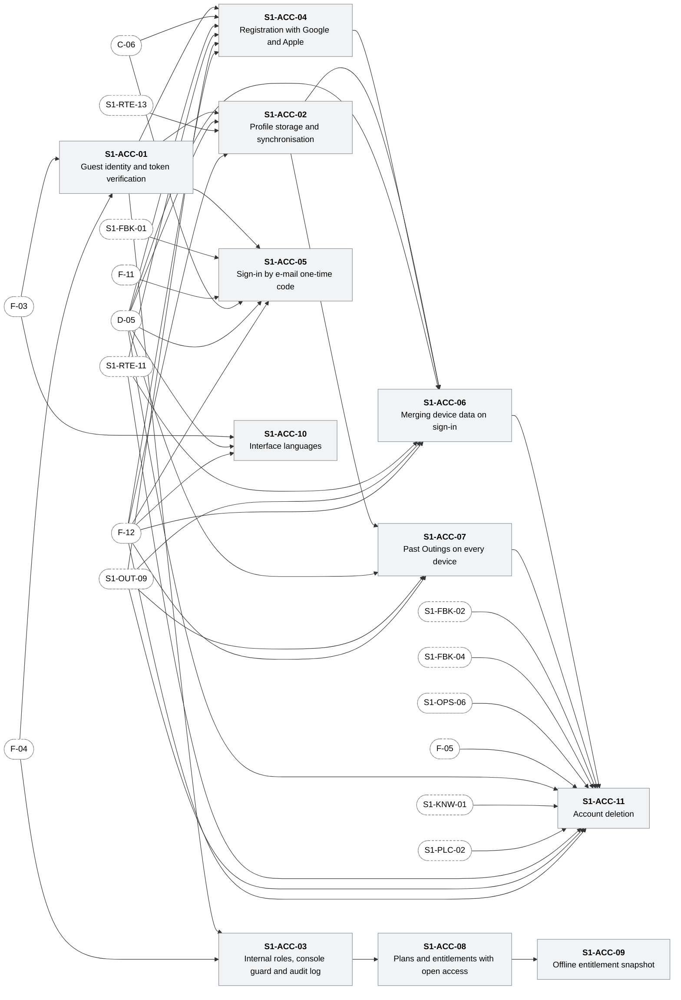
<!-- prettier-ignore-end -->
<!-- /generated -->

### S1-ACC-01 · Guest identity and token verification

- **Status:** todo
- **Depends on:** F-03, F-04
- **Needs:** The device's local database and journal (ADR-0017), where a Guest's Profile, Routes and history live on the device.
- **Requirements:** `ACC-1`, `ACC-2`, `NFR-15`
- **Decisions:** ADR-0019 (points 1, 2), ADR-0017 (point 6), ADR-0028 (point 5)

**Goal.** An `identity` module verifies a Firebase token on every request that needs one, behind an `IdentityProvider` port, and a person record exists on the server only from the first action the server must remember; the app and web create the anonymous Firebase user silently at that moment.

**Tasks**

- [ ] Create the `identity` module with its schema: person (identifier = Firebase user identifier, registered flag, created time), nothing else personal.
- [ ] Define the `IdentityProvider` port (verify token, create custom token, link, delete user) with the Firebase Admin adapter against the emulator locally, and its fault-injecting double on the harness of `F-10`.
- [ ] Add the authentication guard: endpoints are marked public, person-required or internal; a person-required endpoint verifies the token and puts the person's identifier in the request context; opening pages and reading public data never needs a token.
- [ ] Add `ensurePerson` to the module interface, called by modules in the unit of work of their first remembered action (saved Route, Correction, answer to an Invitation), which creates the record idempotently.
- [ ] In the mobile app and the web, sign in anonymously lazily — only before the first remembered action — and keep the Guest's identity in the device's database; never on app start or page open.
- [ ] Keep Firebase's automatic removal of old anonymous users off, as configuration with a comment pointing to ADR-0019 point 2.

**Done when**

- Calling the operation that creates a person twice for one anonymous user yields exactly one person record, and opening any number of pages without a remembered action creates none (integration test against the emulator).
- Every person-required endpoint refuses a missing or forged token with the envelope's code (test walking the routes).

### S1-ACC-02 · Profile storage and synchronisation

- **Status:** todo
- **Depends on:** S1-ACC-01, D-05, S1-RTE-13, F-12
- **Needs:** The Profile set-up and editing screens and the closed lists of themes and Dealbreakers (`PRF-1…4`). The Profile travels through the versioned endpoint of this package and not through the journal: a write based on an old version must be refused, and a journal entry cannot be.
- **Requirements:** `ACC-5`, `PRF-5`, `PRF-7`
- **Decisions:** ADR-0017 (points 4, 5), ADR-0025 (point 3)

**Goal.** A `profile` module stores each person's Profile — Interests, Dealbreakers, pace, interface language and Story language — with a version, and every device of a User reads the same Profile, refreshed when the screen gains focus.

**Tasks**

- [ ] Create the `profile` module and schema: one Profile per person, versioned, with update time and the device that wrote it; themes and Dealbreakers stored by stable code so that the lists can grow.
- [ ] Add endpoints to read and to write the Profile; a write carries the version it was based on; a write based on an older version than the current one is rejected with a code so the device can show both and let the person choose — nothing is overwritten silently.
- [ ] On the device, write the Profile to the local database first and send it when the network is available; fetch on focus and replace the local copy only when the server's version is newer.
- [ ] Expose `profileOf(person)` and `profilesOf(persons)` on the module interface for planning and, later, the Party.
- [ ] Add a test with two devices of one User: an edit on one is present on the other after a focus refresh; concurrent edits produce a conflict answer and no silent loss.

**Done when**

- The two-device test passes against the compose environment.
- Switching the Story language in the Profile on one device changes the language used for the next Story requested from another device of the same User (test at the API level).

### S1-ACC-03 · Internal roles, console guard and audit log

- **Status:** todo
- **Depends on:** S1-ACC-01, F-04
- **Needs:** The console application's shell and navigation (built with the console track); the list of console endpoints as they appear, so each is marked internal with its role.
- **Requirements:** `ACC-7`, `ACC-8`, `ACC-9`, `NFR-31`
- **Decisions:** ADR-0019 (points 6, 7), ADR-0007 (point 5), ADR-0028 (point 7), ADR-0022 (point 2)

**Goal.** Curator, Moderator and Administrator roles are granted per person in our database and mirrored into the token, every console endpoint requires its role and refuses and logs anything else, and every action taken with a role is written to an append-only audit log in the same transaction.

**Tasks**

- [ ] Add roles to the `identity` schema (person, role, granted by, granted at, revoked at); several roles per person; Moderator exists from S1 with no powers until S2.
- [ ] Mirror roles into Firebase custom claims on change; the guard always checks the database, the claim only shapes the console's interface.
- [ ] Add the internal guard: an endpoint declares the role it needs; a request without it is refused with the envelope's code and logged with the hashed identifier, the endpoint and the time.
- [ ] Write the audit writer on the unit of work of `F-04`: who, what (action code), when, on what (entity type and identifier), with the before and after of changed fields where small; the audit table accepts inserts only (no update or delete grants; a test proves it).
- [ ] Expose the endpoints that the console's Administration (`S1-CUR-13`) uses: granting and revoking roles, and reading the audit log filtered by person, action, entity and period.
- [ ] Add a one-off job, run by the owner, that grants the first Administrator role to a named person.

**Done when**

- A test walks every route marked internal and shows that a Guest, a User and a person with the wrong role are each refused and that each refusal is logged.
- Every console action added in S1 appears in the audit log (a test per action that performs it and reads the log; later packages add their own).
- Attempting to update or delete an audit row from the application's database role fails (test).

**Owner only.** Running the job that grants the first Administrator role, locally and in the cloud.

### S1-ACC-04 · Registration with Google and Apple

- **Status:** todo
- **Depends on:** S1-ACC-01, C-06, D-05, S1-RTE-11, S1-OUT-09, F-12
- **Needs:** The saved Routes and Outing history modules, so that the end-to-end test can show they stay attached after the upgrade.
- **Requirements:** `ACC-3`, `ACC-4`
- **Decisions:** ADR-0019 (points 2, 3), ADR-0023 (point 4)

**Goal.** A Guest registers with Google or Apple by linking the provider to the same anonymous Firebase user, so the identifier does not change and everything recorded under it stays attached; registration is recorded in our database.

**Tasks**

- [ ] Add "Sign in" in the mobile app and on the web with Google and Apple, linking to the current anonymous user when there is one, signing in plainly when there is none.
- [ ] Add the endpoint that records registration in the `identity` schema after a successful link (registered flag, providers, time), idempotently.
- [ ] Handle "credential already in use": the person is signed in to the existing account and the merge of `S1-ACC-06` is offered; nothing is merged without the answer.
- [ ] Handle registration started offline: the action waits in the device's queue and completes when the network returns.
- [ ] End-to-end test on the emulator: a Guest saves Routes and a Profile, links Google, and the identifier, Routes and Profile are unchanged.

**Done when**

- The end-to-end test passes on the emulator in the pipeline, for the emulated Google provider.
- On the web build against the emulator, a Guest with saved Routes registers and sees them all afterwards (scenario test).

**Owner only.** Creating the OAuth client for Google and the Apple Services identifier and key (Apple needs a developer account, ADR-0023); confirming Sign in with Apple on a real iPhone, which is a recorded limitation until a paid Apple account exists.

### S1-ACC-05 · Sign-in by e-mail one-time code

- **Status:** todo
- **Depends on:** S1-ACC-01, S1-FBK-01, F-11, C-06, D-05, F-12
- **Requirements:** `ACC-3`, `NFR-31`
- **Decisions:** ADR-0019 (point 4), ADR-0020 (point 2), ADR-0028 (point 3)

**Goal.** A person enters an e-mail address, receives a one-time code through the e-mail channel of the `Notifier`, and on a correct code the address is attached to the same Firebase user as a permanent credential and a Firebase token is issued.

**Tasks**

- [ ] Add code issue: a random short code, stored hashed with its address, expiry and attempt counter; issuing is counted per address and per identity as a costly endpoint (`F-11`).
- [ ] Send the code through the `Notifier` e-mail channel in both languages; the code is never logged.
- [ ] Add code check: limited attempts and lifetime; on success attach the verified address to the current user, mark the person registered in our database, and return a custom Firebase token for the client to sign in with.
- [ ] If the address already belongs to another account, sign the person in to that account and offer the merge of `S1-ACC-06`.
- [ ] Prove on the emulator whether the upgraded user leaves Firebase's anonymous state; record the result in the module's README and keep the anonymous clean-up off either way (ADR-0019 point 2).
- [ ] Tests: wrong code, expired code, too many attempts, too many codes for one address, reuse of a used code — each with its own code of the envelope.

**Done when**

- In the compose environment, a Guest requests a code, reads it in the mail catcher, enters it and is registered with the same identifier (integration test reading the mail catcher's interface).
- Each failure test above passes, and no code appears in logs or traces.

**Owner only.** Buying a domain and choosing the e-mail provider for the cloud; until then sign-in by code works locally only and the cloud offers Google, as recorded in ADR-0019 and ADR-0024.

### S1-ACC-06 · Merging device data on sign-in

- **Status:** todo
- **Depends on:** S1-ACC-02, S1-ACC-04, D-05, S1-RTE-11, S1-OUT-09, F-12
- **Needs:** A merge operation on the interface of every module that holds a person's data in S1 (saved Routes with their versions, Outing history, Visits); the Route version model of ADR-0017 point 4.
- **Requirements:** `ACC-4`, `ACC-5`
- **Decisions:** ADR-0019 (point 5), ADR-0017 (point 4), ADR-0003 (point 5)

**Goal.** A Guest who signs in to an existing account on a device holding Guest data is asked whether to merge, and a merge moves the Guest's records into the account without loss, duplicates or silent overwriting of newer data.

**Tasks**

- [ ] Define the domain event "person merged (from, into)" handled in one unit of work by every module that holds personal data; each module registers its handler.
- [ ] Merge the Profile: when both exist, keep the newer and show the older to the person to accept field by field; never replace silently.
- [ ] Add the endpoint that merges, refused unless the caller proves both identities (the Guest's token held by the device and the account's token).
- [ ] Ask the question on the device after sign-in when the local database holds Guest data; "do not merge" leaves the Guest's data on the device under the Guest identity.
- [ ] Test: Guest data on device B, account data on device A with a newer Profile; after merge every Route of both exists once, both Route versions are kept with the later current, and the Profile choice is offered.

**Done when**

- The merge test passes; a second merge call with the same identities changes nothing (idempotent).
- After registering on one device, every Route and the Profile created as a Guest are present on a second device (acceptance of §4.1, integration test).

### S1-ACC-07 · Past Outings on every device

- **Status:** todo
- **Depends on:** S1-ACC-02, D-05, S1-OUT-09, F-12
- **Needs:** The Outings module with finished and abandoned Outings and their Visits on the server, delivered through the journal.
- **Requirements:** `ACC-10`, `ACC-5`
- **Decisions:** ADR-0017 (point 5)

**Goal.** A person sees a list of their past Outings — Route, date, duration, Places visited — on every device and on the web, read through the API and cached on the device.

**Tasks**

- [ ] Add the read endpoint for a person's past Outings with paging, served by the Outings module's interface.
- [ ] Add the list screen in the mobile app and on the web, with its empty state, in both languages.
- [ ] Cache the list in the device's database; refresh on focus and after the journal delivers an Outing's end.
- [ ] Show a Guest's list from the device alone while offline.
- [ ] Test: an Outing finished on device A appears in the list on device B after a focus refresh; a Guest sees their list in airplane mode.

**Done when**

- The two-device test and the offline Guest test pass.

**Room to improve.** Filters by city and period; a link from each Outing to its Route Page.

### S1-ACC-08 · Plans and entitlements with open access

- **Status:** todo
- **Depends on:** S1-ACC-03
- **Needs:** Each gated feature calls the single entitlement function: Narration beyond the free number of Places, Route Packs, Preparation beyond the free quota (ask the guide arrives in S3).
- **Requirements:** `ENT-1`, `ENT-2`, `ENT-3`, `ENT-4`
- **Decisions:** ADR-0022 (points 1–4, 7)

**Goal.** An `entitlements` module answers "may this person do this?" through one function, Plans are configuration an Administrator edits in the console, open access grants everyone the Plus set and is on, and no feature code mentions a Plan by name.

**Tasks**

- [ ] Create the `entitlements` module and schema: capabilities and limits by stable code; Plans as named sets (Free, Plus) of capabilities and limits; the open-access setting; grants with person, Plan, start, end and source (Pass, subscription, access code, Organizer's cover, Administrator) — all sources modelled now.
- [ ] Write the function `may(person, capability)` and `limit(person, capability)`, resolving open access, active grants and the default Plan; time is passed in, never read inside.
- [ ] Add a lint rule or architecture test that fails when code outside the `entitlements` module names a Plan (by its code or display name).
- [ ] Expose the endpoints that the console's Administration (`S1-CUR-13`) uses for Plans and open access; every change is audited (`S1-ACC-03`) and takes effect without a release.
- [ ] Seed Free and Plus per §8 with open access on.
- [ ] Tests: with open access on everyone may every gated capability; with it off a Free person may not and a person with an active grant may; a grant stops at its end.

**Done when**

- The tests above pass and the Plan-name check fails on a deliberate violation (architecture test).
- An Administrator changes what Free grants through the console's endpoint and the next request sees it, with an audit entry (integration test).

### S1-ACC-09 · Offline entitlement snapshot

- **Status:** todo
- **Depends on:** S1-ACC-08
- **Needs:** The Route Pack and Narration playback on the device consult the snapshot before playing downloaded content.
- **Requirements:** `ENT-6`
- **Decisions:** ADR-0022 (point 5)

**Goal.** The device holds a server-signed snapshot of the person's entitlements with the end of each grant, honours it without a network, and stops honouring a grant at its end time.

**Tasks**

- [ ] Define the snapshot schema in `contracts`: capabilities, limits, each grant's end, issue time, open-access flag, signature.
- [ ] Sign snapshots on the server with a key supplied as configuration: a local key pair in the compose environment, and the cloud's key as a secret once `S1-OPS-03` exists. Publish the public key to clients with the build.
- [ ] Fetch the snapshot with the Profile on focus; verify the signature on the device; reject a tampered snapshot.
- [ ] Write the device-side check used by gated playback, evaluated against the device clock.
- [ ] Tests: an expired grant stops granting on a device that stayed offline past its end; a tampered snapshot is rejected; with open access on everything downloaded plays offline.

**Done when**

- The device-side tests above pass in the mobile app's test suite.

### S1-ACC-10 · Interface languages

- **Status:** todo
- **Depends on:** F-03, D-05, F-12
- **Needs:** Every screen's texts come from `packages/i18n` (all UI tracks).
- **Requirements:** `I18N-1`, `I18N-3`, `PRF-7`
- **Decisions:** ADR-0025 (point 5)

**Goal.** The interface of the app, the web and the console exists in Russian and English from `packages/i18n`, the language follows the person's choice (default: the device's), every error code has a message in both, and a third language can be added by adding texts only.

**Tasks**

- [ ] Fill `packages/i18n` with the message catalogue structure: keys by area, plural rules, dates and times formatted for the language.
- [ ] Add a test that every key exists in every language of the catalogue and every error code of `contracts` has a message in each.
- [ ] Wire language choice: the Profile's interface language when set, otherwise the device's or browser's, falling back to Russian; switching takes effect without a restart.
- [ ] Add a test that adds a third language as a fixture with texts only and shows the app loads it — no data-structure change (`I18N-3`).
- [ ] Add a lint rule that forbids string literals rendered as text in screens of the three clients.

**Done when**

- The catalogue completeness test, the third-language test and the lint rule pass in `pnpm lint` and `pnpm test`.

### S1-ACC-11 · Account deletion

- **Status:** todo
- **Depends on:** S1-ACC-06, S1-ACC-07, S1-FBK-02, S1-FBK-04, S1-OPS-06, F-05, D-05, S1-KNW-01, S1-PLC-02, S1-RTE-11, S1-OUT-09, F-12
- **Needs:** The durable workflow runtime in the worker (ADR-0012, point 10); a delete handler on every module that holds a person's data (saved Routes, Outing history and Visits; change records of Places keep no text and no author of a Correction, ADR-0031).
- **Requirements:** `ACC-6`, `NFR-15`
- **Decisions:** ADR-0019 (point 8), ADR-0021 (point 5), ADR-0010 (point 6), ADR-0027 (point 9)

**Goal.** A person deletes their account, or a Guest their server data, from the app or the web; one durable workflow removes the Firebase user, applies the rules of §4.1 to every store, deletes their files and destroys their event pseudonym key, and a test proves nothing personal is retrievable through any API afterwards.

**Tasks**

- [ ] Add the deletion endpoint and confirmation screen in the app and on the web; the request is recorded and the workflow enqueued and the worker launched (`F-05`) in the same request.
- [ ] Write the workflow: delete handlers of every module in order (Profile, private Routes, Outing history, Corrections with their texts and authorship removed from change records), files through `ObjectStore`, the Firebase user, the pseudonym key; each step idempotent and resumable.
- [ ] Define the domain contract for later stages: published Routes and Reviews unpublished and deleted (S3), names on Chat messages in other people's Outings replaced with "deleted user" (S2) — handlers added by those packages.
- [ ] Clear the device's local data on completion; a Guest's deletion removes the device data and the Guest's server records.
- [ ] Write the privacy test: create a person with data in every module, delete, then call every read endpoint (as the person, as another person and as an Administrator) and query the console's views; nothing personal is returned. Assert that backups age out by the fixed retention of `S1-OPS-06` and that logs hold only hashes.
- [ ] Kill the worker at each step of the workflow and restart it; the deletion completes once.

**Done when**

- The privacy test passes in the pipeline and fails when any module's delete handler is removed (test of the test).
- The kill-at-each-step test passes.

## S1-FBK — Feedback, notifications and measurement in S1

What people tell the product and what the product tells them, and what is measured: the notification outbox with its channels, the product-event schema with pseudonyms, ratings of Stories and Outings, Corrections with a visible outcome, the two S1 notifications, the daily export that computes the measures, and the aggregates for Curators and Administrators. Outbox and events come first because ratings and Corrections emit both.

<!-- generated:track S1-FBK -->
<!-- prettier-ignore-start -->
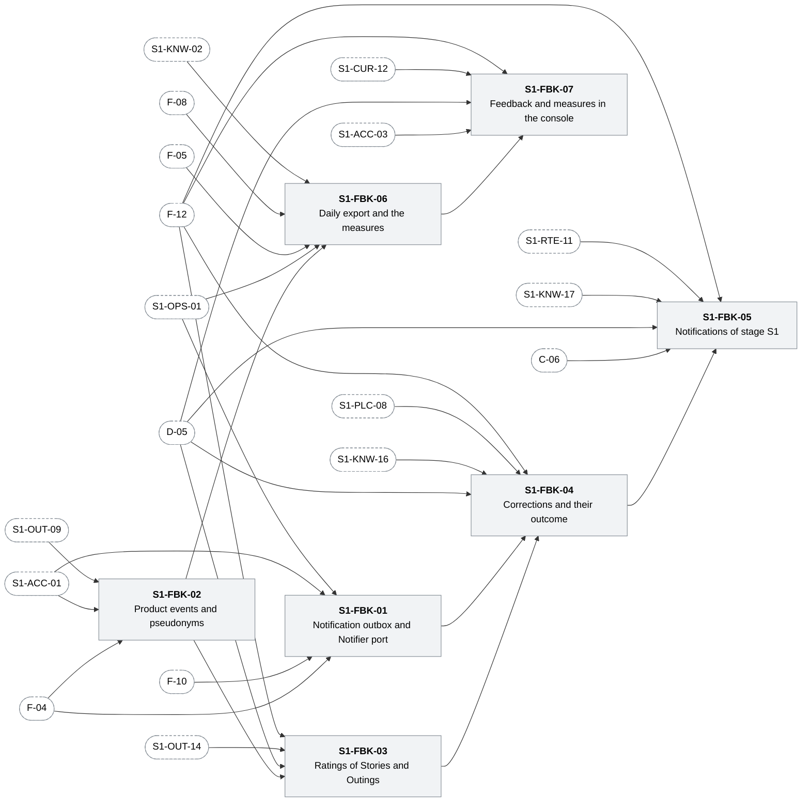
<!-- prettier-ignore-end -->
<!-- /generated -->

### S1-FBK-01 · Notification outbox and Notifier port

- **Status:** todo
- **Depends on:** F-04, F-10, S1-ACC-01, S1-OPS-01
- **Requirements:** `NTF-1`, `NFR-11`, `NFR-17`, `NFR-23`
- **Decisions:** ADR-0020 (points 1, 2, 4, 5), ADR-0024 (rules 2, 3)

**Goal.** An intent to notify is written to an outbox in the same transaction as the change that causes it, delivered right after commit within the same request through a `Notifier` port with push and e-mail channels, and retried or delivered when due by the hourly trigger.

**Tasks**

- [ ] Create the `notifications` module and schema: outbox (kind, recipient, payload by schema, due time, attempts, delivered time), device push tokens per person.
- [ ] Define notification kinds and payload schemas in `contracts`; payloads carry what happened and where to look, never a position or free text from another person.
- [ ] Define the `Notifier` port with push (Firebase Cloud Messaging through the Admin SDK) and e-mail (SMTP to the mail catcher locally; a provider adapter switched on by configuration) channels, each with a double on the `F-10` harness; a local push stand-in records messages for tests.
- [ ] Deliver after commit inside the request; register an outbox task with the hourly dispatcher (`S1-OPS-01`) that delivers what failed and what is due.
- [ ] Register the device's push token from the Android build and remove it on sign-out and deletion.
- [ ] Tests: a rolled-back change sends nothing; a failing channel leaves the entry for the next tick, which delivers it once; a due entry is not sent before its time.

**Done when**

- The three tests above pass against the compose environment, with the hourly tick fired by hand.
- An architecture test fails if any module sends through a channel adapter instead of the outbox.

**Owner only.** Creating the Firebase project's messaging configuration and the Android application's registration in it.

### S1-FBK-02 · Product events and pseudonyms

- **Status:** todo
- **Depends on:** F-04, S1-ACC-01, S1-OUT-09
- **Needs:** The journal intake on the server and the device journal (ADR-0017, point 7), through which device events travel; the device records its own trigger events (fired, confirmed, asked, false start) for trigger reliability.
- **Requirements:** `ANL-1`, `ANL-4`, `NFR-17`
- **Decisions:** ADR-0021 (points 5, 6, 9), ADR-0017 (point 7)

**Goal.** Product events are defined as versioned schemas in `contracts` that cannot hold a coordinate, arrive from devices through the journal and from the server in the same transaction as the change, and are written to a staging table under a per-person pseudonym.

**Tasks**

- [ ] Create the `measurement` module and schema: staging table, per-person pseudonym keys (random key per person; pseudonym = keyed hash of the identifier).
- [ ] Define the event catalogue in `contracts` with type and version: Route requested and offered, Route option chosen, Outing started, paused, finished and abandoned, Visit recorded with how detected, Story started and share heard, trigger events of the device, rating given, Correction sent, second Route requested, planned and actual duration; the first completed Outing is the activation event (`ANL-4`).
- [ ] Restrict event fields to enumerations, bounded integers, identifiers of Places, Routes and Outings, and times rounded to five minutes; add an architecture test that rejects any event schema with a non-integer number, a pair of numbers or a free-text field.
- [ ] Accept journal entries of event type and write them to staging in the transaction that applies the entry; reject entries that do not match their schema.
- [ ] Write a stated purpose for each event type next to its schema (`NFR-17`) and a test that none lacks one.

**Done when**

- The schema test fails on a deliberately added `lat` number field and on a free-text field.
- Events sent through the journal with the network cut and resent appear in staging exactly once (journal suite extended with events).

### S1-FBK-03 · Ratings of Stories and Outings

- **Status:** todo
- **Depends on:** S1-FBK-02, D-05, S1-OUT-14, F-12
- **Needs:** The end-of-Story and end-of-Outing moments in the Outing screens; the journal on device and server.
- **Requirements:** `FBK-1`, `FBK-2`, `FBK-5`
- **Decisions:** ADR-0017 (points 1, 2, 8)

**Goal.** At the end of a Story the listener can mark "liked" or "did not like", and at the end of an Outing each member can rate it; both are optional, work offline, arrive once, and are stored from the first day for later use.

**Tasks**

- [ ] Create the `feedback` module and schema: Story ratings (person, Story, Place, language, value), Outing ratings (person, Outing, value), one per person and subject; a repeat replaces the earlier value.
- [ ] Add journal entry types for both ratings with their versions; apply them idempotently.
- [ ] Add the controls to the Story player (app and web) and the end-of-Outing screen; dismissing them never blocks playback or navigation.
- [ ] Emit the rating events of `S1-FBK-02` in the same transaction.
- [ ] Extend the journal suite: ratings given offline, the network cut, resent and the process killed — zero lost, zero duplicated.

**Done when**

- The extended journal suite passes for ratings.
- The interface test shows the Story ends and the next one plays whether or not the rating is answered.

### S1-FBK-04 · Corrections and their outcome

- **Status:** todo
- **Depends on:** S1-FBK-03, S1-FBK-01, D-05, S1-KNW-16, S1-PLC-08, F-12
- **Needs:** Statement and source identifiers in a Story's text (KNW); the Proposed Change of a Place (ADR-0031) into which a Correction about a Place's data turns; the Corrections inbox in the console (`CUR-7`) where a Curator decides.
- **Requirements:** `FBK-3`
- **Decisions:** ADR-0017 (point 1), ADR-0031, ADR-0019 (point 1)

**Goal.** A person — Guest or User — attaches a Correction to a statement with its source or to a Place's data ("closed", "moved", "wrong hours", "missing from the base"), it reaches a Curator with a status, and its author sees the outcome.

**Tasks**

- [ ] Add Corrections to the `feedback` schema: author, target (statement and source of a Story version, or a Place with a kind of data issue, or a missing Place with a point picked on the map), text, status (received, in review, accepted, rejected, fixed), outcome note, times.
- [ ] Add the journal entry type and the interface: tap a sentence in the Story text to correct it; a Place's card offers the Place-data kinds; the Correction and the Complaint are offered in different places and named differently.
- [ ] Expose on the module interface the operations the Curator's inbox calls (list, take, decide with outcome); a Correction about the data of a Place is handed to the places module when it is filed and becomes a Proposed Change there, so that the Curator decides it once, in that queue, and this module reads the outcome back (ADR-0031, point 14); every decision is audited.
- [ ] Show "my Corrections" with status and outcome to the author; a Guest's outcome is read by the device.
- [ ] Write the outbox intent "Correction outcome" in the transaction of the decision.
- [ ] Extend the journal suite: a Correction sent offline arrives once.

**Done when**

- Steps "taps the sentence and sends a Correction" and "the listener is told the outcome" of `SC-6` pass in a scenario test, with the Curator's decision made through the module interface.
- The journal suite passes for Corrections.

### S1-FBK-05 · Notifications of stage S1

- **Status:** todo
- **Depends on:** S1-FBK-04, C-06, D-05, S1-KNW-17, S1-RTE-11, F-12
- **Needs:** A domain event when a Story becomes available for a Place in a language (KNW); a way to find the saved Routes and Route Packs that contain a Place (RTE/OUT).
- **Requirements:** `NTF-1`
- **Decisions:** ADR-0020 (points 1–4), ADR-0023 (point 4)

**Goal.** A person is notified when Stories for a saved Route become ready and when one of their Corrections has an outcome — by push on Android, and in the app's and web's own state for everyone.

**Tasks**

- [ ] Handle the "Story available" event: find saved Routes of people whose Stories became complete or improved, and write one "Stories ready" intent per Route, batched so that ten Places finishing do not send ten notifications.
- [ ] Deliver "Correction outcome" (intent from `S1-FBK-04`).
- [ ] Open the right screen from a notification on Android; on the web and on iPhone show the same in an in-app list read from the API.
- [ ] Respect the person's language for the text; a notification shows no Place coordinates or Story text.
- [ ] Tests with the local push stand-in: one Route with several Places finishing yields one notification; a decided Correction yields one notification to its author and none to others.

**Done when**

- Both tests pass in the compose environment.

**Owner only.** Confirming that a push arrives on a real Android phone from the cloud deployment; iPhone push is a recorded limitation until a paid Apple account exists.

### S1-FBK-06 · Daily export and the measures

- **Status:** todo
- **Depends on:** S1-FBK-02, S1-OPS-01, F-05, F-08, S1-KNW-02
- **Needs:** The cost ledger of Preparation (ADR-0012, point 5) for time and cost per Place.
- **Requirements:** `ANL-2`, `ANL-4`, `NFR-5`, `NFR-6`
- **Decisions:** ADR-0021 (points 7, 8), ADR-0024 (rule 3), ADR-0010 (point 7)

**Goal.** Once a day a job exports staged events to files in the private bucket, deletes the staged rows, computes every product measure with DuckDB over the files, and writes the results into aggregate tables.

**Tasks**

- [ ] Write the `export-events` job: read staged rows in pages, write them as files partitioned by day and event type through `ObjectStore`, delete exactly the rows written, resumable after a kill without loss or duplicate files.
- [ ] Write the measures as named DuckDB queries in code: share of started Outings finished; share of Stories heard among Places visited; share of people who request a second Route; reliability of automatic starts and false starts per Outing (`NFR-5`); planned versus actual duration (`NFR-3`); activations (`ANL-4`); time and cost of Preparation per Place from the ledger (`NFR-6`).
- [ ] Write results into aggregate tables of the `measurement` schema by day and city; aggregates hold no pseudonym.
- [ ] Register the job as the daily task of the hourly dispatcher.
- [ ] Tests on a fixture of events with known answers: each measure equals its expected value; killing the job mid-export and rerunning yields the same files and an empty staging table.

**Done when**

- The fixture test passes for every measure of `ANL-2`, `ANL-4` and `NFR-5`.
- After the job runs in the compose environment, the staging table is empty and the files are in the private bucket.

**Room to improve.** A retention rule for event files once the 10 GB of object storage is measured against volume.

### S1-FBK-07 · Feedback and measures in the console

- **Status:** todo
- **Depends on:** S1-FBK-06, S1-ACC-03, D-05, S1-CUR-12, F-12
- **Needs:** The console's dashboard area (`CUR-8`), into which these views go.
- **Requirements:** `FBK-6`, `NFR-28`
- **Decisions:** ADR-0021 (point 8)

**Goal.** Curators and Administrators see ratings, Corrections and product measures in aggregate in the console, without asking a developer.

**Tasks**

- [ ] Add internal read endpoints over the aggregate tables and over Corrections by status, city and kind.
- [ ] Build the console views: ratings of Stories by Place and language; Outing ratings; Corrections by status and age; each measure of `ANL-2` over time; activations.
- [ ] Restrict the views to Curator and Administrator roles; nothing personal is shown.
- [ ] Test: with the fixture of `S1-FBK-06` loaded, every view shows its expected numbers.

**Done when**

- The fixture test passes, and the role test of `S1-ACC-03` covers the new endpoints.

## S1-OPS — Operating S1

Running S1 locally and in the cloud with no manual steps: the single hourly trigger and its dispatcher; the cloud environment in Terraform; secrets; deployment by the pipeline with migrations before traffic and rollback by digest; a reachability page for the check from Belarus; backups with the restore rehearsal; the cost dashboard, budgets and alerts; the privacy tests; accessibility checks of the web; the compatibility suites; the load harness; and the sizing decided from the measurements of `C-05`. The trigger is first because Freshness Checks, notifications and the daily export hang on it; the cloud packages follow; `S1-OPS-12` waits for `C-05`.

<!-- generated:track S1-OPS -->
<!-- prettier-ignore-start -->
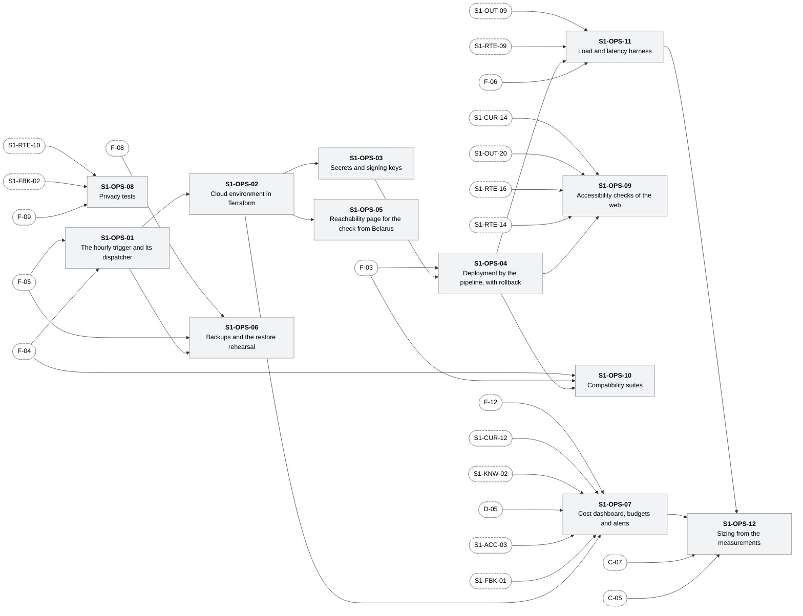
<!-- prettier-ignore-end -->
<!-- /generated -->

### S1-OPS-01 · The hourly trigger and its dispatcher

- **Status:** todo
- **Depends on:** F-04, F-05
- **Requirements:** `NFR-34`, `NFR-33`
- **Decisions:** ADR-0024 (rules 1–3), ADR-0031 (point 15)

**Goal.** One endpoint of the API, called once an hour, dispatches everything that is due from a registry — outbox retries, daily, weekly and monthly jobs, and the rows of the Freshness Checks — locally from a cron container and in the cloud from one scheduler job.

**Tasks**

- [ ] Add the internal endpoint for the tick, accepting only the scheduler's identity in the cloud and a shared local secret in compose.
- [ ] Write the dispatcher registry: a module registers a task with its interval (hourly, daily, weekly, monthly) or as a table of rows with next-run times; the tick runs due in-request tasks and launches due jobs through `F-05`.
- [ ] Make the tick idempotent per hour (a row keyed by the hour) so that a repeated or late call does nothing twice, and so that a missed hour is caught up once.
- [ ] Add a cron container to `compose.yaml` that calls the endpoint hourly, and a command to fire one tick by hand for tests.
- [ ] Add a test that the tick on an idle system issues only the queries needed to find due work, and an architecture test that no module starts a timer or interval in the API process.

**Done when**

- In the compose environment a tick fired by hand runs a registered test task once; firing it twice in the same hour runs it once (integration test).
- The architecture test fails on a deliberate `setInterval` in a module.

### S1-OPS-02 · Cloud environment in Terraform

- **Status:** todo
- **Depends on:** S1-OPS-01
- **Requirements:** `NFR-29`, `NFR-34`, `NFR-31`
- **Decisions:** ADR-0001 (points 1–5), ADR-0002 (point 1), ADR-0010 (points 1, 3, 8, 9), ADR-0018 (point 4), ADR-0007 (point 4), ADR-0024 (rules 3, 5)

**Goal.** Every cloud resource of S1 is described in `infra/` and created by Terraform: the Cloud Run service and jobs, the scheduler job, Firebase Authentication, messaging and Hosting for the console, service identities, the two R2 buckets, and the database connection; every resource carries a component label.

**Tasks**

- [ ] Describe the Cloud Run service for the API (one instance at most, scale to zero, image by digest variable) and the jobs `worker`, `job` and `migrate` in a Tier 1 region set as a variable next to the database's region.
- [ ] Describe the one Cloud Scheduler job calling the tick hourly with an identity token, and the service identities with least privilege (the API may start jobs; jobs may read their secrets).
- [ ] Describe Firebase Authentication with the Google provider, messaging, and Hosting for the console's static build.
- [ ] Describe the public and private R2 buckets with the Cloudflare provider and the CORS rules the web needs; the database is a Neon project whose connection strings (pooled for the API, direct for the worker and migrations) are supplied as secrets — through a Terraform provider if one meets ADR-0002's rule of OpenTofu compatibility, otherwise created by the owner.
- [ ] Add workload identity federation for the GitHub repository; the state lives in a Cloud Storage bucket; label every resource with its component.
- [ ] Extend the pipeline's Terraform check with `plan` against the real state on `main` (read-only), and document the bootstrap in `infra/README.md`.

**Done when**

- `terraform validate` and `terraform plan` run in the pipeline with no changes pending after the first apply.
- Every resource in the plan carries a component label (a test over the plan's JSON).

**Owner only.** Creating the Google Cloud billing account (Poland) and project, the Cloudflare and Neon accounts, the state bucket, and approving the first apply; every later change that creates a paid resource.

**Room to improve.** A second, short-lived environment per pull request — not free while idle today, so not built.

### S1-OPS-03 · Secrets and signing keys

- **Status:** todo
- **Depends on:** S1-OPS-02
- **Requirements:** `NFR-31`
- **Decisions:** ADR-0002 (point 2), ADR-0024 (rule 5), ADR-0022 (point 5)

**Goal.** No secret is in the repository; the cloud's secrets are bundled into as few Secret Manager entries as the free allowance covers, the application validates its configuration at start, and the pipeline blocks a committed secret.

**Tasks**

- [ ] Define the configuration schema of the API, worker and jobs; the process refuses to start with a missing or malformed value and names it without printing it.
- [ ] Bundle the cloud secrets (database strings, R2 keys, model and speech keys, entitlement-snapshot signing key, the tick's local secret where needed) into at most the free number of entries, mounted into the service and jobs.
- [ ] Add a secret scanner to `pnpm lint` and the pipeline, with an allow-list for the local emulator keys in `docker/`.
- [ ] Generate the entitlement-snapshot key pair and the per-environment pseudonym secret as documented one-off steps; rotate by adding a new version.
- [ ] Enforce HTTPS only and strict transport security on the API and the console's hosting.

**Done when**

- A test commit with a fake key fails the secret scan in the pipeline.
- Starting the API without a required variable exits with a message naming the variable (test).

**Owner only.** Entering every real secret value into Secret Manager.

### S1-OPS-04 · Deployment by the pipeline, with rollback

- **Status:** todo
- **Depends on:** S1-OPS-03, F-03
- **Requirements:** `NFR-29`, `NFR-38`, `NFR-33`
- **Decisions:** ADR-0002 (point 2), ADR-0026 (points 3, 4), ADR-0023 (points 1, 2)

**Goal.** On `main` the pipeline builds one image once, pushes it to GitHub Container Registry, runs the migrations job, deploys the image by digest with Terraform, checks the deployment, deploys the console, builds the Android APK, and can roll back to any earlier digest by a workflow run without touching the schema.

**Tasks**

- [ ] Add the release workflow: build the image, push by digest, record the digest and the release tag.
- [ ] Run `migrate` as a Cloud Run job with the new image before the service receives the new digest; stop the deployment if it fails.
- [ ] Deploy the service by digest through Terraform; afterwards call `GET /health/live` and one read endpoint once (not periodically) and roll back automatically if either fails.
- [ ] Add a rollback workflow that takes a digest (default: the previous release) and redeploys it with no schema step.
- [ ] Build and deploy the console to Firebase Hosting, and build an Android APK attached to each release.
- [ ] Authenticate only through workload identity federation; no long-lived key exists in the repository or its settings.

**Done when**

- A merge to `main` deploys to the cloud with no manual step, and the run shows migrations completing before traffic moves.
- Running the rollback workflow returns the service to the previous digest and the previous release's smoke test passes against it.

**Owner only.** Approving the GitHub environment that holds the deployment permission; installing the APK on test phones.

### S1-OPS-05 · Reachability page for the check from Belarus

- **Status:** todo
- **Depends on:** S1-OPS-02
- **Requirements:** `NFR-23`
- **Decisions:** ADR-0001, ADR-0010, ADR-0019, ADR-0020, README "Checks that come before building on a decision"

**Goal.** A public test page calls every service a phone or a browser talks to directly — the API's address, Firebase Authentication, Firebase Cloud Messaging, the public bucket's address and a signed link of the private bucket, the console's hosting — and shows which answered, so that check `C-06` can be done by a person in Belarus.

**Tasks**

- [ ] Publish the page as a static page of its own, so that it needs only the project and the buckets of `S1-OPS-02` and can be opened before anything else is deployed. It has one row per service, each with the time to answer and the result; it creates nothing (anonymous sign-in is attempted against a test-only path that deletes the user at once, or only the service's discovery endpoint is called).
- [ ] Add a "copy result" button that produces a text the owner can paste back; the page stores nothing.
- [ ] Include an Android build variant of the same checks reachable from the app's developer menu.
- [ ] Document what the page proves and what it does not (one network, one moment).

**Done when**

- The page reports every service as reachable from the pipeline's runner (test against the deployed environment).

**Owner only.** Arranging for a person in Belarus to open the page on a phone and in a browser, on mobile and fixed networks — that is check `C-06`.

### S1-OPS-06 · Backups and the restore rehearsal

- **Status:** todo
- **Depends on:** S1-OPS-01, F-05, F-08
- **Requirements:** `NFR-30`, `ACC-6`
- **Decisions:** ADR-0010 (point 6), ADR-0026 (point 7, consequences), ADR-0024 (rule 3), ADR-0019 (point 8)

**Goal.** A weekly job writes a compressed dump to the private bucket and deletes dumps older than the fixed retention, and a monthly job restores the latest dump into a fresh database, applies the migrations after it, checks the result and reports it.

**Tasks**

- [ ] Write the `backup` job: a compressed dump over a direct connection to the private bucket under a dated key; delete dumps beyond the retention (a fixed number of weeks, configuration).
- [ ] Write the `restore-rehearsal` job: create a fresh database (a temporary database locally; a temporary branch or database on the provider in the cloud), restore the latest dump, apply pending migrations, run the integrity checks (row counts per module schema, the audit log readable, one Route replanned from its stored request), drop the database.
- [ ] Register both with the hourly dispatcher (weekly and monthly); record each run's result and raise an alert through the outbox on failure.
- [ ] Write the restore procedure for a real incident in `infra/README.md`, including the database's own short-range restore.
- [ ] Tests in the compose environment: backup then rehearsal succeeds; a corrupted dump makes the rehearsal fail and alert.

**Done when**

- Both compose tests pass, and the first cloud rehearsal's result is visible in the console's operations view (`S1-OPS-07`).

**Room to improve.** Measure the dump's network transfer against the database plan's monthly allowance, and lengthen or shorten the interval from it.

### S1-OPS-07 · Cost dashboard, budgets and alerts

- **Status:** todo
- **Depends on:** S1-OPS-02, S1-FBK-01, S1-ACC-03, D-05, S1-KNW-02, S1-CUR-12, F-12
- **Needs:** The cost ledger with monthly budgets per provider (ADR-0012, points 5–6); Preparation failure counts from the workflow state.
- **Requirements:** `NFR-34`, `NFR-28`, `NFR-22`
- **Decisions:** ADR-0024 (rules 5–7), ADR-0021 (point 3), ADR-0001 (point 5)

**Goal.** The console shows what can run out — instance hours including those held by connections, database compute hours and network transfer, storage, and each ledger budget — refreshed daily; platform alerts are at most three; every other alert is raised by the system through the outbox.

**Tasks**

- [ ] Write a daily task that reads usage from the platforms' APIs (Cloud Run instance time, the database provider's consumption, object-storage size) into a usage table; locally the same task reads stand-in values.
- [ ] Build the console's operations view: usage against each free allowance and each ledger budget, with the date the allowance resets; last results of backup, rehearsal, export and Freshness Check runs; outbox backlog and journal intake backlog.
- [ ] Define at most three platform alert conditions in Terraform: the API not answering (a check of `GET /health/live`, which does not touch the database), a high rate of server errors, and one left for the database's compute hours if the provider exposes it.
- [ ] Raise the other alerts from the system through the outbox to Administrators: Preparation failing repeatedly, a ledger budget reached, outbox or journal backlog, allowance above a threshold, rehearsal failed.
- [ ] Add billing budgets well below the owner's ceiling, with notification to the owner.

**Done when**

- The operations view shows every quantity of ADR-0024 rule 7 in the compose environment from stand-in values, and in the cloud from real ones.
- Reaching a ledger budget in a test raises one alert through the outbox and stops the work that would exceed it.
- The Terraform plan has no more than three alert conditions (test over the plan).

**Owner only.** Setting the budget amounts and the ceiling's notification address.

### S1-OPS-08 · Privacy tests

- **Status:** todo
- **Depends on:** F-09, S1-FBK-02, S1-RTE-10
- **Needs:** The Route request with a coarse start cell (RTE); the model and speech ports' request shapes (KNW, RTE).
- **Requirements:** `NFR-14`, `NFR-16`, `NFR-17`, `NFR-31`
- **Decisions:** ADR-0027 (point 9), ADR-0019 (point 8), ADR-0021 (point 5), ADR-0006 (point 11)

**Goal.** Automated tests prove that exact coordinates of a person never reach the server, that requests to model and speech services carry no identifier of a person and no location finer than the city, that every collected item has a stated purpose, and that one person cannot read another's data.

**Tasks**

- [ ] Add a guard on the model and speech ports that rejects a request containing a person's identifier, an e-mail address or a coordinate finer than the city, with a test per port.
- [ ] Add a test that the Route request schema accepts a start or finish taken from the person's position only as a cell of the stated size, and that the server stores and logs nothing finer.
- [ ] After a scripted S1 scenario in the compose environment, scan the database, the object storage and the logs for coordinate-shaped values of the scenario's track; only Place data and points picked on the map may appear.
- [ ] Keep a data inventory beside each module's schema — each personal column with its purpose — and a test that fails for a personal column without one.
- [ ] Add a test that walks every person-required endpoint as another person and gets a refusal or an empty result for the first person's data.

**Done when**

- Every test above passes in the pipeline; each fails on a deliberate violation (a coordinate in a log line, an identifier in a model request, a column without purpose).

### S1-OPS-09 · Accessibility checks of the web

- **Status:** todo
- **Depends on:** S1-OPS-04, S1-RTE-14, S1-RTE-16, S1-OUT-20, S1-CUR-14
- **Needs:** The public web's screens (Route Page, Route request and editing, Story player) and the console's screens as they are built.
- **Requirements:** `NFR-27`
- **Decisions:** ADR-0007 (point 6), ADR-0027 (point 10)

**Goal.** On every change the web build and the console are checked automatically against WCAG 2.2 level AA on every page in a list that grows with the screens.

**Tasks**

- [ ] Add a browser-driven check (an axe-based runner) over the server-rendered public pages and the console in the compose environment.
- [ ] Keep the list of pages and states to check in one file; a new route of the web without an entry fails a test.
- [ ] Check keyboard-only navigation of the Route Page and the Story player, and that every Story's text is present beside its audio.
- [ ] Add the job to the pipeline as a required check.

**Done when**

- The job passes on `main` with zero violations of level AA on every listed page, and fails on a deliberately unlabeled button.

**Owner only.** The screen-reader pass by hand on the web and on both phones before the stage is called done.

### S1-OPS-10 · Compatibility suites

- **Status:** todo
- **Depends on:** S1-OPS-04, F-03, F-04
- **Requirements:** `NFR-29`, `NFR-38`
- **Decisions:** ADR-0025 (points 3, 6), ADR-0026 (point 4), ADR-0027 (point 8)

**Goal.** On every change the pipeline runs the previous release's contract against the current server, and the previous release's suite against the schema after the current migrations, so that a rollback by digest and old app builds keep working.

**Tasks**

- [ ] Package each release's contract tests (requests and expected response shapes generated from its OpenAPI document and its journal entry versions) as an artefact attached to the release.
- [ ] Add a pipeline job that starts the current server in compose and runs the previous release's contract tests against it.
- [ ] Add a pipeline job that applies the current migrations to a database, then starts the previous release's image against it and runs that release's integration suite.
- [ ] Add a test that every journal entry type and event version of the previous release is still accepted.

**Done when**

- Both jobs run and pass on `main` once two releases exist; a deliberately removed column still used by the previous release fails the second job.

### S1-OPS-11 · Load and latency harness

- **Status:** todo
- **Depends on:** F-06, S1-OPS-04, S1-RTE-09, S1-OUT-09
- **Needs:** The Route request endpoint and the journal intake.
- **Requirements:** `NFR-4`, `NFR-32`
- **Decisions:** ADR-0003 (consequences), ADR-0024 (consequences)

**Goal.** A repeatable harness drives the design load — 50 Route requests a minute at peak and the journal traffic of 500 Outings in progress — against the compose environment or the cloud, and reports the 95th-percentile latency of warm requests and of the first request after an idle period.

**Tasks**

- [ ] Write the load scenarios with a standard load-testing tool: Route requests from a fixed set; journal batches at the rate of 500 Outings; Route Page loads.
- [ ] Add a cold-path measurement: wait past the container's and the database's idle suspension, then time one Route request end to end, repeated.
- [ ] Report the percentiles, the planner pool's queue and the instance's memory in a short machine-readable result.
- [ ] From the results, write what has to be added to carry ten times the design load — instances, the size of the pool, the size of the database — and name anything that would have to be redesigned (`NFR-32`).
- [ ] Run the harness against compose in the pipeline at a reduced rate as a regression check on warm latency; the full run is on demand only, because it spends free instance hours.

**Done when**

- The reduced run in the pipeline is gated on regression against a baseline stored from the same kind of runner; the comparison with the thresholds of `NFR-4` is made on the run in the cloud.
- The on-demand run against the cloud produces the result file used by check `C-05`.
- The result states how ten times the design load is reached by adding capacity, or lists what stands in the way.

**Owner only.** Starting the full cloud run, which uses free instance and database hours.

### S1-OPS-12 · Sizing from the measurements

- **Status:** todo
- **Depends on:** C-05, C-07, S1-OPS-07, S1-OPS-11
- **Requirements:** `NFR-4`, `NFR-32`, `NFR-34`
- **Decisions:** ADR-0003 (consequences), ADR-0024, ADR-0010 (not verified)

**Goal.** The instance's memory and processors, the planner pool's size, the alert thresholds and the free-allowance warnings are set from the measurements of `C-05`, and what the measurements did not confirm is written down as a limitation.

**Tasks**

- [ ] Set the instance size and pool size in Terraform and configuration from the measured planning time, graph and matrix memory, and cold-path latency.
- [ ] Set the allowance thresholds of the operations view and the alerts from the measured database hours per idle day and per test day.
- [ ] Record the measured values and any threshold not met in the stage's limitations (for `S1-GATE-01`).

**Done when**

- A rerun of the harness after the change meets `NFR-4` warm and cold, or the miss is recorded as a limitation with its number.

**Owner only.** Deciding to accept a missed threshold as a limitation or to spend to meet it.

## S1-GATE — Closing stage S1

One package that proves stage S1 complete by specification §7.4.

<!-- generated:track S1-GATE -->
<!-- prettier-ignore-start -->
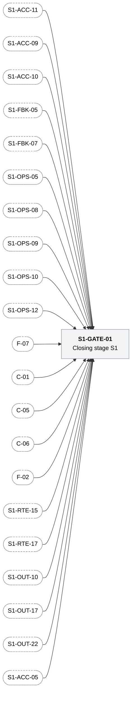
<!-- prettier-ignore-end -->
<!-- /generated -->

### S1-GATE-01 · Closing stage S1

- **Status:** todo
- **Depends on:** S1-ACC-11, S1-ACC-09, S1-ACC-10, S1-FBK-05, S1-FBK-07, S1-OPS-05, S1-OPS-08, S1-OPS-09, S1-OPS-10, S1-OPS-12, F-07, C-01, C-05, C-06, F-02, S1-RTE-15, S1-RTE-17, S1-OUT-10, S1-OUT-17, S1-OUT-22, S1-ACC-05
- **Needs:** Every S1 package of the tracks `S1-PLC`, `S1-KNW`, `S1-CUR`, `S1-RTE` and `S1-OUT` done; the reference Outing of Minsk prepared and verified.
- **Requirements:** `NFR-5`, `NFR-7`, `NFR-4`, `NFR-38`
- **Decisions:** ADR-0027 (points 5, 13–15), ADR-0023 (point 4)

**Goal.** Scenarios `SC-1`, `SC-4`, `SC-5` and `SC-6` pass without a developer's help, the automatable acceptance criteria of S1 pass in the pipeline, the thresholds that apply are measured, the system starts locally with one command and is deployed by the pipeline, and the known limitations are written down.

**Tasks**

- [ ] Write one automated scenario test per scenario against the compose environment, as far as automation reaches: `SC-1` through request, edit, Route Pack and an Outing driven by a recorded track; `SC-4` with the network cut mid-Outing and restored; `SC-5` through the console's endpoints only; `SC-6` from the Correction to the outcome.
- [ ] Make a table of every S1 requirement's acceptance criterion with the test that covers it, or the reason it is checked by hand; fill the gaps found.
- [ ] Collect the measured values of `NFR-4`, `NFR-5`, `NFR-7`, `NFR-3`, `NFR-8` and `NFR-18` from the harness, the measures and the field protocol into the stage record.
- [ ] Write the stage's known limitations: those recorded in the decision records (iPhone push, Sign in with Apple, e-mail sign-in only locally, the development address of public files, one instance for real time, hourly accuracy of reminders) and any threshold not met.
- [ ] Compare every screen built in this stage with its image under `design/approved/` and list the differences for the owner.
- [ ] Draw a random sample from the Stories that the first Preparation produced (`S1-KNW-22`) for the owner to label against their sources, and report it as the reading of `NFR-18` for the stage.
- [ ] Verify from a clean clone that `docker compose up --build --wait` and the smoke test pass, and that the last deployment came from the pipeline.

**Done when**

- The four scenario tests pass in the pipeline.
- Every S1 acceptance criterion in the table is either covered by a passing test or has a completed hand check recorded.
- The stage record lists a measured value, not an assumption, for each threshold named above.

**Owner only.** Walking the reference Outing in Minsk twice with the screen locked on an iPhone and an Android phone, recording trigger reliability and battery use (`NFR-5`, `NFR-7`), and once in airplane mode; running `SC-5` and `SC-6` in the console personally; the screen-reader pass; declaring the stage done.

## S2 — The Party

The Party on top of the S1 Outing that already belongs to a Party of one: Invitations answered in a browser, combining preferences, voting, the real-time gateway with Chat and Complaints, the Meeting Point and position sharing, the shared Outing in several languages, Party notifications, the Organizer's cover, and the Party measures. The invitation and answers come first, planning for the Party next, then the live phases that need the gateway.

<!-- generated:track S2 -->
<!-- prettier-ignore-start -->
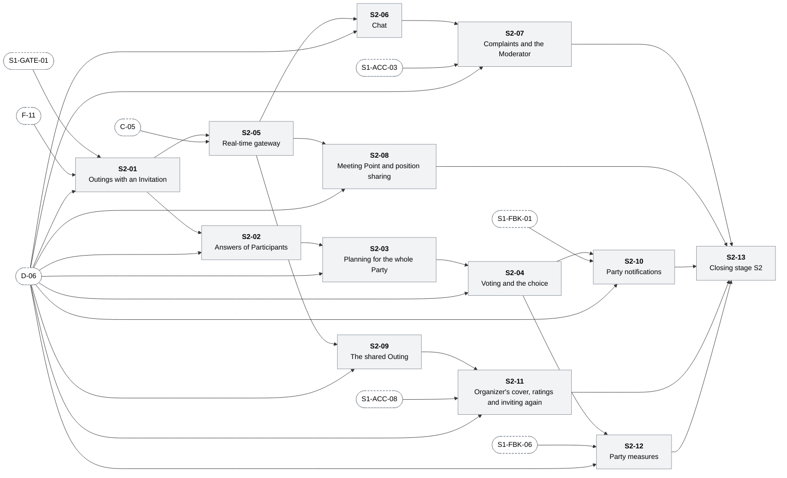
<!-- prettier-ignore-end -->
<!-- /generated -->

### S2-01 · Outings with an Invitation

- **Status:** todo
- **Depends on:** S1-GATE-01, F-11, D-06
- **Needs:** The Outing modelled as belonging to a Party from S1 (`PTY-1`); server-rendered pages of the public web (ADR-0007); design of the Invitation page and Outing-creation screens (`D-06`).
- **Requirements:** `PTY-2`, `PTY-3`, `PTY-5`, `PTY-6`, `PTY-12`
- **Decisions:** ADR-0028 (points 3–5), ADR-0019 (point 1), ADR-0007 (point 2)

**Goal.** An Organizer with an account creates an Outing with date, time, duration, area, start, mode and Travel Mode and gets an unguessable, replaceable Invitation link whose page opens in a browser without installation or account; a Party has at most ten members.

**Tasks**

- [ ] Create the `party` module: Party, members with role, Invitation token (revocable), answers stored with the Outing and deleted with it.
- [ ] Server-render the Invitation page with link-preview tags; opening it creates nothing.
- [ ] Organizer powers: hand over the role, remove a member, replace the link (old link and removed members lose access at once); the role passes to the longest-standing member after the planned start if the Organizer is gone.
- [ ] Count answers to an Invitation as a costly endpoint; refuse the eleventh member.
- [ ] Tests: replaced link refused; removed member refused; deleting the Outing deletes every Guest answer.

**Done when**

- The tests above pass, and the Invitation page renders on a phone browser without an account.

### S2-02 · Answers of Participants

- **Status:** todo
- **Depends on:** S2-01, D-06
- **Needs:** The Profile questions and closed lists (PRF); design of the answer form (`D-06`).
- **Requirements:** `PTY-4`, `PTY-11`, `I18N-4`
- **Decisions:** ADR-0019 (point 1)

**Goal.** A Participant answers at most five questions — name, Dealbreakers, liked themes, pace, an optional Wish — pre-filled from their Profile if they have one, each in their own language, within a minute; a late answer offers the Organizer a recalculation.

**Tasks**

- [ ] Build the answer form for the web and the app, pre-filled from the Profile; a Guest is created at submission.
- [ ] Store each member's language; everything shown to a member uses it.
- [ ] When an answer arrives after options were offered, offer the Organizer a recalculation; a member joining on the day counts as neutral until they answer.
- [ ] Prepare the usability run: a script of the answer flow and a way to time it.

**Done when**

- A scenario test answers four Invitations from four browser sessions without accounts, in two languages.

**Owner only.** The usability run with people who have not seen the form: answering takes under a minute.

### S2-03 · Planning for the whole Party

- **Status:** todo
- **Depends on:** S2-02, D-06
- **Needs:** The planner and verifier (ADR-0006, point 4) extended with the lexicographic Party objective and the generator of Parties in the property suite; design of the Party option cards with their line and tags (`D-06`).
- **Requirements:** `RTE-16`, `PTY-7`, `PTY-8`, `PTY-9`
- **Decisions:** ADR-0006 (points 4–6), ADR-0027 (point 1)

**Goal.** Routes for a Party respect every member's Dealbreakers, maximise the least satisfied member and then the total, carry one line per option saying what is in it for whom with a tag per member, and when Dealbreakers leave nothing feasible say which Dealbreaker blocks without naming whose.

**Tasks**

- [ ] Combine members' Profiles and answers into the Party planning request; ties broken by total satisfaction; each member finds at least one option leaning their way.
- [ ] Generate the option line and per-member tags from the planner's features; never promise "suits everyone".
- [ ] Explain infeasibility by Dealbreaker and offer the Organizer's relaxations (time, area, fewer stops); only a member can lift their own Dealbreaker.
- [ ] Extend the property suite: over generated Parties no offered Route violates any member's Dealbreaker; the conflict case of §4.8's acceptance names the least-served member.

**Done when**

- The Party property suite passes on every change, with the byte-identical engine check of `F-07` extended to Party requests.

### S2-04 · Voting and the choice

- **Status:** todo
- **Depends on:** S2-03, D-06
- **Needs:** Design of voting and the choice (`D-06`).
- **Requirements:** `PTY-10`
- **Decisions:** —

**Goal.** Participants mark each option "for" or "against", members who have not answered count as neutral, the Organizer makes the final choice, and a recalculation discards the votes.

**Tasks**

- [ ] Store votes per member and option version; show the tally to the Party.
- [ ] Organizer confirms an option, moving the Party to Agreed (§3.5).
- [ ] Discard votes on recalculation; tests for each transition.

**Done when**

- The state transitions of §3.5 up to Agreed are covered by tests.

### S2-05 · Real-time gateway

- **Status:** todo
- **Depends on:** S2-01, C-05
- **Requirements:** `NFR-13`, `NFR-32`
- **Decisions:** ADR-0018 (points 1–4, 7), ADR-0024 (rule 4), ADR-0003 (point 6)

**Goal.** A `realtime` module accepts WebSocket connections only during live phases of a Party, closes them after minutes without traffic, fans out in memory behind a `Fanout` port, and orders messages by a per-Outing sequence number stored in Postgres.

**Tasks**

- [ ] Add the WebSocket endpoint with the same schemas as REST; authenticate on connect; close idle connections.
- [ ] Write the `Fanout` port with its in-memory adapter; clients state the last sequence number they saw and fetch any gap through REST.
- [ ] Show instance hours held by connections on the operations view.
- [ ] Measure latency against `NFR-13` with the harness of `S1-OPS-11`.

**Done when**

- Messages sent from two devices arrive in the same order on all devices (test); Chat and positions meet 2 s and progress 5 s at the 95th percentile in the harness.

**Owner only.** Accepting the recorded limit of one instance (about a thousand connections) until the broker adapter is written.

### S2-06 · Chat

- **Status:** todo
- **Depends on:** S2-05, D-06
- **Needs:** The journal on the device for messages composed offline (ADR-0017); design of the Chat (`D-06`).
- **Requirements:** `PTY-13`
- **Decisions:** ADR-0018 (points 3, 6), ADR-0020 (consequences)

**Goal.** A Party has a Chat of text messages, reactions and system events, used by Guest Participants on the web too, existing for the life of the Outing and removed with it; a message sent offline is delivered once.

**Tasks**

- [ ] Store messages with their sequence number in one transaction; system events ("Dima answered", "option 2 chosen") as messages of their own kind.
- [ ] Deliver to connected members through the gateway and to disconnected ones through push, de-duplicated by sequence number.
- [ ] Replace the author's name with "deleted user" in the account-deletion workflow of `S1-ACC-11`.
- [ ] Tests: offline message delivered once; Chat removed with its Outing.

**Done when**

- The tests above pass, and the account-deletion privacy test covers Chat.

### S2-07 · Complaints and the Moderator

- **Status:** todo
- **Depends on:** S2-06, S1-ACC-03, D-06
- **Needs:** The console's shell; design of Complaints and the Moderator's inbox in the console (`D-06`).
- **Requirements:** `FBK-4`, `CUR-10`, `ACC-7`
- **Decisions:** ADR-0019 (points 6, 7)

**Goal.** Any Chat message can be the subject of a Complaint that goes to a Moderator, who can dismiss it, hide or remove the message, or restrict the person; a restricted person cannot post and is told so.

**Tasks**

- [ ] Add Complaints to the `feedback` module, distinct from Corrections in model and interface.
- [ ] Build the Complaints inbox in the console for the Moderator role; every decision audited.
- [ ] Add restrictions on a person checked by Chat (and later by publishing).
- [ ] Tests: a restricted person's message is refused with its code; a non-Moderator cannot reach the inbox.

**Done when**

- The tests above pass, and the console's role test covers the inbox.

### S2-08 · Meeting Point and position sharing

- **Status:** todo
- **Depends on:** S2-05, D-06
- **Needs:** The map component on app and web; design of the Meeting Point, statuses and position sharing (`D-06`).
- **Requirements:** `PTY-14`, `PTY-15`, `NFR-14`
- **Decisions:** ADR-0018 (point 5), ADR-0027 (point 9)

**Goal.** The Party sees the Meeting Point and each member's status ("on my way", "here"); a member may share their position, off by default, limited in time, stoppable, ending when the Outing starts, relayed in memory and never stored.

**Tasks**

- [ ] Meeting Point and statuses in the Party's state.
- [ ] Position relay in memory only, with the time limit and the end at Start enforced on the server at relay time.
- [ ] Extend the privacy test: after sharing stops, no position in the database, object storage or logs.

**Done when**

- The extended privacy test passes; a shared position reaches the Party within 2 s at the 95th percentile.

### S2-09 · The shared Outing

- **Status:** todo
- **Depends on:** S2-05, D-06
- **Needs:** Visits delivered by the journal (OUT); manual Story playback on the web (`OUT-20`, S1 part); design of the shared Outing on app and web (`D-06`).
- **Requirements:** `PTY-16`, `OUT-20`, `I18N-4`
- **Decisions:** ADR-0018 (point 6), ADR-0017

**Goal.** Visits are visible to every member as they arrive, each member listens on their own device in their own language, a device without a network catches up later, and the web shows the Route and shared progress.

**Tasks**

- [ ] Announce Visits to the Party through the gateway as the journal delivers them.
- [ ] Shared progress on the web page of the Outing.
- [ ] Two members at different Places: each device records its own Visits; progress shows both.
- [ ] Scenario test of `SC-3`: one Outing, Stories in Russian on one device and English on the other, progress shared.

**Done when**

- The `SC-3` scenario test passes, and progress reaches other members within 5 s at the 95th percentile.

### S2-10 · Party notifications

- **Status:** todo
- **Depends on:** S2-04, S1-FBK-01, D-06
- **Needs:** Design of Party notifications and their settings (`D-06`).
- **Requirements:** `NTF-2`, `NTF-3`, `NTF-4`, `NTF-5`
- **Decisions:** ADR-0020 (points 2, 3, 5)

**Goal.** Party members are notified of a new answer (Organizer only), options offered, the option chosen, a reminder before the Outing and Chat messages; a Guest Participant may leave an e-mail for the chosen option and the reminder; each kind can be switched off; the Invitation page always shows the current state.

**Tasks**

- [ ] Write the intents for each kind in the transactions that cause them; the reminder as a due-time entry.
- [ ] Per-kind preferences per person, checked before delivery.
- [ ] Optional e-mail of a Guest Participant, deleted with the Outing.
- [ ] Test that the Invitation page reflects every state without any notification.

**Done when**

- A test per kind shows delivery and suppression when switched off.

**Owner only.** Buying the domain and switching on the e-mail provider for Guests in the cloud.

### S2-11 · Organizer's cover, ratings and inviting again

- **Status:** todo
- **Depends on:** S2-09, S1-ACC-08, D-06
- **Needs:** Design of the Party rating and "invite the same people" (`D-06`).
- **Requirements:** `ENT-5`, `PTY-17`, `PTY-18`
- **Decisions:** ADR-0022 (point 3)

**Goal.** For the duration of an Outing the Organizer's entitlements extend to every member, each member rates the Outing for themselves, and a past Party can be invited again in one step.

**Tasks**

- [ ] Grant the Organizer's cover to members for the Outing's duration (grant source "Organizer's cover").
- [ ] Per-member rating at the end (reusing `S1-FBK-03`).
- [ ] "Invite the same people" copies the member list into a new Outing.
- [ ] Test with open access off: a Free Participant gets Route Packs through a Plus Organizer's cover and loses them after the Outing.

**Done when**

- The test above passes.

### S2-12 · Party measures

- **Status:** todo
- **Depends on:** S2-04, S1-FBK-06, D-06
- **Needs:** Design of the Party measures view in the console (`D-06`).
- **Requirements:** `ANL-3`
- **Decisions:** ADR-0021 (point 7)

**Goal.** The share of invited people who answer, the time from Invitation to an agreed Route and the share of agreed Outings started are computed daily and shown in the console.

**Tasks**

- [ ] Add the Party events and the three measures with fixture tests.
- [ ] Add the view to the console.

**Done when**

- The fixture test passes for each measure.

### S2-13 · Closing stage S2

- **Status:** todo
- **Depends on:** S2-07, S2-08, S2-10, S2-11, S2-12
- **Requirements:** `NFR-13`
- **Decisions:** ADR-0027 (points 14, 15)

**Goal.** `SC-2` and `SC-3` pass without a developer's help, real-time thresholds are measured, and S2's limitations are recorded.

**Tasks**

- [ ] Automated `SC-2` with four browser Participants without accounts.
- [ ] Compare every screen built in this stage with its image under `design/approved/` and list the differences for the owner.
- [ ] Measure `NFR-13` in the cloud; record the one-instance limit and push limitations.

**Done when**

- `SC-2` and `SC-3` scenario tests pass in the pipeline, and the stage record holds measured latencies.

**Owner only.** A real Party of several people on phones and browsers; declaring the stage done.

## S3 — The Catalog

Routes that travel beyond one Party: Curator Routes and filters, publishing by Users with screening, ratings, Reviews and Catalog order, Complaints about publications, learning from ratings, the Recap and personal map, ask the guide, Story text in Belarusian, and the Pass, subscription and sandbox payments. Curator Routes come first, so the Catalog is never empty; payments are independent and can come at any point.

<!-- generated:track S3 -->
<!-- prettier-ignore-start -->
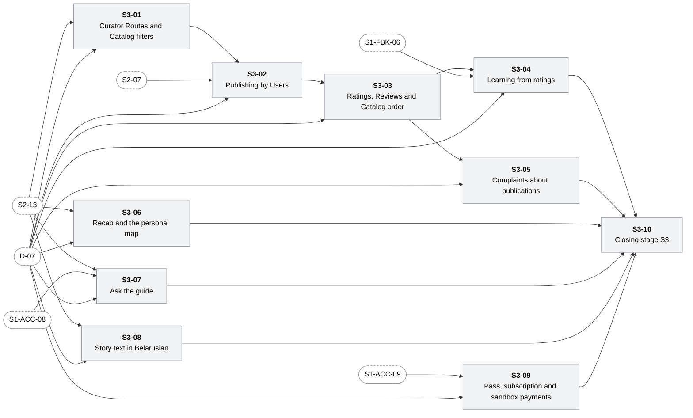
<!-- prettier-ignore-end -->
<!-- /generated -->

### S3-01 · Curator Routes and Catalog filters

- **Status:** todo
- **Depends on:** S2-13, D-07
- **Needs:** The Route Page and Route versions (EDT); the console's shell; design of the Catalog and its filters, and Catalog editing in the console (`D-07`).
- **Requirements:** `CAT-2`, `CAT-3`, `CUR-11`
- **Decisions:** ADR-0010 (point 2)

**Goal.** Curators assemble and publish Catalog Routes for the Reference City, and people filter the Catalog by duration, themes, district and Travel Mode.

**Tasks**

- [ ] Create the `catalog` module: published Route versions, their state and author.
- [ ] Console editing of Catalog Routes (audited).
- [ ] Catalog screens with filters as plain queries.

**Done when**

- Filters return exactly the matching published Routes on a fixture (test).

### S3-02 · Publishing by Users

- **Status:** todo
- **Depends on:** S3-01, S2-07, D-07
- **Needs:** Design of publishing a Route (`D-07`).
- **Requirements:** `CAT-4`, `CAT-5`, `CAT-8`
- **Decisions:** ADR-0010 (point 3); README "Decisions left for later stages" (covers, screening)

**Goal.** A User publishes a Route with a title, description and cover, screened automatically before publication; editing publishes a new version keeping rating and Reviews; the Author can unpublish; a restricted person cannot publish.

**Tasks**

- [ ] Draft, for the owner to accept, the decision on how covers are uploaded and stored, and how titles, descriptions and Custom Place names are screened.
- [ ] Publishing flow on app and web; Custom Places appear as plain points without Stories.
- [ ] Delete published Routes in the account-deletion workflow.

**Done when**

- A restricted person's publication is refused; a published Route's new version keeps its Reviews (tests).

**Owner only.** Accepting the decision record on covers and screening.

### S3-03 · Ratings, Reviews and Catalog order

- **Status:** todo
- **Depends on:** S3-02, D-07
- **Needs:** Completed Outings per Route (OUT); design of Catalog entries, ratings and Reviews (`D-07`).
- **Requirements:** `CAT-6`, `CAT-7`, `CAT-10`
- **Decisions:** —

**Goal.** Catalog entries show rating, number of Outings and Reviews; only a User who completed an Outing on a Route can write one Review of it, editable and deletable; ratings influence the Catalog's order.

**Tasks**

- [ ] Reviews in the `catalog` module with the completion rule enforced on the server.
- [ ] Ordering by a rating-aware score.
- [ ] Delete Reviews in the account-deletion workflow.

**Done when**

- A User who has not completed the Route cannot submit a Review through any endpoint (test).

### S3-04 · Learning from ratings

- **Status:** todo
- **Depends on:** S3-03, S1-FBK-06, D-07
- **Needs:** Place scores in the city data (ADR-0015); the regeneration of draft Stories and the Curator's queue (KNW); design of Profile suggestions (`D-07`).
- **Requirements:** `FBK-5`, `KNW-21`, `PRF-8`
- **Decisions:** ADR-0015, ADR-0012 (point 9)

**Goal.** Once enough ratings exist, they influence which Places are chosen for other people; draft Stories with poor ratings or Corrections are regenerated automatically while verified ones go to the Curator's queue; the system may suggest Profile changes that apply only on confirmation.

**Tasks**

- [ ] Fold rating aggregates into Place scores of the next city version, behind a threshold of data an Administrator sets.
- [ ] Trigger regeneration of draft Stories, and queue verified ones for the Curator.
- [ ] Suggest Profile changes from ratings and behaviour; nothing changes without confirmation; a reset is available.

**Done when**

- Reproducibility still holds: the influence enters only through a new city version (test); a verified Story never changes without a Curator action (test).

### S3-05 · Complaints about publications

- **Status:** todo
- **Depends on:** S3-03, D-07
- **Needs:** Design of Complaints about publications and hidden items (`D-07`).
- **Requirements:** `FBK-4`, `CAT-9`, `CUR-11`
- **Decisions:** —

**Goal.** Published Routes, Reviews and Custom Place names can receive Complaints; several Complaints from different people hide the item automatically until a Moderator decides; the Author sees the reason.

**Tasks**

- [ ] Extend Complaints to publications, with a configurable threshold; one Complaint never hides anything.
- [ ] Hidden items: invisible in the Catalog and by link to new visitors, visible to the Author with the reason.
- [ ] Review of hidden items in the console.

**Done when**

- The hiding rules of §4.9's acceptance pass as tests.

### S3-06 · Recap and the personal map

- **Status:** todo
- **Depends on:** S2-13, D-07
- **Needs:** Visits and Outing history (OUT); design of the Recap and the personal map (`D-07`).
- **Requirements:** `OUT-21`, `ACC-10`
- **Decisions:** —

**Goal.** At the end of an Outing the person gets a Recap, and a personal map shows the cities, Places and Outings they visited.

**Tasks**

- [ ] Recap from the Outing's Visits and Stories heard, built on the device from data it holds.
- [ ] Personal map from Visits, without any track.

**Done when**

- The Recap and the map render for an Outing completed offline (test).

### S3-07 · Ask the guide

- **Status:** todo
- **Depends on:** S2-13, S1-ACC-08, D-07
- **Needs:** Dossiers of the current and nearby Places; the language-model and speech-recognition ports (KNW); design of ask the guide (`D-07`).
- **Requirements:** `KNW-22`
- **Decisions:** ADR-0004, ADR-0014; README "Decisions left for later stages"

**Goal.** By a button a person asks a question in text or voice; the answer uses only the Dossiers of the current and nearby Places and says when it does not know; without a network, pre-generated answers to frequent questions per Place are available.

**Tasks**

- [ ] Draft, for the owner to accept, the decision on where a spoken question is recognised and how offline answers are produced and packed.
- [ ] Grounded answering behind the entitlement "ask the guide"; costly endpoint counted.
- [ ] Offline answers in the Route Pack.

**Done when**

- Answers to a labelled set use only Dossier facts or say they do not know (replayed recordings).

**Owner only.** Accepting the decision; reading the quality set.

### S3-08 · Story text in Belarusian

- **Status:** todo
- **Depends on:** S2-13, D-07
- **Needs:** Story generation per language (KNW); design of Story text in Belarusian (`D-07`).
- **Requirements:** `KNW-24`
- **Decisions:** ADR-0004

**Goal.** Stories are available as text in Belarusian, without Narration (should).

**Tasks**

- [ ] Add Belarusian as a Story-text language with the statement check; no Narration.

**Done when**

- A Belarusian Story text passes the statement check and is shown with its sources.

**Owner only.** Reading a sample of Belarusian Stories.

### S3-09 · Pass, subscription and sandbox payments

- **Status:** todo
- **Depends on:** S1-ACC-09, D-07
- **Needs:** Design of Plus, the Pass, the subscription and checkout (`D-07`).
- **Requirements:** `ENT-7`, `ENT-8`, `ENT-9`
- **Decisions:** ADR-0022 (points 3, 6)

**Goal.** Plus can be obtained as a Pass for a few days or a yearly subscription, both modelled with start, end and source; payment goes through a `PaymentProvider` port with a sandbox provider; the model allows access codes granting a Pass.

**Tasks**

- [ ] Write the `PaymentProvider` port and the sandbox adapter; a payment produces a grant.
- [ ] Pass and subscription purchase flows against the sandbox; access-code model (no issuing interface).
- [ ] Acceptance of §4.13: open access off makes gated capabilities unavailable to Free and available with a sandbox Pass; an expired Pass stops granting, also offline.

**Done when**

- The acceptance test of §4.13 passes in the pipeline.

**Owner only.** Which real providers get adapters (a launch decision).

### S3-10 · Closing stage S3

- **Status:** todo
- **Depends on:** S3-04, S3-05, S3-06, S3-07, S3-08, S3-09
- **Requirements:** `CAT-1`
- **Decisions:** ADR-0027 (point 15)

**Goal.** `SC-7` passes without a developer's help, and S3's limitations are recorded.

**Tasks**

- [ ] Automated `SC-7`: publish, find, take a copy, start an Outing, rate, review, complain, hide.
- [ ] Compare every screen built in this stage with its image under `design/approved/` and list the differences for the owner.

**Done when**

- The `SC-7` scenario test passes in the pipeline.

**Owner only.** Declaring the stage done.

## S4 — Bicycle and car

Travel Modes beyond walking, built on the interfaces that carry the Travel Mode from S1: times and paths for bicycle and car, planning across Territories with parking, and the Outing while moving.

<!-- generated:track S4 -->
<!-- prettier-ignore-start -->
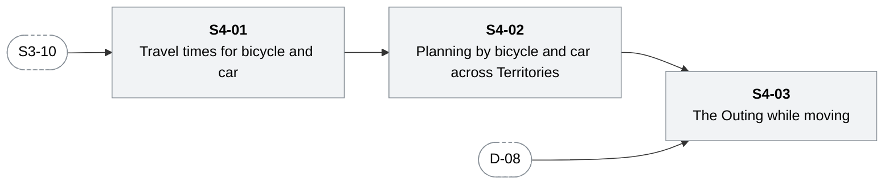
<!-- prettier-ignore-end -->
<!-- /generated -->

### S4-01 · Travel times for bicycle and car

- **Status:** todo
- **Depends on:** S3-10
- **Needs:** The city-data build and the travel-time and path ports (ADR-0009); parking points of Places (`PLC-9`, field from S1).
- **Requirements:** `RTE-18`, `RTE-1`, `PLC-9`
- **Decisions:** ADR-0009 (point 6), ADR-0010 (point 4)

**Goal.** Valhalla supplies times and paths for bicycle and car behind the existing ports as a batch step of the city-data build, the area may be "the city and its surroundings", and whether Valhalla is also needed at request time is decided.

**Tasks**

- [ ] Add Valhalla as a batch step; integer costs stored with the city version.
- [ ] Draft, for the owner to accept, the decision on request-time use of Valhalla.
- [ ] Parking allowance in the time model.

**Done when**

- Reproducibility and engine-identity suites pass for bicycle and car requests.

**Owner only.** Accepting the decision on Valhalla at request time and any cost it brings.

### S4-02 · Planning by bicycle and car across Territories

- **Status:** todo
- **Depends on:** S4-01
- **Needs:** The planner and verifier.
- **Requirements:** `RTE-18`, `PTY-19`
- **Decisions:** ADR-0006, ADR-0009

**Goal.** Between Territories and stand-alone Places the Party rides or drives, inside a Territory it walks, with a parking allowance; a Party has one Travel Mode.

**Tasks**

- [ ] Mixed legs (vehicle between, foot inside) in planner and verifier.
- [ ] Property suite over vehicle requests.

**Done when**

- The verifier accepts 100 % of vehicle Routes over the generated suite.

### S4-03 · The Outing while moving

- **Status:** todo
- **Depends on:** S4-02, D-08
- **Needs:** The trigger rules (T5 approach triggers) and Outing screens; design of the Outing while moving (`D-08`).
- **Requirements:** `OUT-22`, `NFR-35`
- **Decisions:** ADR-0005 (point 3)

**Goal.** While a bicycle or car moves, the app only speaks; the screen shows the next Place and one large pause control; Stories begin on the approach; no interaction is required while moving.

**Tasks**

- [ ] Moving mode in the Outing screens; approach triggers for vehicles tested on recorded tracks.
- [ ] Automated `SC-8` on recorded tracks.

**Done when**

- The `SC-8` scenario test passes on recorded tracks.

**Owner only.** A day out by car and by bicycle in the field; declaring the stage done.

## S5 — Other cities of Belarus

A second city as data, Routes at once on light data, Preparation started by Users within quotas, and public Coverage.

<!-- generated:track S5 -->
<!-- prettier-ignore-start -->
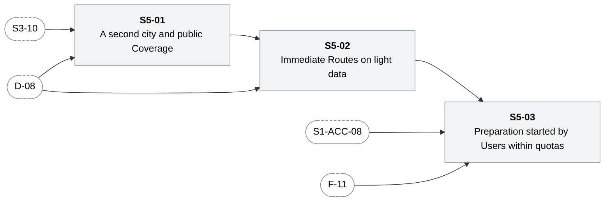
<!-- prettier-ignore-end -->
<!-- /generated -->

### S5-01 · A second city and public Coverage

- **Status:** todo
- **Depends on:** S3-10, D-08
- **Needs:** The city-data build and Coverage computation (PLC); design of public Coverage (`D-08`).
- **Requirements:** `PLC-10`
- **Decisions:** ADR-0010 (point 4), ADR-0030

**Goal.** A second city is added by publishing its data only, and every city shows its Coverage to people requesting Routes there.

**Tasks**

- [ ] Publish a second city's version with no code change; show Coverage on the request screen.

**Done when**

- A test adds a city as data and plans in it; no city is named in code.

### S5-02 · Immediate Routes on light data

- **Status:** todo
- **Depends on:** S5-01, D-08
- **Needs:** Preparation with de-duplication (KNW-1…3); design of Story progress on a Route (`D-08`).
- **Requirements:** `RTE-17`
- **Decisions:** ADR-0009 (point 9), ADR-0012 (point 2)

**Goal.** In an area with few Dossiers a Route is built at once from light data, Stories are prepared in the background with visible progress, and the Outing can start without waiting.

**Tasks**

- [ ] Progress "n of m Stories ready" on the Route; Places not ready play without a Story.
- [ ] A second request for the same Places starts no new Preparation (test).

**Done when**

- `SC-9` passes as a scenario test with replayed models.

### S5-03 · Preparation started by Users within quotas

- **Status:** todo
- **Depends on:** S5-02, S1-ACC-08, F-11
- **Requirements:** `KNW-23`
- **Decisions:** ADR-0028 (point 3), ADR-0022 (point 1)

**Goal.** A User triggers Preparation for Places without a Dossier within a quota by Plan, counted in the database, with the budgets as the last line.

**Tasks**

- [ ] Quota as an entitlement limit; counted as a costly endpoint.
- [ ] Tests: the quota refuses one over; budgets stop work.

**Done when**

- The tests pass; `SC-9` runs without exceeding a test budget.

**Owner only.** Setting the quotas and budgets; declaring the stage done.

## What only the owner can do

Collected from the packages; each line is the "Owner only" of its package.

<!-- generated:owner -->
<!-- prettier-ignore-start -->
- **D-01** — Choosing the direction.
- **D-05** — The walk-through on both phones and the approval. Asking two or three people who have never seen the product to go through scenario SC-1 on the mockups while their stumbles are noted. A change to the specification that the walk-through suggests.
- **D-06** — The walk-through and the approval.
- **D-07** — The walk-through and the approval.
- **D-08** — The walk-through and the approval.
- **F-02** — Switching on the protection of `main` in the repository's settings, and logging the repository's account into the `gh` command so that sessions can open pull requests themselves.
- **F-07** — Adding the new job to the required checks in the repository settings on GitHub.
- **F-09** — Choosing the crash reporter's provider, which needs an account; until then the no-op adapter stays.
- **F-12** — Accepting a seventh shared package, if the tokens and components need one: ADR-0005 lists six.
- **C-01** — Installing the check build — on the iPhone through the owner's Mac — and walking for an hour with each phone, screen locked.
- **C-02** — Accounts and keys of the model providers, approval of the spend, reading the Stories and choosing.
- **C-03** — Listening and choosing; the cloud account the voices are synthesised with.
- **C-04** — Labelling the sample.
- **C-05** — The cloud accounts the environment runs in.
- **C-06** — Finding a person in Belarus to open the page; and the choice to make those three packages wait for this check instead.
- **S1-PLC-05** — Accept that the heritage bank is read while its terms are unknown; this is already recorded as a limitation in ADR-0011 and needs no new decision unless the owner wants to revisit it.
- **S1-PLC-06** — Confirm the labels of the doubtful pairs in the labelled set of match decisions.
- **S1-PLC-12** — Confirm the holiday calendar of the first city for the coming year against the official list.
- **S1-PLC-19** — Open the first city's area to a Curator, and approve running the jobs in the cloud account.
- **S1-KNW-03** — Create the Groq account, enable Vertex AI, and store the keys. Any real recording run is started by the owner with their key.
- **S1-KNW-04** — Enable the speech service and store the keys. Real recordings are made by the owner.
- **S1-KNW-18** — Run the comparison with real models (cents) and read the report; this is check C-02.
- **S1-KNW-19** — Produce the open-model samples, run the real synthesis, listen and mark; this is check C-03.
- **S1-KNW-20** — Label the sample; this is check C-04.
- **S1-KNW-21** — If C-03 shows that ordinary-word stress needs an automatic step, decide whether to add the small Python job of ADR-0003 point 7. That is a separate package not drafted here.
- **S1-KNW-22** — Approve the spend and start the run. Verifying Dossiers is the Curator's work, done by the owner.
- **S1-CUR-14** — Walk SC-5 by hand in the console on the first city (§7.4).
- **S1-RTE-04** — Set the ceiling per kind and the weight of popularity after looking at real Routes of Minsk (ADR-0006, "Not verified").
- **S1-RTE-05** — Set the starting values the specification does not give: the Outing length that triggers a Break, the buffer, and the run length for monotony.
- **S1-RTE-10** — Review and approve the labelled set. Run the scoring script against the real model with the owner's key, inside the budget, and accept the ≥ 90 % field-by-field result of `NFR-36` or ask for a prompt change.
- **S1-RTE-13** — Fix the final theme list and Dealbreaker list (specification §4.2, "to be fixed in S1"). Time the set-up in a usability run with at least one person, against 60 seconds.
- **S1-RTE-14** — Walk the screen on a real phone in sunlight with one hand (`NFR-24`).
- **S1-RTE-16** — Paste a link into a messenger and confirm the preview.
- **S1-RTE-17** — Decide whether the measured gap and the time difference are acceptable. Calibrate `NFR-3` on real Outings (S1-OUT-22).
- **S1-OUT-01** — Build and install on the iPhone through the Mac.
- **S1-OUT-02** — Confirm the map from a local file on the iPhone and the Android phone in airplane mode (part of `C-01`).
- **S1-OUT-05** — Confirm fixes keep arriving with the screen locked on the iPhone and the Android phone (part of `C-01`).
- **S1-OUT-06** — Confirm on both phones that a Story starts by itself from the background with working lock-screen controls, and whether other audio is lowered or must be paused (part of `C-01`).
- **S1-OUT-07** — Build for the iPhone on the Mac, install on both phones, walk an hour with the screen locked on a test area, and record the outcome of `C-01`.
- **S1-OUT-13** — Walk a test Outing with the screen locked.
- **S1-OUT-14** — Confirm by ear that a whole test Outing works from the pocket.
- **S1-OUT-15** — Judge by ear whether assembled bridges sound continuous (ADR-0016, "Not verified").
- **S1-OUT-16** — Measure the replanning time on a mid-range phone against the 2 seconds of `NFR-4`.
- **S1-OUT-18** — Complete a test Outing in airplane mode on both phones.
- **S1-OUT-19** — Measure the battery use per hour with the screen off and on, on both phones (`NFR-7`).
- **S1-OUT-21** — Decide, from `C-01`, whether this package is needed at all. Repeat the device check with it.
- **S1-OUT-22** — Walk the reference Outing in Minsk per the protocol on both phones; set the calibrated trigger constants; accept or reject `NFR-3` and `NFR-5` thresholds; check SC-1 end to end.
- **S1-ACC-03** — Running the job that grants the first Administrator role, locally and in the cloud.
- **S1-ACC-04** — Creating the OAuth client for Google and the Apple Services identifier and key (Apple needs a developer account, ADR-0023); confirming Sign in with Apple on a real iPhone, which is a recorded limitation until a paid Apple account exists.
- **S1-ACC-05** — Buying a domain and choosing the e-mail provider for the cloud; until then sign-in by code works locally only and the cloud offers Google, as recorded in ADR-0019 and ADR-0024.
- **S1-FBK-01** — Creating the Firebase project's messaging configuration and the Android application's registration in it.
- **S1-FBK-05** — Confirming that a push arrives on a real Android phone from the cloud deployment; iPhone push is a recorded limitation until a paid Apple account exists.
- **S1-OPS-02** — Creating the Google Cloud billing account (Poland) and project, the Cloudflare and Neon accounts, the state bucket, and approving the first apply; every later change that creates a paid resource.
- **S1-OPS-03** — Entering every real secret value into Secret Manager.
- **S1-OPS-04** — Approving the GitHub environment that holds the deployment permission; installing the APK on test phones.
- **S1-OPS-05** — Arranging for a person in Belarus to open the page on a phone and in a browser, on mobile and fixed networks — that is check `C-06`.
- **S1-OPS-07** — Setting the budget amounts and the ceiling's notification address.
- **S1-OPS-09** — The screen-reader pass by hand on the web and on both phones before the stage is called done.
- **S1-OPS-11** — Starting the full cloud run, which uses free instance and database hours.
- **S1-OPS-12** — Deciding to accept a missed threshold as a limitation or to spend to meet it.
- **S1-GATE-01** — Walking the reference Outing in Minsk twice with the screen locked on an iPhone and an Android phone, recording trigger reliability and battery use (`NFR-5`, `NFR-7`), and once in airplane mode; running `SC-5` and `SC-6` in the console personally; the screen-reader pass; declaring the stage done.
- **S2-02** — The usability run with people who have not seen the form: answering takes under a minute.
- **S2-05** — Accepting the recorded limit of one instance (about a thousand connections) until the broker adapter is written.
- **S2-10** — Buying the domain and switching on the e-mail provider for Guests in the cloud.
- **S2-13** — A real Party of several people on phones and browsers; declaring the stage done.
- **S3-02** — Accepting the decision record on covers and screening.
- **S3-07** — Accepting the decision; reading the quality set.
- **S3-08** — Reading a sample of Belarusian Stories.
- **S3-09** — Which real providers get adapters (a launch decision).
- **S3-10** — Declaring the stage done.
- **S4-01** — Accepting the decision on Valhalla at request time and any cost it brings.
- **S4-03** — A day out by car and by bicycle in the field; declaring the stage done.
- **S5-03** — Setting the quotas and budgets; declaring the stage done.
<!-- prettier-ignore-end -->
<!-- /generated -->

## Stage gates

A stage is closed by the rule of [specification §7.4](PRODUCT-SPEC.md#74-when-a-stage-is-done): its scenarios pass without a developer's help, the acceptance criteria of its requirements pass automatically where they can, the thresholds that apply are measured, the system starts locally with one command and is deployed by the pipeline, and the known limitations are written down.

| Stage | What it adds            | Scenarios that must pass                                                  |
| ----- | ----------------------- | ------------------------------------------------------------------------- |
| D     | The approved design     | the owner's walk-through of SC-1, SC-2, SC-4, SC-5, SC-6, SC-7 on mockups |
| S1    | A solo Outing on foot   | SC-1, SC-4, SC-5, SC-6                                                    |
| S2    | The Party               | SC-2, SC-3                                                                |
| S3    | The Catalog             | SC-7                                                                      |
| S4    | Bicycle and car         | SC-8                                                                      |
| S5    | Other cities of Belarus | SC-9                                                                      |

## Improvement log

What was made better than a package asked for. One line each; the pull request holds the detail.

| Package | Improvement | Pull request |
| ------- | ----------- | ------------ |
| —       | —           | —            |

## Plan change log

Packages added, split, reordered or dropped, and why.

| Change               | Why                                                      | Pull request  |
| -------------------- | -------------------------------------------------------- | ------------- |
| The plan was written | Stage zero (design) was put first at the owner's request | first version |
