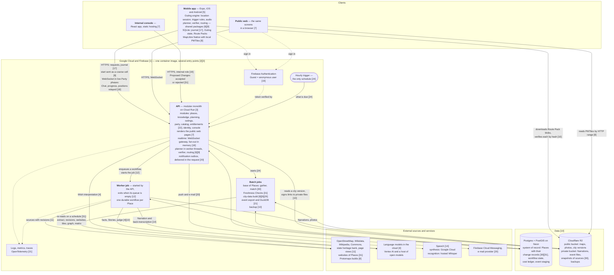

# Promenade — architecture overview

One picture of the components and the data that moves between them, as decided in the [Architecture Decision Records](adr/README.md). Numbers in brackets are ADR numbers. Terms are those of the [glossary](../GLOSSARY.md).

## How to read it

- **Solid arrows** carry product data and point from the side that starts the exchange; **dotted arrows** carry identity and telemetry. Firebase Cloud Messaging is drawn with the delivery services for readability, although it belongs to Firebase.
- **One language and one image.** The API, the worker and the batch jobs are entry points of the same TypeScript container image; the planner, the verifier and the routing code are the same packages on the server and on the phone.
- **What stays on the device:** the track of movement, arrival detection, Visit detection and replanning. The server receives the fact of a Visit through the journal, never coordinates, and a start taken from the person's position only as a cell of 100–150 m (`NFR-14`). Positions shared before a Party gathers are relayed through the memory of one instance and are not written anywhere.
- **Nothing runs in the background of a service.** Work happens inside a request, in a job that is started and exits, or on the single hourly trigger; nothing polls the database while nobody uses the product ([ADR-0024](adr/0024-runtime-rules-under-scale-to-zero-and-the-spending-envelope.md)).
- **What the planner reads:** a published, immutable version of a city — Places, theme scores, opening hours resolved into intervals, pedestrian graph, matrix of travel times — never the live tables. The verifier checks every result on the server and on the phone.
- **How the base of Places is made and kept true:** a job gathers the map and Wikidata for the whole of Belarus, matches their records to Places with identifiers of our own, and never overrides a Curator ([ADR-0030](adr/0030-base-of-places-gathered-ahead-of-time-and-matched.md)). Afterwards Freshness Checks re-read the Sources on a schedule — and, in Minsk, the websites of Places. Whatever they find is a change record with its evidence: applied by stated rules, or put to the Curator as a Proposed Change. The records are the history of a Place ([ADR-0031](adr/0031-keeping-the-base-of-places-current.md)).
- **How content is made:** the API enqueues one durable workflow per Place and starts the worker job — sources, facts, Stories, statement check, Narration, back-transcription. Every step writes its cost to a ledger whose monthly budgets are hard stops.
- **How a Route Pack reaches the phone:** the API returns a manifest with signed links; the phone downloads content-addressed blobs straight from object storage, verifies every hash and marks the Pack usable only when complete.
- **Delivery:** GitHub Actions builds the image once, pushes it to GitHub Container Registry, runs the migrations and deploys with Terraform; `docker compose up` starts the same image locally next to emulators and recorded responses of the paid services ([ADR-0002](adr/0002-terraform-github-actions-and-local-environment.md)).
